# COLDSPINE — MASTER PLAYER-FLOW SPEC (FLOW.md)

> The single, end-to-end UX spec that stitches the six segment designs into ONE player-driven,
> diegetic flow — boot to victory to the next breach. The game is BUILT and playable end-to-end
> (six headless suites green: `run_tests.gd`, `render_smoke.gd`, `run_smoke.gd`, `balance_smoke.gd`,
> `input_smoke.gd`, `interactive_smoke.gd`), but the on-screen flow is minimal/functional, NOT yet a
> deliberate, diegetic, player-driven UX. This doc turns the existing, authoritative systems into a
> deliberate operator journey.
>
> **Grounding (read before building any screen here):**
> - `docs/art/ART_BIBLE.md` — §2 console chrome, §3 color contract, §4 the 5-section palette, §5 CRT/scanline, §6 telegraphs.
> - `docs/COLDSPINE_GDD.md` — §3.1 operator framing, §16 UX/UI essentials.
> - `render/ops_hud.gd` — the persistent console chrome (camera header, comms, AP pips, action/control rows, order meter, currency, recon strip, status legend, scanline shader).
> - `render/palette.gd` — the ART_BIBLE §3 tokens as `Color` constants (the names used throughout this doc).
> - `app/screens/run_screens.gd` — the per-screen panel surface (`show_*`, `set_ending_prompt`, `_auto_dismiss`).
> - `app/menu.gd`, `app/run_controller.gd`, `core/**`, `meta/**` — the authoritative rails this UX presents.
>
> **Token names used below (from `render/palette.gd`, never invented):** `FRAME_BG #0B0E11`,
> `FRAME_BORDER #1C2630`, `FRAME_INSET #243240`, `AMBER #FFB000` (primary type/actions),
> `CYAN #3FC6D4` (data/FULL recon/scrip), `ALERT_RED #FF3B3B` (alerts/live danger ONLY — reserved,
> never on a preview per ART_BIBLE §6.7), `DIM #5A6470` (inactive/disabled/HIDDEN),
> `FAC_PLAYER #2EA7E0`, `FAC_NEUTRAL #E0B72E`, `FAC_OBJECT #9AA3AD`. Section glow tints re-skin
> surfaces only: tail ember `#C24A2A`, third hazard `#D8C24A`, second tank `#7EC8E3`,
> first velvet `#8E1F3A`, engine alarm `#FF3B3B`.

---

## 1. Diegetic through-line — the operator's journey

You are a remote operator on hijacked surveillance feeds, directing a tail-section uprising aboard a
globe-circling train, car by car toward the Engine. **The whole UI is the fiction.** The console
**boots** — a black CRT warms up, a typed uplink log seizes 47 camera nodes, `● REC` goes live — and
resolves into the **operator console at rest** (the main menu), whose amber-on-black vitals line reads
the rebellion's standing. From there you **vet volunteers** over the tail-assembly comms net (the
interactive Draft), feeling the risk-dial tradeoff before you **blow the coupling and breach**. The run
proper is a walk down **the line**: hijacked cameras feed the recon strip you read ahead, and each car
is a diegetic decision surface — a black-market aisle, a maintenance bay, a med-car, a sanctuary, a
cornered first-class passenger, a field promotion — committed through the same two-tap pattern as combat.
**Combat** is the camera cutting to a live, hostile car: you command the cell each team-turn, point at
tiles to preview the deterministic physics outcome, and confirm to commit, while the persistent ops
chrome frames every move. Deep in the train the feed cuts to the brightest, coldest camera in the run —
the **Conductor's Chamber** — where the room itself is the antagonist: a Bridge Countdown bites, the
Conductor re-routes the room against you, you disable relays to drop the core shield, and you race to
**sabotage the exposed core** before the clock (or the enrage) ends you. The feed then **freezes to
"FEED ENDED"** and reports the **verdict** — one of five endings in its own tone — winds down the uplink
to hand you the **after-action ledger** (meta-currency counting up, the fallen enshrined to the
**Memorial**), and re-establishes at the console for the next breach: arm a **Legacy** from a fallen
hero, spend currency on **Unlocks**, and launch a stronger cell down the line again.

---

## 2. GLOBAL FLOW MAP

Every screen is a node; every transition is a labeled edge. Verified: **every node has at least one
outbound edge (no dead-ends) and is reachable** from `TITLE`. The one previously-fixed dead-end (the
finale WIN path not funneling through the ending screen, leaving a sticky panel with a runaway timecode)
is closed — both the win and loss paths route through `S6-1 ENDING_CARD` → `S6-2 PAYOUT` → the menu.

### 2a. Mermaid `stateDiagram-v2`

```mermaid
stateDiagram-v2
    [*] --> S1_00_BOOT

    %% ---- SEGMENT 1: TITLE & PRE-RUN ----
    S1_00_BOOT --> S1_01_HOME: auto-complete / any input (skip)
    S1_00_BOOT --> DRAFT_VETTING: --sim flag (boot then auto NEW RUN)

    S1_01_HOME --> DRAFT_VETTING: NEW RUN (stage MenuHandoff)
    S1_01_HOME --> S4_01_ENTRY: CONTINUE (resume save) / [via run scene]
    S1_01_HOME --> S1_02_MEMORIAL: MEMORIAL
    S1_01_HOME --> S1_03_UNLOCKS: UNLOCKS
    S1_01_HOME --> S1_04_SETTINGS: SETTINGS
    S1_01_HOME --> ASCII_POC: ASCII POC
    S1_01_HOME --> [*]: QUIT

    S1_02_MEMORIAL --> S1_01_HOME: < BACK (legacy armed/cleared)
    S1_03_UNLOCKS --> S1_01_HOME: < BACK
    S1_04_SETTINGS --> S1_01_HOME: < BACK
    ASCII_POC --> S1_01_HOME: back

    %% ---- SEGMENT 2: CHARACTER SELECT (THE DRAFT) ----
    DRAFT_VETTING --> DRAFT_VETTING: TAKE / DECLINE (deal next round)
    DRAFT_VETTING --> BREACH_CONFIRM: STOP & BREACH (picks>=1) / auto-finalize
    DRAFT_VETTING --> S1_01_HOME: ESC (abandon draft)

    BREACH_CONFIRM --> S4_01_ENTRY: BREACH — GO (run begins, timecode starts)
    BREACH_CONFIRM --> DRAFT_VETTING: BACK (not finalized)
    BREACH_CONFIRM --> S1_01_HOME: ESC (abandon, run not started)

    %% ---- THE LINE: recon + car-type screens + level-up (Segment 3) ----
    S4_01_ENTRY --> S4_02_TEAMTURN: first actor selected
    S4_01_ENTRY --> S4_09_RESOLVE: zero-enemy car (auto-clear)

    state "THE LINE (between-car beat)" as LINE
    S4_09_RESOLVE --> LINE: WIN (regroup) + run.advance
    LINE --> S3_RECON: recon strip live (persistent)
    LINE --> S3_LEVELUP: pending level-up pick(s)
    LINE --> S3_SHOP: car_type SHOP
    LINE --> S3_WORKSHOP: car_type UPGRADE
    LINE --> S3_BOURGEOIS: car_type BOURGEOIS
    LINE --> S3_RECRUIT: car_type RECRUIT
    LINE --> S3_EVENT: car_type EVENT
    LINE --> S3_REST: car_type REST
    LINE --> S4_01_ENTRY: car.is_combat()
    LINE --> F1_ANTECHAMBER: engine car reached

    S3_RECON --> S3_RECON: open/close detail card; Deep Scan
    S3_RECON --> LINE: (persistent panel; coexists, never blocks)

    S3_SHOP --> S3_LEVELUP: pending pick
    S3_SHOP --> LINE: BUY / LEAVE -> resolve + advance
    S3_WORKSHOP --> S3_LEVELUP: pending pick
    S3_WORKSHOP --> LINE: CONFIRM / LEAVE -> resolve + advance
    S3_BOURGEOIS --> S3_LEVELUP: pending pick
    S3_BOURGEOIS --> LINE: SPARE / KILL -> resolve + advance
    S3_RECRUIT --> S3_LEVELUP: pending pick
    S3_RECRUIT --> LINE: ACCEPT / DECLINE -> resolve + advance
    S3_EVENT --> S3_LEVELUP: pending pick
    S3_EVENT --> LINE: option resolves -> advance
    S3_REST --> S3_LEVELUP: pending pick
    S3_REST --> LINE: REST / LEAVE -> resolve + advance

    S3_LEVELUP --> LINE: all picks resolved (safety auto-pick if stuck)

    %% ---- SEGMENT 4: COMBAT ----
    S4_02_TEAMTURN --> S4_03_PALETTE: select unit / arm action
    S4_02_TEAMTURN --> S4_08_ENEMYPHASE: player phase released
    S4_02_TEAMTURN --> S4_09_RESOLVE: check_victory != 0
    S4_02_TEAMTURN --> S4_10_AUTOSPEED: AUTO pressed

    S4_03_PALETTE --> S4_04_TARGETING: MOVE/SHOOT/SHOVE/SLAM/THROW armed
    S4_03_PALETTE --> S4_07_OVERWATCH: OVR
    S4_03_PALETTE --> S4_02_TEAMTURN: END / reselect

    S4_04_TARGETING --> S4_05_GHOST: physics target pointed
    S4_04_TARGETING --> S4_06_COMMIT: move/shoot second tap
    S4_04_TARGETING --> S4_03_PALETTE: cancel/disarm

    S4_05_GHOST --> S4_06_COMMIT: confirm (adopts ghost result)
    S4_05_GHOST --> S4_04_TARGETING: re-point
    S4_05_GHOST --> S4_03_PALETTE: cancel

    S4_06_COMMIT --> S4_02_TEAMTURN: AP remains / next actor
    S4_06_COMMIT --> S4_08_ENEMYPHASE: phase release
    S4_06_COMMIT --> S4_09_RESOLVE: commit ends fight
    S4_06_COMMIT --> S4_11_UNDO: movement commit (undoable)

    S4_07_OVERWATCH --> S4_02_TEAMTURN: next actor / release
    S4_07_OVERWATCH --> S4_08_ENEMYPHASE: reaction may fire

    S4_08_ENEMYPHASE --> S4_02_TEAMTURN: new player phase (loop)
    S4_08_ENEMYPHASE --> S4_09_RESOLVE: victory/loss resolved

    S4_09_RESOLVE --> S4_01_ENTRY: WIN -> next combat car
    S4_09_RESOLVE --> F1_ANTECHAMBER: WIN on last pre-engine car
    S4_09_RESOLVE --> S6_1_ENDING_CARD: LOSS / STALL

    S4_10_AUTOSPEED --> S4_08_ENEMYPHASE: AUTO resolves rounds
    S4_10_AUTOSPEED --> S4_02_TEAMTURN: MANUAL resumes

    S4_11_UNDO --> S4_03_PALETTE: AP refunded / disarmed

    %% ---- SEGMENT 5: THE FINALE ----
    F1_ANTECHAMBER --> F2_CONDUCTOR: cross divider / first relay or turret down
    F1_ANTECHAMBER --> S6_1_ENDING_CARD: squad wipe (LOSS)

    F2_CONDUCTOR --> F3_CORE_EXPOSED: core_exposed (relays down / decap)
    F2_CONDUCTOR --> F4_BREACHED: countdown expired (overlay)
    F2_CONDUCTOR --> S6_1_ENDING_CARD: squad wipe / one-beat sabotage

    F3_CORE_EXPOSED --> S6_1_ENDING_CARD: CORE_SABOTAGED (win) / squad wipe (loss)
    F3_CORE_EXPOSED --> F4_BREACHED: countdown still draining / expires

    F4_BREACHED --> S6_1_ENDING_CARD: core sabotaged after expiry (PYRRHIC) / wipe (LOSS)
    F4_BREACHED --> F2_CONDUCTOR: escalation continues underneath
    F4_BREACHED --> F3_CORE_EXPOSED: escalation continues underneath

    %% ---- SEGMENT 6: VICTORY, ENDINGS & META LOOP-BACK ----
    S6_1_ENDING_CARD --> S6_2_PAYOUT: ENTER / CLICK (reveal ledger)
    S6_1_ENDING_CARD --> S4_01_ENTRY: N (fresh run, after finalize)

    S6_2_PAYOUT --> S1_01_HOME: ENTER / CLICK (return to console)
    S6_2_PAYOUT --> S4_01_ENTRY: N (fresh run)
```



> **Reachability + no-dead-end audit:** `TITLE/BOOT` reaches `HOME`; `HOME` reaches every menu panel
> (each `< BACK` to `HOME`) and `DRAFT`; `DRAFT` reaches `BREACH_CONFIRM` (and back to `HOME` on abandon);
> `BREACH` reaches the run; the run threads `LINE ↔ recon/economy/level-up ↔ combat` and ends in the
> finale; the finale and any combat LOSS both funnel to `ENDING_CARD → PAYOUT → HOME`; `HOME` loops back
> to a new `DRAFT`/run. No node terminates without an outbound edge except application `QUIT` (the single
> sanctioned exit), and `[*]` is reached only via the deliberate QUIT.

### 2b. ASCII fallback map

```
                         [APP LAUNCH]
                              |
                       S1-00 BOOT/UPLINK
                       |             \  (--sim)
              (skip/auto)              \
                       v                v
                 S1-01 HOME -----------------------------> [QUIT -> exit]
                  |  |  |  |  \____ ASCII POC ___/
                  |  |  |  |
        MEMORIAL<-+  |  |  +->SETTINGS      (each panel: < BACK -> HOME)
        UNLOCKS <----+  |
                        v
                 (NEW RUN / CONTINUE)
                        v
                DRAFT_VETTING <--+ (TAKE/DECLINE deal next round)
                  |   |   \______/        (ESC -> HOME)
                  |   v
                  | BREACH_CONFIRM --(BACK,not final)--> DRAFT_VETTING
                  |   |   \__(ESC)__> HOME
                  |   v (BREACH - GO)
                  v   v
      +======== THE LINE (between-car spine) ==========================+
      |  recon strip (S3-RECON) live every beat                        |
      |   LINE --car_type--> SHOP / WORKSHOP / BOURGEOIS /             |
      |                      RECRUIT / EVENT / REST  --resolve--> LINE |
      |   LINE --pending--> S3-LEVELUP --resolved--> LINE              |
      |   LINE --combat--> S4 COMBAT --WIN--> LINE                     |
      |   LINE --engine car--> F1 FINALE                              |
      +================================================================+
                                |  (LOSS anywhere in combat/finale)
                                v
   S4 COMBAT loop:  S4-01 ENTRY -> S4-02 TEAM-TURN -> S4-03 PALETTE
       -> S4-04 TARGETING -> S4-05 GHOST -> S4-06 COMMIT -> (loop / S4-08)
       S4-07 OVERWATCH, S4-10 AUTO/SPEED, S4-11 UNDO branch off S4-03/06
       S4-08 ENEMY/ENV PHASE -> S4-09 WIN/LOSS  (WIN->LINE, LOSS->S6-1)
                                |
   FINALE:  F1 ANTECHAMBER -> F2 CONDUCTOR+COUNTDOWN -> F3 CORE EXPOSED
            F4 BREACHED overlays F2/F3 when the clock hits 0
            (win: CORE_SABOTAGED -> S6-1 ; loss/wipe -> S6-1)
                                v
   ENDING:  S6-1 ENDING CARD -> S6-2 PAYOUT LEDGER -> S1-01 HOME  (loop)
            (N at either -> fresh run)
```

---

## 3. PER-SEGMENT SCREEN SPECS

The six segments below, in flow order (TITLE -> CHARACTER SELECT -> THE LINE -> COMBAT -> FINALE ->
ENDING/META). Each screen carries the full spec: purpose / diegetic framing / layout (with ART_BIBLE
tokens) / player actions + inputs / interactive states / data shown / transitions in + out / empty + error
/ build_status + build gap. 38 screens total (6 `exists` already wired beyond display, the rest
`partial`/`missing` — see the §4 backlog).

---

### SEGMENT 1 — TITLE & PRE-RUN

> Backed by real code: `app/menu.gd` (live main menu; `project.godot run/main_scene=res://app/menu.tscn`),
> `core/meta/meta_profile.gd` / `save_system.gd` / `unlocks.gd` / `legacy.gd`, `render/palette.gd`,
> `render/ops_hud.gd` (the in-run chrome whose look this menu should ADOPT but currently does not).
> The menu is functionally complete (every button works; CONTINUE gates on `SaveSystem.has_run_save()`;
> settings persist; Memorial/Unlocks fully wired) but is NOT diegetically dressed — its controls are
> bare engine-default `Button`s. Hence most screens are `partial`; two are genuinely `missing` (the
> BOOT/uplink animation; the per-control hover/focus/pressed/disabled visual states + the slider drag).

---

#### S1-00-BOOT — BOOT / UPLINK (cold-start title)  ·  build_status: **missing**

- **PURPOSE:** First beat of fiction — the console powers on and seizes the train's camera net,
  establishing "you are a remote operator on hijacked feeds" (GDD §3.1) in ~2-3s before any choice.
- **DIEGETIC FRAMING:** Black CRT warming up: the scanline shader fades in, an `AMBER` cursor blinks,
  a terminal boot log types itself line-by-line (`COLDSPINE // OPERATOR CONSOLE`, `establishing
  uplink...`, `cameras: 47 nodes online`, `uplink established`); `● REC` (`ALERT_RED`) + a running
  timecode (`CYAN`) appear top-left as the feed goes live, mirroring the in-run OpsHUD header. A 2-4
  frame chroma-split/scan-tear glitch (ART_BIBLE §2 idiom) punctuates the snap, then settles into HOME.
- **LAYOUT:** Full-rect `FRAME_BG` base. Center-left typed boot-log column in `AMBER` 14-16px monospace
  (append on the comms cadence). Top-left once live: `COLDSPINE // OPERATOR CONSOLE` `AMBER` 28 +
  `uplink established — tail-section command` `DIM` 14 (these resolve INTO the existing menu title/sub at
  `menu.gd:101-104`). REC dot `ALERT_RED` + timecode `CYAN`. Scanline overlay = the EXISTING OpsHUD
  `_scanline_material()` reused on a full-rect `ColorRect` (gated by `crt_filter`). A 2px `FRAME_BORDER`
  rule animates in under the header. **Phone-portrait:** log centered, header pins top. **Desktop:** same,
  more breathing room.
- **PLAYER ACTIONS + INPUTS:** Tap anywhere / click / any key / Enter -> SKIP to HOME. Wait ~2-3s ->
  auto-complete reveals HOME.
- **INTERACTIVE STATES:** Transient cutscene, not a control surface. **default** (animation, blinking
  cursor, lines typing); **pressed/any-input** (skip -> immediate cut, no half-state); **loading** (this
  screen IS the load beat — `menu.gd._ready` loads the profile under the animation); **success** (uplink-
  established glitch + settle); **empty/error** (if `SaveSystem.load_profile` fell back to a fresh
  profile, optionally a `DIM` `NEW OPERATOR PROFILE INITIALIZED` line — never an error wall, per
  SaveSystem's never-throw contract). No hover/focus/disabled (no discrete widgets).
- **DATA SHOWN:** `MetaProfile` load result (presence vs fresh-fallback) drives the optional "new
  operator" line; `settings.crt_filter` (gates the overlay during boot); `OS.get_cmdline_args` (`--sim`).
- **TRANSITIONS IN:** App launch (`run/main_scene`) -> menu `_ready` -> BOOT plays first.
- **TRANSITIONS OUT:** Auto-complete or any input -> **S1-01 HOME**. If launched with `--sim`/
  `coldspine_sim` -> BOOT plays then `call_deferred` `_on_new_run` -> RUN scene (the self-play proof; BOOT
  must not block it).
- **EMPTY / ERROR:** Fresh/corrupt profile -> boot completes normally; SaveSystem never throws.
- **BUILD GAP:** No boot animation exists; `menu.gd._ready` loads the profile then calls `_show_home()`
  with zero intro. Build a small boot node (typed-line timer reusing comms cadence) before `_show_home`,
  reusing `_scanline_material()` on a full-rect overlay, REC+timecode, a one-shot glitch on "uplink
  established", skippable by any input. Preserve the `--sim` auto-run; gate behind a non-headless/has-
  display check so `render_smoke`/menu-load stay green.

---

#### S1-01-HOME — MAIN MENU (ops console front-end)  ·  build_status: **partial**

- **PURPOSE:** Home base + the loop's return point: present the rebellion's living state (currency,
  fallen, runs/wins) and route to NEW RUN / CONTINUE / MEMORIAL / UNLOCKS / SETTINGS / ASCII POC / QUIT.
- **DIEGETIC FRAMING:** The console at rest, feed live. Camera-ID-style title bar (`AMBER` 28) + sub
  (`DIM` 14) + REC/timecode reading as the same surveillance header as in-run; a `CYAN` status readout =
  the console's vitals telemetry; the button column = the operator's command list; scanline overlay
  (gated by `crt_filter`) so menu and game are visibly the same machine.
- **LAYOUT:** Anchored to `menu.gd`: `FRAME_BG` full-rect bg + `MarginContainer` 48/36 (phone: ~16/24) +
  root `VBoxContainer` (sep 10). Header = title `AMBER` 28 / sub `DIM` 14 / status `CYAN` 16 / a 2px
  `FRAME_BORDER` rule (all exist, `menu.gd:101-112`). Panel host holds 7 buttons (`menu.gd:156-162`),
  360x40 today. A `LEGACY ARMED: <kind> <id> from <name>` line (`AMBER` 14) appears when a Legacy is
  armed. **Phone:** buttons stretch full-width (`H_FILL`), min ~44px touch, header pinned, scroll on
  overflow. **Desktop:** fixed 360px left column. **NEW chrome:** buttons get an OpsHUD-style
  `StyleBoxFlat` (`FRAME_BG@85%`, 1px `FRAME_BORDER`, 2px `FRAME_INSET` top, corner ticks). `ALERT_RED`
  reserved (REC dot only).
- **PLAYER ACTIONS + INPUTS:** Tap/click NEW RUN -> stage `MenuHandoff` + launch (`_on_new_run`);
  CONTINUE (enabled only when a save exists) -> resume (`_on_continue`); MEMORIAL/UNLOCKS/SETTINGS -> swap
  the panel host (`_show_*`); ASCII POC -> `_on_ascii_poc`; QUIT -> `get_tree().quit()`. Keyboard/gamepad:
  Up/Down focus, Enter/A activate (focus traversal is a build gap).
- **INTERACTIVE STATES:** Per BUTTON: **default** (`FRAME_BG@85%`, `AMBER` text, 1px `FRAME_BORDER`);
  **hover** (border->`AMBER`, subtle `FRAME_INSET` top-glow); **focus** (bracket-tick + `AMBER` outline);
  **pressed** (invert: `AMBER` fill / `FRAME_BG` text, 1-frame); **disabled** (`DIM` text, `FRAME_BORDER`
  fill). CONTINUE additionally **disabled/EMPTY** when `has_run_save()` false (`DIM` + a `NO SAVE` tag —
  logic exists, visual is the gap). Status line: **loading** (optional `reading profile...`),
  **success** (populated vitals), **empty** (fresh profile shows 0/0/0/0, never blank). Legacy-armed line:
  **selected** (only when `_chosen_legacy_id != ''`).
- **DATA SHOWN:** `MetaProfile.meta_currency`, `unlocked_content.size()`, `Legacy.available(profile).size()`
  (FALLEN), `stats.runs`, `stats.wins`, `SaveSystem.has_run_save()`, the armed Legacy `{kind,id,from}`.
- **TRANSITIONS IN:** From BOOT (auto/skip); from MEMORIAL/UNLOCKS/SETTINGS `< BACK`; from a finished RUN
  (controller returns to `menu.tscn`; `_ready` reloads the profile so currency/fallen/stats are fresh).
- **TRANSITIONS OUT:** NEW RUN -> `run.tscn` (after `MenuHandoff`); CONTINUE (enabled) -> `run.tscn` with
  `resume_run` set, else stays with `NO RESUMABLE RUN` (no dead end); MEMORIAL/UNLOCKS/SETTINGS -> S1-02/
  03/04 (panel swap); ASCII POC -> `main.tscn`; QUIT -> exit.
- **EMPTY / ERROR:** Fresh profile renders all-zero cleanly; corrupt save -> fresh-profile fallback, menu
  still builds.
- **BUILD GAP:** Flow + data + gating WORK. Gaps: (1) no ops-console chrome (no scanline overlay, no
  REC/timecode, no panel StyleBox/corner-ticks); reuse `_scanline_material()` + a shared StyleBox helper.
  (2) Buttons have no hover/focus/pressed/disabled styling. (3) No phone-portrait reflow. (4) Promote the
  cyan status string to the diegetic header telemetry. (5) Focus traversal is engine-default + unstyled.

---

#### S1-02-MEMORIAL — the fallen + Legacy pick  ·  build_status: **exists**

- **PURPOSE:** Turn loss into continuity: review fallen heroes and ARM exactly ONE Legacy (item or trait)
  to carry into the next run — the GDD §7.4 "permadeath is sacred, but the rebellion persists" beat.
- **DIEGETIC FRAMING:** A console casualty record on the feed: `AMBER` header `MEMORIAL — the fallen
  (pick ONE Legacy to carry forward)`, one dossier row per fallen hero (name, archetype, what they pass
  on). The armed pick wears `[ARMED]`. Empty record = a quiet `DIM` "No fallen yet."
- **LAYOUT:** Panel-host swap (`_show_memorial`). Header `AMBER` 20. Per `Legacy.available(profile)` hero:
  a full-width selectable row `<name> (<archetype>) — <kind>: <id>[  [ARMED]]` (`menu.gd:212-220`). If
  none: `DIM` 15 `No fallen yet. Their legacies will appear here.` Footer: `CLEAR LEGACY` + `< BACK`.
  **Phone:** rows full-width, wrap long text, scrollable; armed row gets a left bracket-tick + `AMBER`
  border. Tokens: `AMBER` (header/armed marker/border), `CYAN` (hero data), `DIM` (empty/unarmed),
  `FRAME_BG`/`FRAME_BORDER` row chrome; **NEW** enshrine plate uses `FAC_NEUTRAL #E0B72E` ring (see §5).
- **PLAYER ACTIONS + INPUTS:** Tap a hero row -> arm (`_on_pick_legacy`, sets `_chosen_legacy_id`,
  re-renders with `[ARMED]`); CLEAR LEGACY -> disarm (`_on_clear_legacy`); `< BACK` -> HOME. Keyboard:
  Up/Down rows, Enter arm, key for BACK.
- **INTERACTIVE STATES:** Per ROW: **default** (`DIM`/`CYAN` dossier, `FRAME_BORDER`); **hover** (`AMBER`
  border); **focus** (bracket-tick + outline); **pressed** (1-frame invert); **selected/ARMED**
  (persistent `AMBER` border + `[ARMED]` + left tick — the one genuinely persistent selected state in the
  segment; code tracks it via `_chosen_legacy_id`, only the visual is a gap); **disabled** (a hero whose
  `Legacy.inherit` yields `{}` shows "nothing to pass on", non-armable / `DIM`). **EMPTY** = `DIM`
  placeholder, BACK still present. CLEAR LEGACY: default/hover/pressed; disabled when nothing armed
  (optional). BACK: default/hover/focus/pressed.
- **DATA SHOWN:** `Legacy.available(profile)` -> name, archetype; `Legacy.inherit(profile, legacy_id)` ->
  `{kind:item|trait, id, from}` or `{}`; `_chosen_legacy_id`.
- **TRANSITIONS IN:** From HOME `MEMORIAL` button.
- **TRANSITIONS OUT:** `< BACK` -> HOME; the armed pick persists as the `LEGACY ARMED` line on HOME and is
  consumed by the next NEW RUN. (No direct run launch — the pick is carried.)
- **EMPTY / ERROR:** No fallen -> DIM placeholder + BACK only; malformed entry -> safe defaults.
- **BUILD GAP:** Fully wired and correct (arming, clearing, `[ARMED]`, empty state, BACK, consumption by
  `_on_new_run`). The only gap is cosmetic — rows are plain Buttons without the dossier-styled
  chrome/selected-border (shared with the S1-01 button-styling work).

---

#### S1-03-UNLOCKS — spend meta-currency  ·  build_status: **partial**

- **PURPOSE:** Permanently strengthen the rebellion's baseline (classes, gear, cars, recruit pools, Tail
  upgrades, narrative) by spending meta-currency (GDD §14) — the between-run growth that makes it a
  roguelite.
- **DIEGETIC FRAMING:** A console requisition/quartermaster screen: `AMBER` header `UNLOCKS — meta-
  currency: <N>`, the catalog as a buy-list. Each entry an item with a price `[cost]`; affordable+unowned
  = active buy; owned = a `DIM` `OWNED` stamp; unaffordable = greyed. Buying decrements the readout live.
- **LAYOUT:** Panel-host swap (`_show_unlocks`). Header `AMBER` 20 with live currency. Per
  `Unlocks.catalog_ids()`: owned -> `DIM` 15 `<name> — OWNED`; unowned -> button `<name>  [<cost>]`,
  enabled only if `meta_currency >= cost`. Footer `< BACK`. **Phone:** full-width rows grouped loosely by
  `kind` (class/gear/car/pool/tail/narrative), price right-aligned, scrollable. Tokens: `AMBER`
  (header/affordable price), `CYAN` (name/data), `DIM` (OWNED/unaffordable); `ALERT_RED` never.
- **PLAYER ACTIONS + INPUTS:** Tap an affordable unowned entry -> purchase (`_on_buy` ->
  `Unlocks.purchase` + `SaveSystem.save_profile`), re-render with new currency + OWNED stamp; `< BACK` ->
  HOME. Keyboard: Up/Down, Enter buy, key for BACK.
- **INTERACTIVE STATES:** Per BUY entry: **default** (`CYAN` name + `AMBER` price, `FRAME_BORDER`);
  **hover** (`AMBER` border); **focus** (tick+outline); **pressed** (invert, 1-frame); **disabled/
  UNAFFORDABLE** (`DIM` text+price, non-interactive — logic exists via `afford` flag, visual is the gap);
  **success** (brief `AMBER` flash / converts to OWNED + currency ticks down — currently an instant
  re-render with no feedback = gap); **OWNED** (static `DIM` label, not a button — exists). **EMPTY:**
  catalog never empty; if all owned, all rows are OWNED stamps + BACK. **ERROR:** `Unlocks.purchase`
  refuses overspend (returns false, no mutation); the affordability gate prevents reaching the user.
- **DATA SHOWN:** `MetaProfile.meta_currency`; `Unlocks.catalog_ids()` / `entry(id)` -> name, cost, kind;
  `MetaProfile.is_unlocked(id)`.
- **TRANSITIONS IN:** From HOME `UNLOCKS` button.
- **TRANSITIONS OUT:** `< BACK` -> HOME; purchases persist immediately and widen the next run's content
  (`Unlocks.unlocked_car_ids` / `unlocked_class_ids` read at NEW RUN).
- **EMPTY / ERROR:** 0 currency -> all BUY disabled, BACK only; overspend refused; re-buy idempotent.
- **BUILD GAP:** Purchase flow, affordability gating, OWNED stamps, persistence, BACK all WORK. Gaps:
  (1) no buy/affordable/disabled visual states; (2) no purchase success feedback (instant re-render);
  (3) no kind-grouping/scroll affordance on phone; (4) price-color affordance not implemented.

---

#### S1-04-SETTINGS — options (in-car-fog, CRT, volumes)  ·  build_status: **partial**

- **PURPOSE:** Tune the session — surface/flip the owner-flagged in-car-fog toggle, the CRT/scanline
  filter, the move-confirm gate, and SFX/Music volumes — persisting each change immediately.
- **DIEGETIC FRAMING:** A console configuration panel: `AMBER` header `SETTINGS`, labeled rows reading
  current state inline (`<label> : ON/OFF` / `<label> : NN%`). These are the operator's feed/console
  preferences — "In-car fog (operator vision limit)" literally describes losing camera omniscience in
  maze/steam cars (E1.4); "CRT / scanline filter" toggles the very overlay you look through.
- **LAYOUT:** Panel-host swap (`_show_settings`). Header `AMBER` 20. Toggle rows (`_toggle_row` -> button
  `<label> : ON/OFF`): In-car fog (`in_car_fog`), CRT/scanline (`crt_filter`), Confirm before committing a
  move (`confirm_moves`). Slider rows (`_slider_row` -> `<label> : NN% (tap to cycle)`): SFX volume
  (`sfx_volume`), Music volume (`music_volume`). Footer `< BACK`. **Phone:** full-width rows, label left /
  value right, ~44px touch; sliders SHOULD become drag tracks (`FRAME_BORDER` track, `AMBER` fill to
  value, `CYAN` thumb). Tokens: `AMBER` (header/ON/slider fill), `CYAN` (thumb/value), `DIM` (OFF/hint),
  `FRAME_BG`/`FRAME_BORDER` row + track chrome.
- **PLAYER ACTIONS + INPUTS:** Tap a toggle -> flip + persist (`_on_toggle` -> `set_setting` +
  `save_profile`); tap a volume -> CURRENTLY cycles 0/20/.../100 then wraps (`_on_cycle_volume`); SHOULD be
  drag-to-set (build gap); `< BACK` -> HOME. Keyboard: Up/Down rows, Enter/Left/Right adjust, key for BACK.
  CRT toggle takes effect live (flipping `crt_filter` shows/hides the scanline overlay).
- **INTERACTIVE STATES:** Per TOGGLE: **default** (label `CYAN`/`AMBER`, value `AMBER` if ON / `DIM` if
  OFF); **hover** (`AMBER` border); **focus** (tick+outline); **pressed** (1-frame invert); **success**
  (value swaps ON<->OFF on the save frame). Per VOLUME (target = slider): **default** (track
  `FRAME_BORDER`, `AMBER` fill, `CYAN` thumb); **hover** (thumb brightens); **focus** (thumb outline);
  **pressed/dragging** (thumb follows, live % readout); the current tap-cycle has only
  default/hover/pressed + a wrap. `confirm_moves` same toggle states. `in_car_fog`:
  default/hover/pressed PLUS an owner-locked DEFAULT (ON) the UI reflects but does not editorialize (no
  "recommended" tag). BACK: default/hover/focus/pressed. No empty/error (documented defaults via
  `get_setting` fallback).
- **DATA SHOWN:** `get_setting('in_car_fog')` (default true, owner-locked), `crt_filter` (true),
  `confirm_moves` (true), `sfx_volume` (100), `music_volume` (80) — all persisted via `set_setting` +
  `save_profile` on every change.
- **TRANSITIONS IN:** From HOME `SETTINGS` button.
- **TRANSITIONS OUT:** `< BACK` -> HOME; every change already persisted, live for the next run/boot.
- **EMPTY / ERROR:** None — settings always have documented defaults.
- **BUILD GAP:** All five options exist, persist, round-trip; in-car-fog default untouched. Gaps:
  (1) volumes are tap-to-cycle, not draggable sliders — replace with a real slider keeping the int value
  model + headless-safety; (2) toggles/rows have no hover/focus/pressed visual states; (3) CRT toggle
  should drive the menu's OWN scanline overlay live (depends on S1-00/S1-01 chrome work); (4) no audio
  buses wired yet — volume changes persist but are silent (known backlog, out of segment scope).

---

### SEGMENT 2 — CHARACTER SELECT (THE DRAFT)

> Grounding (read, not assumed): `core/units/draft.gd` is the real state machine — `start()` deals round
> 0; `take(idx)` validates `idx in [0,size)`, appends to `picks`, burns the round, `_advance()`;
> `decline()` burns all 3; `stop()` finalizes. `_advance` auto-deals OR finalizes when `picks.size() >=
> DRAFT_MAX_STARTERS(3)` OR `round_idx >= DRAFT_ROUNDS(3)`. `draft_payout_mult` is an x100 int set ON
> FINALIZE by pick count: 3->100, 2->125, 1->160. `shown_and_removed` enforces NO REPEATS. Each round's
> three cards carry value bands so a round poses a tradeoff. `core/units/unit_instance.gd` gives card
> fields (name, archetype_id, traits/revealed_traits, max_hp, level; `effective_accuracy(db)`); per-card
> stats = HP / MOVE (`baseStats.move`) / ACC (`effective_accuracy`) / MASS (`baseStats.mass`).
> `content/traits/traits.json` carries `polarity` (positive=`CYAN`, negative=`ALERT_RED`, mixed=`AMBER`)
> — the chip "tell". The Draft reuses the OpsHUD header (becomes `CAR 00 — TAIL ASSEMBLY / VETTING`),
> comms, and scanlines; it adds its own card buttons on the `RunScreens` surface.
>
> **build_status reality:** the Draft SYSTEM is fully built and deterministic (`draft.gd`, `_run_draft`,
> `RunState.new_run`, payout finalize, legacy apply, all test-covered). MISSING is purely the interactive
> UX: render `current_choices` as selectable cards, a TAKE/DECLINE/STOP control surface routed through
> player input, a live picks roster strip + payout readout, a BREACH confirm, the legacy-heir picker. The
> controller's auto path (`_best_draft_pick`) becomes the AUTO/skip button + the headless default. No core
> changes.

---

#### DRAFT_VETTING — The Draft, Vetting Volunteers  ·  build_status: **partial**

- **PURPOSE:** Interactively choose the starting cell (1-3 starters) from rolling 3-at-a-time candidates,
  feeling the risk-dial tradeoff (fewer bodies = higher meta-payout + open recruit slots) before breach.
- **DIEGETIC FRAMING:** The console is patched into the tail-assembly comms net BEFORE any camera feed
  exists. Header `CAR 00 — TAIL ASSEMBLY` / subhead `VETTING`; `● REC` shows `STANDBY` (the run clock
  starts on BREACH). Each candidate is a hijacked dossier still-frame; comms streams volunteer barks
  (`> SABOTEUR_03: rig's ready when you are.` / `! decline logged — next three coming up.`). DECLINE =
  waving a trio off the net; STOP/BREACH = closing the channel and blowing the coupling. Scanline + grain
  heavy (Tail = grimiest grain, ART_BIBLE §4).
- **LAYOUT (phone-portrait primary):** Full-screen takeover on the `RunScreens` surface, expanded under
  the OpsHUD frame. TOP: `RISK_DIAL_READOUT` — 3-segment payout bar + `x1.00 NOW` live label
  (`CYAN`->`AMBER`), caption `DIM`. CENTER: up to 3 `DRAFT_CANDIDATE_CARD` (~176x300, horizontally
  scrollable on a narrow phone; stack-of-3 with snap-scroll on a tall phone): faction-cyan ring +
  archetype glyph header (reuse `unit_<archetype>` stems from `car_view` UNIT_TEX), callsign `AMBER`, role
  line `DIM`, STAT BLOCK (HP/MOVE/ACC/MASS) `CYAN`, TRAIT_CHIP stack colored by polarity. BOTTOM-CENTER:
  control bar — `[ TAKE ]` (enabled only when a card is selected), `[ DECLINE ROUND ]`, `[ STOP & BREACH ]`
  (enabled once `picks>=1`), `[ AUTO ]`. BOTTOM strip: `CELL_ROSTER_STRIP` — 1-3 slots filling, empty slots
  dashed `OPEN — recruit in-run`. LEGACY armed -> thin `AMBER` banner above the roster `LEGACY ARMED:
  <item/trait> from <hero> — tap a drafted unit to assign`. **Desktop:** cards widen ~220x340 in a fixed
  3-up row, controls a right-rail column, hover states active, key hints `[1][2][3] inspect  [T] take
  [D] decline  [B] breach`. Tokens: panel `FRAME_BG`/`FRAME_BORDER`/`FRAME_INSET`, `AMBER` primary,
  `CYAN` data + `FAC_PLAYER #2EA7E0` ring, `ALERT_RED` only for negative chips + a "roster full" lock,
  `DIM` for inactive/captions.
- **PLAYER ACTIONS + INPUTS:** Inspect: TAP a card (click / touch / number key 1-3) -> selects (FIRST tap
  of the two-tap = preview), enables `[TAKE]`. Take: TAP `[ TAKE ]` (or `[T]` / a second tap on the
  selected card's TAKE) -> `draft.take(selected_idx)` (SECOND tap = commit, matching InputIntent); roster
  gains a slot; auto-advances/finalizes. Decline: `[ DECLINE ROUND ]` (`[D]`) -> `draft.decline()`. Stop:
  `[ STOP & BREACH ]` (`[B]`) -> if `picks>=1`, `draft.stop()` then BREACH_CONFIRM; disabled at `picks==0`.
  Auto: `[ AUTO ]` (`[A]`) -> `_best_draft_pick` for the current round only (animated so the pick stays
  legible). Assign legacy heir (if armed): TAP a filled roster slot -> reassigns the inheritor (default
  `squad[0]`). Scroll/snap on narrow phone: swipe / vertical snap.
- **INTERACTIVE STATES:** `DRAFT_CANDIDATE_CARD`: **default** (`FRAME_BORDER` edge); **hover** [desktop]
  (`FRAME_INSET` brightened edge + slight lift); **focus** [keyboard] (`CYAN` outline + bracketed index);
  **selected** (solid `AMBER` 2px border + faint `AMBER` inner glow, `[TAKE]` enabled); **pressed** (brief
  white flash, like a `car_view` token flash); **disabled-when-cell-full** (`DIM`-washed, `ALERT_RED`
  `ROSTER FULL` lock, not tappable — only at `picks==3` mid-deal edge); **loading** (card back +
  `VETTING…`, 1-2 frame glitch-in while the round deals); **success** (on take: card slides into the
  roster slot + a comms "copy" bark); **empty** (n/a — a round always deals 3 until finalize). `[ TAKE ]`:
  **disabled** (no card selected, `DIM`), **default/enabled** (`CYAN`), hover/focus/pressed, **success**
  (fires take). `[ DECLINE ROUND ]`: default (`AMBER`), hover/focus/pressed; never disabled.
  `[ STOP & BREACH ]`: **disabled** at `picks==0` (`DIM`, `DRAFT AT LEAST ONE`), default/enabled at
  `picks>=1` (`AMBER`), hover/focus/pressed. `[ AUTO ]`: default (`DIM`-cyan), hover/focus/pressed,
  loading (while it animates). `TRAIT_CHIP`: static — positive(`CYAN`)/negative(`ALERT_RED`)/mixed(`AMBER`)
  fill; hover [desktop] expands the full effect. `RISK_DIAL_READOUT`: updates live; the next-fewer-pick
  segment pulses faintly ("stop now for more payout"). `CELL_ROSTER_STRIP` slot: empty (dashed `FAC_PLAYER`
  outline `OPEN`), filled (glyph+callsign+HP), legacy-armed-and-selected (`AMBER` heir ring).
- **DATA SHOWN:** `Draft.current_choices` (the 3 cards); `UnitInstance.name`/`archetype_id`/
  `revealed_traits`/`traits`/`max_hp`/`effective_accuracy(db)`; `db.archetype(id).baseStats.move`/`.mass`;
  `ContentDB.trait_def(id).polarity`+name+effect (chip color+text); `Draft.picks` (roster);
  `Draft.draft_payout_mult` (live: 3->x1.00 / 2->x1.25 / 1->x1.60); `RunController.legacy_payload`
  `{kind,id,from}`; `RunState.currency` via the OpsHUD header (read-only context).
- **TRANSITIONS IN:** From RUN START (new run): `drive_full_run` -> `_run_draft` opens this instead of
  auto-looping; the `Draft` is `start()`'d and round 0 feeds the cards. From MENU NEW RUN (`MenuHandoff`:
  unlocked-car allow-list + `legacy_payload`). If a Legacy was armed (MEMORIAL), the banner shows here.
- **TRANSITIONS OUT:** To BREACH_CONFIRM: `[ STOP & BREACH ]` with `picks>=1` -> `draft.stop()` finalizes,
  then the confirm overlay raises. To DRAFT_VETTING (self, next round): `[ TAKE ]`/`[ DECLINE ROUND ]` with
  rounds remaining and `picks<3` -> a fresh trio deals. To BREACH_CONFIRM (auto-finalize): `[ TAKE ]`
  brings `picks` to 3 OR the 3rd round resolves -> `draft.finished` latches -> auto-roll to BREACH_CONFIRM
  (no dead end). To MAIN MENU: ESC/back -> abandon, return to console (mirrors `_leave_to_menu` /
  `KEY_ESCAPE`).
- **EMPTY / ERROR:** A round always deals 3 until finalize, so the row is never empty mid-draft; an empty
  trait pool -> `NO NOTED TRAITS` `DIM` line instead of chips. `[STOP & BREACH]` guarded so finalize can
  never run at `picks==0`; `take(idx)` bounds-checked in `draft.gd` (out-of-range returns `[]`); a stale
  tap after `finished` latches is swallowed -> proceed to BREACH_CONFIRM. No repeats (guaranteed by
  `shown_and_removed`).
- **BUILD GAP:** Build the interactive surface over the existing model (NO core changes): (1) `render/
  run_screens.gd` — replace text-only `show_draft(run)` with a live `show_draft_interactive(draft, db,
  legacy_payload)` building 3 `DRAFT_CANDIDATE_CARD`, the `RISK_DIAL_READOUT`, the `CELL_ROSTER_STRIP`,
  and the TAKE/DECLINE/STOP/AUTO bar; emit `card_pressed(idx)` / `take_pressed` / `decline_pressed` /
  `stop_pressed` / `auto_pressed` (mirroring `ops_hud.action_pressed`). (2) `app/run_controller.gd` —
  split `_run_draft` into an interactive path: build `Draft`+rng exactly as now, but route the screen's
  signals to `draft.take(idx)`/`decline()`/`stop()`; refresh cards from `draft.current_choices` each round;
  keep `_best_draft_pick` on `[AUTO]` AND as the headless/scripted default (determinism + the six suites
  untouched). After `draft.finished`, build `RunState.new_run` + apply `legacy_payload` (to the player-
  chosen heir, not hardcoded `squad[0]`), then route to BREACH_CONFIRM. (3) Add the heir-selection state.
  (4) A new `interactive_smoke` case driving take/decline/stop to assert `picks`+payout match the auto path
  for a fixed seed.

---

#### BREACH_CONFIRM — Breach Confirm, Blow the Coupling  ·  build_status: **missing**

- **PURPOSE:** A final, deliberate commit point: confirm the drafted cell + locked payout multiplier and
  launch the run, OR back out for one more round if rounds remain.
- **DIEGETIC FRAMING:** The operator closes the comms channel and arms the coupling charge. The header
  `● REC` flips from `STANDBY` to a live blinking `● REC` and the run timecode starts ticking the instant
  BREACH is confirmed (OpsHUD `set_running(true)`). A glitch-tear fires as the coupling blows (ART_BIBLE
  §2/§5 scan-tear on a big event), then the first car's camera feed snaps in. Comms: `> ALL UNITS —
  BREACHING. GO.` Sits on the DRAFT_VETTING surface, not a separate scene.
- **LAYOUT (phone-portrait):** A centered ~320x260 confirm overlay (`FRAME_BG@95%`, 2px `FRAME_BORDER`,
  corner ticks) dimming the draft behind it. Title `BREACH?` `AMBER`. Body `CYAN`: the final cell list
  (callsign + archetype + HP each, from `picks`), `PAYOUT MULTIPLIER: x1.XX (LOCKED)` `AMBER`, and
  `OPEN SLOTS: N — fill by recruiting in-run` `DIM` when `picks<3`. Controls: `[ BREACH — GO ]` (large,
  `AMBER`, primary) + `[ BACK ]` (`DIM`) — BACK returns to vetting ONLY if not finalized; if finalized
  (`picks==3` or rounds spent), BACK is replaced by a `DIM` `draft locked` and only BREACH remains.
  **Desktop:** ~420x300 centered; ENTER/CLICK = breach, ESC/BACK = back (matches the ending screen's
  `[ENTER/CLICK]` idiom in `set_ending_prompt`).
- **PLAYER ACTIONS + INPUTS:** Confirm: `[ BREACH — GO ]` (click / tap / ENTER / SPACE) -> hides the draft
  surface, the run (built via `RunState.new_run`) begins, starts the OpsHUD timecode (`set_running true`),
  fires the breach glitch, hands control to `RunController._advance_line` for the first car. Back out:
  `[ BACK ]` (ESC) -> only if not finalized; back to DRAFT_VETTING. Reassign legacy heir before breach:
  TAP a cell line (if armed) -> sets the inheritor before `legacy_payload` is applied at run start.
- **INTERACTIVE STATES:** `[ BREACH — GO ]`: **default** (`AMBER`, primary weight); **hover** [desktop]
  (brightened); **focus** (`CYAN` outline, default keyboard focus so ENTER fires it); **pressed** (white
  flash + glitch); **loading** (~0.3s `BREACHING…` lock while the first car composes, button disabled to
  prevent double-fire); **success** (overlay dismisses, first feed snaps in). `[ BACK ]`:
  default/hover/focus/pressed, **disabled/hidden** when finalized (replaced by `DRAFT LOCKED` `DIM`).
  Cell-line (legacy heir pick): default, hover, **selected** (`AMBER` heir ring), **disabled** when no
  legacy armed.
- **DATA SHOWN:** `Draft.picks` (final cell: name/archetype_id/max_hp); `Draft.draft_payout_mult` (LOCKED
  after stop/finalize); open slot count = `DRAFT_MAX_STARTERS - picks.size()`; `RunController.
  legacy_payload` (heir); `RunState` (the built run `_advance_line` will drive).
- **TRANSITIONS IN:** From DRAFT_VETTING: `[ STOP & BREACH ]` with `picks>=1` (`draft.stop` finalized), OR
  auto-finalize when `picks` hits 3 / the 3rd round resolves.
- **TRANSITIONS OUT:** To the FIRST CAR (run begins): `[ BREACH — GO ]` -> `_advance_line` composes car 1;
  timecode starts; the Draft surface is hidden — the run's real entry into combat/screen cars. To
  DRAFT_VETTING: `[ BACK ]`/ESC when not finalized -> back to vetting (no dead end). To MAIN MENU: ESC at
  the overlay when finalized-and-abandoned -> `_leave_to_menu` (safe; the run isn't started until BREACH).
- **EMPTY / ERROR:** Unreachable with `picks==0` (gated on `picks>=1`). Double-tap of BREACH guarded by
  the loading-lock disabling the button after first press. If the first car fails to compose (should not
  happen — line is pre-generated in `new_run`), the controller logs to comms and the overlay stays up
  rather than dead-ending.
- **BUILD GAP:** New overlay on the `RunScreens` surface. (1) `render/run_screens.gd` — add
  `show_breach_confirm(picks, payout_mult, open_slots, legacy_payload)` building the centered panel +
  `[BREACH-GO]`/`[BACK]` emitting `breach_pressed` / `back_pressed`; show `DRAFT LOCKED` instead of
  `[BACK]` when finalized. (2) `app/run_controller.gd` — after `draft.stop()`/auto-finalize, call
  `show_breach_confirm`; wire `breach_pressed` -> hide draft surface, `OpsHUD.set_running(true)` + breach
  glitch, then `_advance_line()`; wire `back_pressed` -> re-open DRAFT_VETTING if not finalized. (3) Guard
  the BREACH button with a loading-lock so it cannot double-fire `_advance_line`. (4) This closes the only
  remaining dead-end risk: the Draft now has an explicit, reachable launch exit instead of the controller
  silently proceeding.

---

### SEGMENT 3 — THE LINE: RECON + UPGRADES + ECONOMY (the between-combat decisions)

> THE CORE GAP this segment closes: the non-combat cars are ALL display-only. `app/run_controller.gd::
> _resolve_screen_car()` (line 1259) dispatches to `_do_shop / _do_workshop / _do_bourgeois / _do_recruit
> / _do_event / _do_rest`, and each (1280-1333) calls a `screens.show_*()` panel that ONLY renders text,
> then the controller takes a HARDCODED default (buy `field_kit`, upgrade `reinforced_plating`, SPARE,
> ACCEPT, take SAFE, REST). The SYSTEM rails are real and tested (`RunState.market_buy / workshop_upgrade
> / resolve_bourgeois / rest_heal / earn`, `Recruitment.roll_recruit`, `OrderSystem`), but the player
> never CHOOSES. Every screen below is `partial`: wire interactive choice onto an already-authoritative
> rail, and remove the controller's auto-pick for the on-screen path (keep it for the headless
> `_advance_line` test path, which must stay byte-stable per the determinism invariant + the 6 green
> suites).
>
> RECON: the strip EXISTS (`ops_hud.set_recon()` line 255 rebuilds the right rail from `_car_summaries()`,
> honoring `recon_state`; `[ DEEP SCAN ] -N tools` is colored by affordability) but is a Label, not a
> Button — `RunState.deep_scan()` / `Recon.deep_scan()` are implemented + tested yet UNREACHABLE from UI.
> LEVEL-UP: `core/leveling.gd` is complete (`grant_xp` emits XP_GAIN+LEVEL_UP leaving a pending choice;
> `choice_for_level()` returns 1-of-2 ability ids then capstone; `choose_ability()` records it) BUT
> nothing in `app/` ever CALLS `grant_xp` on the run squad and there is NO pick screen — `missing` on the
> UX side, the single highest-value add in the segment.
>
> Real constants (`core/sim_enums.gd`): DEEP_SCAN_TOOL_COST=1, MARKET_BUY_SCRIP_COST=5,
> WORKSHOP_UPGRADE_SCRIP_COST=6, REST_HEAL_SUPPLY_COST=1, REST_HEAL_AMOUNT=4, BOURGEOIS_KILL_SCRIP=12,
> ORDER_MERCY_DROP=6, ORDER_CIVILIAN_KILL=15, SQUAD_SOFT_CAP=4, SQUAD_HARD_CAP=5, BETRAYER_DENSITY_PCT=8
> (OWNER-FLAGGED), XP_PER_LEVEL=20, MAX_LEVEL=4, POST_COMBAT_REGROUP_HP=99.
>
> Interaction: the economy SCREENS are menu-style, so they use a lighter two-tap — FIRST tap an option =
> SELECT (consequence preview + currency/Order delta), SECOND tap the SAME option (or a CONFIRM
> affordance) = COMMIT the rail (mirrors §16 "tap-to-preview, tap-confirm-to-commit"). Cancel/back = tap
> elsewhere or `[ LEAVE ]`. Can't-afford options render `DIM` with the cost in `ALERT_RED`, non-committable.
> Desktop: hover = preview, number keys select, ENTER confirm, ESC leave.
>
> NO DEAD ENDS: every economy/recon screen exits by resolving the car (`run.resolve_current` +
> `run.collect_reward` + `run.advance` back to the line); the `drive_full_run_onscreen` spine already does
> this after `_resolve_screen_car` returns. The level-up screen exits back to whatever invoked it once all
> pending picks resolve (a deterministic auto-pick option 0, logged, is the never-stuck safety valve).

---

#### S3-RECON — RECON STRIP + CAR DETAIL  ·  build_status: **partial**

- **PURPOSE:** Let the operator READ the road ahead (next car full, +1 partial, rest dark) and decide how
  to prepare — turning the fixed line into a planning surface, not a routing choice.
- **DIEGETIC FRAMING:** The right-rail camera feed list: hijacked cameras down the train. FULL cars = a
  clean live feed (`CYAN`); the PARTIAL car = a degraded single-camera silhouette (`[ heavy security ]`);
  HIDDEN cars = dead-signal black. Tapping a FULL row "pulls up that camera" — the detail card is the
  operator zooming the feed.
- **LAYOUT:** Within the OpsHUD recon strip (right rail, panel `(992,60)` 280x430; **phone:** a
  collapsible top sheet or right drawer, full-width rows). Header `RECON — NEXT` (`CYAN`). Rows top->bottom
  = current (`»`) then forward cars while `recon_state != HIDDEN`, max 5 (matches `set_recon`'s cap). FULL
  row: `CAR n — Name` (`AMBER` if current, `CYAN` if FULL ahead) + subline `type   sec k` (`DIM`). PARTIAL
  row: `CAR n — [threat]` (`DIM`). Tapping a FULL row opens the **RECON CARD** overlay (new-for-ART_BIBLE)
  anchored over the feed: name/type/section header, modifier chips (positive `CYAN`, negative muted),
  enemy glyph row (faction rings §3.5), hazard glyphs (§3.2), reward `{kind} +{amount}` (`CYAN`). Bottom:
  `[ DEEP SCAN ]  -1 tools` (`AMBER` label styled as a button). **Desktop:** hover a row = highlight +
  tooltip; the detail card can be a hover-popover.
- **PLAYER ACTIONS + INPUTS:** Tap a FULL recon row -> expand the RECON CARD; tap `[ DEEP SCAN ]` -> spend
  1 Tool to push `recon_depth +1`, lighting the next car FULL (`RunState.deep_scan`); tap outside / the row
  again -> collapse. Desktop: hover preview; click DEEP SCAN; ESC closes the card.
- **INTERACTIVE STATES:** RECON ROW: **default** (FULL=`CYAN` / PARTIAL=`DIM`); **hover** (desktop:
  brighten + corner ticks); **focus** (keyboard: bracket marks); **pressed** (brief `AMBER` flash);
  **selected** (card open: row inverts to `AMBER` underline); **disabled** (HIDDEN rows aren't rendered —
  natural empty); **current** (`»` + `AMBER`, not selectable as a future). DEEP SCAN: **default** (`CYAN`,
  affordable), hover, pressed, **disabled** (`DIM` when `tools<DEEP_SCAN_TOOL_COST` OR
  `position+recon_depth+1>=line.size` — "nothing further"/"not enough tools" from `Recon.deep_scan`
  reason; cost in `DIM`, non-committable), **success** (DEEP_SCAN event -> the newly-revealed row animates
  black->`CYAN` with a 2-4f scan-tear glitch §2; comms `CAM n HIJACKED — feed live`), **error** (refused:
  brief `DIM` shake + comms note, no spend). **EMPTY:** `(line clear)` (`DIM`) when no forward cars.
- **DATA SHOWN:** `CarInstance.name/template_id`, `car_type` (via `_type_name`), `section`, `recon_state`;
  `threat_tags[0]` (PARTIAL), `modifiers[]` (FULL card), `reward{kind,amount}` (FULL card); enemy
  composition + hazard tags (FULL only); `RunState.currency.tools` (Deep Scan affordability),
  `recon_depth`, `position`, `line.size()`.
- **TRANSITIONS IN:** From any between-car beat in `drive_full_run_onscreen` after `_refresh_recon_hud()`
  (the strip is always live during the run); from a car-resolved -> `run.advance()` -> `Recon.refresh` +
  re-render.
- **TRANSITIONS OUT:** The strip never blocks flow — it is a persistent panel. "Out" = closing the detail
  card back to the live strip (tap-away / ESC), or the run advancing to the next car (the strip rebuilds).
  NOT a modal: it coexists with whatever economy/combat screen is up.
- **EMPTY / ERROR:** EMPTY: `(line clear)` when only the current car remains. ERROR: Deep Scan refused
  (insufficient tools / nothing further) -> the affordance is `DIM` and the tap is a no-op with a one-line
  comms reason; never spends on failure (`Recon.deep_scan` returns `{ok:false,reason}`).
- **BUILD GAP:** The strip + Deep Scan COLOR affordance exist, but: (1) recon rows are Labels — make each
  FULL row a tappable control opening the new RECON CARD detail overlay (no full-detail expansion exists);
  (2) the `[ DEEP SCAN ]` label is inert — wire its tap to `RunState.deep_scan(events)`, then re-render
  `set_recon` + push a comms line + play the reveal glitch; route input through OpsHUD (add a signal like
  `recon_pressed(kind,index)` mirroring `action_pressed`) into RunController; (3) add the genuine DISABLED
  interactive state (not just dim text) so a can't-afford Deep Scan tap is rejected cleanly. Keep
  `_car_summaries` feeding it; extend the summary dict with modifiers/enemies/reward for the card.

---

#### S3-WORKSHOP — WORKSHOP / ARMORY (pick an upgrade)  ·  build_status: **partial**

- **PURPOSE:** A build-defining permanent choice: spend Scrip on ONE upgrade (plating vs edge —
  survivability vs damage), trading scarcity against the road you just reconned.
- **DIEGETIC FRAMING:** A maintenance-bay camera `CAR n — WORKSHOP`. The console overlays a fabrication
  menu the operator pushes to the cell ("bolt on what the last car left behind"). Section re-skin tints
  the feed.
- **LAYOUT:** `RunScreens` panel (600x360 @ `(340,180)`; **phone:** full-width sheet, large rows). Title
  `WORKSHOP / ARMORY` (`AMBER`) + rule. Body = vertical `OPTION ROW`s (new): label (`AMBER`) + right cost
  chip `6 scrip` (`CYAN` affordable / `ALERT_RED` not) + a consequence blurb (`+armor, soaks a hit` / `+
  knockback on slams`). Footer: `ON HAND: SCR n` (`CYAN`, mirrors `currency_label`) + `[ LEAVE ]`
  (`AMBER`). Selecting shows a `DELTA CHIP` `SCRIP n → n-6`. Optionally a target-unit sub-pick (which
  squadmate) as a second OPTION list once an upgrade is chosen.
- **PLAYER ACTIONS + INPUTS:** Tap an upgrade row -> SELECT (preview cost delta + effect, optionally
  prompt which unit); tap the same row / `[ CONFIRM ]` -> commit `RunState.workshop_upgrade(upgrade_id)`
  (guarded spend); `[ LEAVE ]` / ESC / a second tap elsewhere -> resolve with no purchase. Desktop: hover
  preview, 1/2 select, ENTER confirm, ESC leave.
- **INTERACTIVE STATES:** OPTION ROW: **default** (`AMBER` label, `CYAN` cost); **hover/focus** (brighten +
  corner ticks); **selected** (inverted/underlined + DELTA CHIP + effect expanded); **pressed** (flash);
  **disabled** (can't-afford: whole row `DIM`, cost `ALERT_RED`, tap rejected — the can't-afford state
  §16); **committed/success** (row -> `CYAN` check, WORKSHOP_UPGRADE event, comms `> bolted on
  reinforced_plating`, `currency_label` updates, screen resolves); **empty** (no upgrades -> `(armory
  stripped)` `DIM` + `[ LEAVE ]` only); **error** (spend refused mid-commit -> `DIM` shake, stay open).
  LEAVE: default/hover/pressed.
- **DATA SHOWN:** upgrade option ids + `WORKSHOP_UPGRADE_SCRIP_COST` (6); `RunState.currency.scrip`
  (affordability + DELTA CHIP); target `UnitInstance.name` (if per-unit); the WORKSHOP_UPGRADE result.
- **TRANSITIONS IN:** `drive_full_run_onscreen` -> `_resolve_screen_car(car)` when `car_type==UPGRADE` ->
  `_do_workshop`; recon told the operator this car was an UPGRADE (planning loop).
- **TRANSITIONS OUT:** Back to the LINE (`collect_reward` + `advance` + recon refresh) on commit OR
  `[ LEAVE ]`; if a unit leveled from a prior fight and a pick is pending, the LEVEL-UP overlay
  (S3-LEVELUP) surfaces here first, then back to the line.
- **EMPTY / ERROR:** EMPTY: armory offers nothing (`DIM` note) — leave only. can't-afford: rows `DIM` with
  `ALERT_RED` cost; committing is impossible (`RunState.spend` returns false, no mutation) so the UI gates
  it pre-commit.
- **BUILD GAP:** `_do_workshop` auto-buys `reinforced_plating` if affordable and dismisses. Replace
  (on-screen path) with real OPTION ROWs, route taps to a screen-input signal -> RunController ->
  `run.workshop_upgrade(chosen_id)`; add SELECT-preview + can't-afford-disabled + `[ LEAVE ]` exit; keep
  the headless `_do_workshop` default for the test path. Offer 2 distinct upgrade ids with real effect
  blurbs (data-driven if available, else the two symbolic ids already used).

---

#### S3-SHOP — BLACK-MARKET SHOP (buy gear / consumables)  ·  build_status: **partial**

- **PURPOSE:** A pure resource-conversion decision: turn Scrip into gear/consumables, weighed against what
  recon shows you'll need (filters for a gas car, a stim before a captain gate).
- **DIEGETIC FRAMING:** A fence working the aisle on a dim camera `CAR n — BLACK MARKET`: "Scrip talks."
  The console shows stock as an intercepted inventory feed.
- **LAYOUT:** `RunScreens` panel; title `BLACK-MARKET SHOP` (`CYAN` — a data/trade screen). List of
  `OPTION ROW`s: item label + cost chip (5 scrip default) + a one-line effect. A `STOCK` header. Footer
  `ON HAND: SCR n / SUP n / TLS n` + `[ LEAVE ]`. Selecting shows DELTA CHIP + effect; already-bought items
  show a `DIM` `SOLD` tag (a shop is visited once; multi-buy allowed until scrip runs out). **Phone:**
  full-width rows, sticky footer.
- **PLAYER ACTIONS + INPUTS:** Tap an item -> SELECT (preview cost delta + effect); tap again / `[ BUY ]`
  -> commit `RunState.market_buy(item_id, price)` (guarded spend); buy multiple while scrip allows (each
  commit re-prices affordability); `[ LEAVE ]` / ESC -> resolve and return. Desktop: hover preview, number
  keys, ENTER buys, ESC leaves.
- **INTERACTIVE STATES:** ITEM ROW: **default** (label `AMBER`, cost `CYAN`), hover/focus, **selected**
  (DELTA CHIP + effect), pressed, **disabled** (scrip<price -> `DIM` row, `ALERT_RED` cost, no commit),
  **success** (MARKET_BUY event -> `ACQUIRED` flash, item added to a unit inventory, currency updates,
  comms `> bought field_kit -5 scrip`), **sold-out** (`DIM` `SOLD` if single-stock), **empty** (`(aisle
  empty)`), **error** (refused spend -> shake). LEAVE: default/hover/pressed.
- **DATA SHOWN:** shop item ids + `MARKET_BUY_SCRIP_COST` (5) per item; `RunState.currency` (all three;
  scrip gates buying); `UnitInstance.inventory` (where the bought item lands); MARKET_BUY event.
- **TRANSITIONS IN:** `_resolve_screen_car` -> `_do_shop` when `car_type==SHOP`; from the planning loop
  (recon showed a SHOP ahead).
- **TRANSITIONS OUT:** Back to the LINE (`collect_reward` + `advance` + recon refresh) on `[ LEAVE ]` or
  after buying; LEVEL-UP overlay if a pick is pending, then the line.
- **EMPTY / ERROR:** EMPTY: no stock -> `DIM` note + leave. can't-afford: rows `DIM`, cost `ALERT_RED`,
  commit gated. Insufficient-scrip while browsing is the normal terminal state -> `[ LEAVE ]`.
- **BUILD GAP:** `_do_shop` auto-buys one `field_kit` if affordable then dismisses. Replace on-screen with
  interactive multi-item OPTION ROWs wired to `run.market_buy`; add per-item affordability/disabled, the
  SELECT-preview, and a real `[ LEAVE ]`. Decide where the bought item attaches (a unit's inventory): today
  `market_buy` only emits the event + spends; on-screen we should also push the item id onto a chosen/lead
  unit's `inventory[]` for it to mean something (flag if that crosses into core).

---

#### S3-BOURGEOIS — BOURGEOIS LOUNGE (spare or kill)  ·  build_status: **partial**

- **PURPOSE:** The signature MORAL choice: SPARE (gear/intel, Order DOWN, toward the good/Liberation
  endings) vs KILL (instant +12 scrip, Order UP, toward Pyrrhic). The screen must make the cost legible
  BEFORE commit.
- **DIEGETIC FRAMING:** A first-class lounge camera `CAR n — BOURGEOIS LOUNGE`: a cornered passenger, "the
  cell watches you." The two choices are orders relayed over comms. KILL tints the feed toward
  `ALERT_RED`; SPARE stays calm `CYAN`/`AMBER`.
- **LAYOUT:** `RunScreens` panel; title `BOURGEOIS LOUNGE` (`AMBER`). Two large `OPTION ROW`s (a moral
  fork, not a list): `[ SPARE ]` — `gear + intel; Order falls` with DELTA CHIP `ORDER n → n-6` (`CYAN`, a
  good drop); `[ KILL ]` — `+12 scrip; Order rises` with DELTA CHIP `ORDER n → n+15` (`ALERT_RED`) and
  `SCRIP n → n+12` (`CYAN`). Footer shows current ORDER (mirrors the top meter) + the active Order-threshold
  consequence (`>=30: tougher reinforcements`). No `[ LEAVE ]` — a forced choice (both options are valid
  exits). **Phone:** two stacked full-width buttons.
- **PLAYER ACTIONS + INPUTS:** Tap SPARE -> SELECT (preview Order drop + the gear/intel reward); tap KILL
  -> SELECT (preview +scrip and the Order rise + threshold warning); tap the chosen option / `[ CONFIRM ]`
  -> commit `RunState.resolve_bourgeois(spare:bool)` (routes Order via OrderSystem, grants scrip on kill).
  Desktop: 1=SPARE, 2=KILL, ENTER confirms the highlighted.
- **INTERACTIVE STATES:** SPARE ROW: **default** (`AMBER`/`CYAN`), hover/focus, **selected** (Order-drop
  DELTA CHIP + reward), pressed, **committed** (mercy applied, comms `> SPARED — Order -6`, resolves).
  KILL ROW: **default** (`AMBER` label, `ALERT_RED` accent edge — the cruel option), hover, **selected**
  (shows +scrip `CYAN` AND Order-rise `ALERT_RED` + any newly-crossed threshold in `ALERT_RED`), pressed,
  **committed** (civilian_kill Order + scrip grant, glitch flash §2, comms `> KILLED — +12 scrip, Order
  +15`, resolves). No disabled (both always affordable). **success** on either -> closes to the line.
  **error:** n/a (`resolve_bourgeois` never fails).
- **DATA SHOWN:** `RunState.order` (before) + OrderSystem deltas: mercy `-ORDER_MERCY_DROP(6)`, kill
  `+ORDER_CIVILIAN_KILL(15)`; `BOURGEOIS_KILL_SCRIP` (+12) on kill; spare reward = gear/intel
  (`resolve_bourgeois` returns `{reward:'gear'}`); `active_order_tags()` / threshold crossings
  (reinforce>=30, lockdown>=60, elites>=85) for the preview warning; `currency.scrip`.
- **TRANSITIONS IN:** `_resolve_screen_car` -> `_do_bourgeois` when `car_type==BOURGEOIS`; planning loop
  flagged a BOURGEOIS car.
- **TRANSITIONS OUT:** Back to the LINE (`collect_reward` + `advance` + recon refresh) after SPARE or KILL
  — both resolve the car; LEVEL-UP overlay if a pick is pending.
- **EMPTY / ERROR:** No empty/error: the encounter always offers both and both always succeed. The only
  nuance is the KILL preview surfacing an Order THRESHOLD crossing (`ALERT_RED` warning) so the player sees
  the difficulty consequence before committing (§9/§16 "clear cause-and-effect").
- **BUILD GAP:** `_do_bourgeois` hardcodes SPARE (`run.resolve_bourgeois(true)`). Replace on-screen with
  the two interactive choices wired to `run.resolve_bourgeois(spare)`; add the consequence PREVIEW (Order
  delta + threshold warning + scrip) before commit. Keep the headless default = spare (deterministic test
  path). Surface the spare reward concretely (gear/intel) rather than the text-only "Order falls."

---

#### S3-RECRUIT — SANCTUARY (accept / decline a joiner)  ·  build_status: **partial**

- **PURPOSE:** A squad-shaping risk decision: take a free body (fills slots, counts toward Liberation) or
  keep the cell tight — with the textured-trust catch that a recruit may carry a risky/hidden trait (the
  betrayer path).
- **DIEGETIC FRAMING:** A sanctuary-car camera `CAR n — SANCTUARY`: a sympathetic citizen offers to join.
  The console shows their vetting dossier — archetype + REVEALED traits only (`hidden_betrayer` is
  deliberately NOT surfaced, per Recruitment's event payload note).
- **LAYOUT:** `RunScreens` panel; title `SANCTUARY — RECRUIT` (`CYAN`). A dossier card: rolled recruit
  name, archetype glyph (faction-NEUTRAL amber ring `#E0B72E` pre-join, §3.5), revealed_traits as chips
  (positive `CYAN` / negative `ALERT_RED`-muted / unknown `DIM` `?`), HP/level. Two `OPTION ROW`s:
  `[ ACCEPT ]` `fills a slot; +Liberation progress` (DELTA CHIP `SQUAD n → n+1`, warns near soft cap 4 /
  blocks at hard cap 5) and `[ DECLINE ]` `keep the cell tight.` Footer `SQUAD: n / 5`. **Phone:** dossier
  on top, two buttons below.
- **PLAYER ACTIONS + INPUTS:** Tap ACCEPT -> SELECT (preview squad-size delta + a "trust is textured" note
  if a trait reads risky); tap DECLINE -> SELECT; tap the choice / `[ CONFIRM ]` -> ACCEPT calls
  `Recruitment.roll_recruit(...)` (appends to squad), DECLINE just resolves. Desktop: 1=ACCEPT, 2=DECLINE,
  ENTER confirm.
- **INTERACTIVE STATES:** ACCEPT ROW: **default**, hover/focus, **selected** (SQUAD delta + trait-risk
  hint), pressed, **disabled** (squad at `SQUAD_HARD_CAP=5` -> `DIM`, "cell full" — `roll_recruit` refuses
  past hard cap), **warning** (squad>=`SQUAD_SOFT_CAP=4` -> `AMBER` "tight quarters" but still allowed),
  **success** (RECRUIT_JOIN event -> the dossier ring flips NEUTRAL-amber to PLAYER-cyan, comms `> Name
  joined — squad n`, resolves). DECLINE ROW: default/hover/selected/pressed/committed (resolves, no squad
  change). **empty** (no recruit rolled -> only DECLINE). **error** (roll fails at cap -> ACCEPT disabled
  pre-commit).
- **DATA SHOWN:** rolled `UnitInstance`: name, archetype_id, `revealed_traits[]` (NOT `hidden_betrayer`),
  level, hp/max_hp; `RunState.squad.size()` vs `SQUAD_SOFT_CAP(4)`/`SQUAD_HARD_CAP(5)`; RECRUIT_JOIN event;
  Liberation-progress note (`ENDING_LIBERATION_RECRUITS=2` toward the hidden ending).
- **TRANSITIONS IN:** `_resolve_screen_car` -> `_do_recruit` when `car_type==RECRUIT`; recon flagged a
  SANCTUARY/RECRUIT car.
- **TRANSITIONS OUT:** Back to the LINE (`collect_reward` + `advance` + recon refresh) after ACCEPT or
  DECLINE; LEVEL-UP overlay if a pick is pending.
- **EMPTY / ERROR:** EMPTY/at hard cap: ACCEPT `DIM`-disabled (`cell full — 5/5`), DECLINE only. The
  hidden-betrayer is intentionally invisible here (no error, by design — the risk is the point; only a
  Saboteur scan / story beat reveals it). DECLINE is always available so the screen never dead-ends.
- **BUILD GAP:** `_do_recruit` auto-accepts (rolls + appends) unconditionally. Replace on-screen with the
  dossier card + ACCEPT/DECLINE wired to run input -> `Recruitment.roll_recruit` on accept / no-op on
  decline; PRE-ROLL the candidate so the dossier can SHOW it before the player commits (today the roll
  happens at resolve time). Add the hard-cap disabled state and the soft-cap warning. Keep the headless
  default = accept (deterministic, uses the same `rec_rng` seed derivation already in `_do_recruit`).

---

#### S3-EVENT — EVENT (FTL-style text choice)  ·  build_status: **partial**

- **PURPOSE:** A flavor-rich branching micro-decision with mechanical stakes (safe small find vs risky
  bigger-or-worse), giving the line narrative texture between fights.
- **DIEGETIC FRAMING:** A corridor-fork camera `CAR n — ?`: the feed shows a situation, the console
  presents 2-3 response options as operator orders. Outcomes report back over comms like field reports.
- **LAYOUT:** `RunScreens` panel; title `EVENT` (`CYAN`). Body: a scenario paragraph then 2-3 `OPTION
  ROW`s (`[ SAFE ]` `a quiet route — a small find` / `[ RISK ]` `push hard — more, or worse`), each with a
  hinted consequence chip (SAFE: `+1 tools, no Order`; RISK: `? — gamble`, a `DIM` `?` since the outcome is
  rolled). Some options gate on a resource (`costs 1 tool`) -> can't-afford-disabled. Footer shows the
  relevant resource (Tools). **Phone:** scenario scrolls, options pinned below.
- **PLAYER ACTIONS + INPUTS:** Tap an option -> SELECT (preview the known/hinted consequence); tap again /
  `[ CONFIRM ]` -> commit -> `RunState.earn/spend` + optional `apply_order`; the rolled outcome reports to
  comms. Desktop: number keys select, ENTER confirms.
- **INTERACTIVE STATES:** OPTION ROW: **default** (`AMBER`), hover/focus, **selected** (consequence chip —
  concrete for SAFE, `?` for RISK), pressed, **disabled** (option requires a resource the run lacks ->
  `DIM` + `ALERT_RED` cost), **success** (outcome applied: `earn('tools',1)` -> comms `> +1 tools` or a
  RISK roll `> jackpot +8 scrip` / `> ambush — Order +8`), **empty** (single-option events degrade to one
  `[ CONTINUE ]`), **error** (gated commit blocked pre-commit). The RISK reveal can use the §2 glitch on a
  bad outcome.
- **DATA SHOWN:** event option ids + costs/payouts (`earn/spend` kinds + amounts); `RunState.currency`
  (gating), `order` (if an option moves it); the resolved outcome (rolled deterministically from
  seed+position, like `_do_event`'s rng derivation).
- **TRANSITIONS IN:** `_resolve_screen_car` -> `_do_event` when `car_type==EVENT`; recon flagged an EVENT
  car (type known, outcome not).
- **TRANSITIONS OUT:** Back to the LINE (`collect_reward` + `advance` + recon refresh) once an option
  resolves; LEVEL-UP overlay if a pick is pending.
- **EMPTY / ERROR:** EMPTY: a one-outcome event still presents a single `[ CONTINUE ]` (never a dead end).
  ERROR/gated: an option needing Tools the run lacks is `DIM`-disabled with the cost in `ALERT_RED`; at
  least one option is always free so the event is always resolvable.
- **BUILD GAP:** `_do_event` hardcodes the SAFE branch (`earn('tools',1)`). Replace on-screen with 2-3
  interactive options wired to run input -> the matching `earn/spend/apply_order` calls, with a
  deterministic seeded roll for RISK (mirror the `seed^(0x5EC0+pos)` derivation pattern already used for
  recruits). Author a few event templates (data-driven if a content slot exists; else a small in-app
  table). Keep headless default = safe.

---

#### S3-REST — MED-CAR / REST (heal with supplies)  ·  build_status: **partial**

- **PURPOSE:** A scarcity-vs-survival decision: spend a precious Supply to heal the whole cell (+4 HP each,
  also stands a stabilized-downed comrade per the regroup logic) — or hoard it for later, knowing the road
  ahead from recon.
- **DIEGETIC FRAMING:** A med-car camera `CAR n — MED-CAR`: "a moment between cars; patch the wounded."
  The console shows the squad's HP bars as a triage readout; REST is the order to spend supplies.
- **LAYOUT:** `RunScreens` panel; title `MED-CAR — REST` (`AMBER`). Body: a squad triage list — each
  living `UnitInstance` row: name, an HP bar (`CYAN` fill on `FRAME_BG`, like the Order meter) showing
  hp/max_hp, and a projected `+4 -> ` ghost segment in preview. One `OPTION ROW`: `[ REST ]` `-1 supply;
  heal cell +4 HP each` with a SUPPLY DELTA CHIP. Footer `SUPPLIES: n` + `[ LEAVE ]` (hoard). **Phone:**
  triage list scrolls, REST/LEAVE pinned. Section tints the feed; HP bars stay the §3 gameplay color
  (constant).
- **PLAYER ACTIONS + INPUTS:** Tap REST -> SELECT (preview each unit's HP bar gaining its ghost +4 + supply
  delta); tap REST / `[ CONFIRM ]` -> commit `RunState.rest_heal()` (spends 1 supply, heals each non-dead
  unit, clamps to max); `[ LEAVE ]` / ESC -> resolve with no heal. Desktop: R=rest, ENTER confirm, ESC
  leave.
- **INTERACTIVE STATES:** REST ROW: **default** (`AMBER`, `CYAN` cost), hover/focus, **selected** (every
  unit's HP bar shows the ghost +4 + `SUPPLIES n → n-1` chip), pressed, **disabled** (supplies<
  `REST_HEAL_SUPPLY_COST(1)` -> `DIM`, `ALERT_RED` cost, "no supplies" — `rest_heal` returns false),
  **success** (REST_HEAL event -> bars animate up, comms `> patched the cell +4`, currency updates,
  resolves), **empty** (full-HP squad -> REST shows `0 HP gained` `DIM` hint, or auto-suggest LEAVE),
  **error** (spend refused -> shake). LEAVE: default/hover/pressed. Per-unit row: shows
  downed-but-stabilized in `STATUS_DOWNED` red until the regroup stands them.
- **DATA SHOWN:** each `UnitInstance.hp / max_hp / downed / dead`; `REST_HEAL_AMOUNT(+4)`,
  `REST_HEAL_SUPPLY_COST(1)`; `RunState.currency.supplies`; REST_HEAL event.
- **TRANSITIONS IN:** `_resolve_screen_car` -> `_do_rest` when `car_type==REST`; recon flagged a MED-CAR.
- **TRANSITIONS OUT:** Back to the LINE (`collect_reward` + `advance` + recon refresh) on REST or
  `[ LEAVE ]`; LEVEL-UP overlay if a pick is pending.
- **EMPTY / ERROR:** EMPTY: squad already full HP -> REST shows a `DIM` `+0` and nudges `[ LEAVE ]` (don't
  waste the supply). can't-afford: REST `DIM`-disabled with `ALERT_RED` cost when supplies==0; `[ LEAVE ]`
  always available so no dead end.
- **BUILD GAP:** `_do_rest` auto-rests if affordable. Replace on-screen with the triage list + REST/LEAVE
  wired to `run.rest_heal`; add the per-unit HP-bar ghost PREVIEW, the can't-afford-disabled state, and
  the `[ LEAVE ]`/hoard exit. Keep headless default = rest. Note the interaction with
  `POST_COMBAT_REGROUP_HP=99` (free near-full heal between non-captain fights already happens) — Rest
  still matters specifically before CAPTAIN/ENGINE gates (no regroup there), so frame the preview around
  that scarcity.

---

#### S3-LEVELUP — LEVEL-UP (pick 1 of 2 ability)  ·  build_status: **missing**

- **PURPOSE:** The core build-defining upgrade moment: when a unit gains a level from combat XP, the
  operator picks one of two tier abilities (or the capstone), permanently shaping that unit's kit. The
  single highest-value missing screen in the segment.
- **DIEGETIC FRAMING:** A field-promotion readout: the unit's dossier flashes LEVEL UP over its camera
  tile; two `ABILITY CARD`s slide in as "the cell adapts." Framed as the operator authorizing a
  specialization.
- **LAYOUT:** An OVERLAY (its own modal, above `RunScreens`) shown between cars / right after a fight
  resolves. Header `UNIT Name — LEVEL n` (`AMBER`) + `CHOOSE A SPECIALIZATION` (`CYAN`). Two `ABILITY
  CARD`s side by side (**phone:** stacked): each = ability name, tier tag (T1/T2/T3/CAPSTONE from
  `leveling.choice_for_level`), one-line effect blurb (from the AbilityDef), faction-cyan frame. If the
  tree is exhausted, a single CAPSTONE card (a forced single pick). A queue indicator `PICK 1 of N` when
  multiple units leveled. No `[ LEAVE ]` — a level-up must resolve (a never-stuck safety auto-picks option
  0 deterministically + logs, mirroring the ending-dead-end fix philosophy).
- **PLAYER ACTIONS + INPUTS:** Tap an ability card -> SELECT (highlight + expand the full effect text);
  tap the selected card / `[ CONFIRM ]` -> `Leveling.choose_ability(db, unit, ability_id)` (records into
  `chosen_abilities`, emits ABILITY_PICKED); resolve the next queued level-up unit, then close. Desktop:
  1/2 select, ENTER confirm.
- **INTERACTIVE STATES:** ABILITY CARD: **default** (`CYAN` frame), **hover/focus** (brighten + corner
  ticks), **selected** (filled accent + full blurb + a CONFIRM affordance), pressed, **committed/success**
  (ABILITY_PICKED -> card locks with a check, comms `> Name learned <ability>`, advance to next pick or
  close), **disabled** (only the capstone-single case has one card; never two-disabled), **empty**
  (`choice_for_level` returns `[]` -> nothing to pick -> overlay auto-closes, no-op), **error**
  (`choose_ability` returns false on a bad id -> reject, re-prompt). loading: n/a. The card row reuses
  OPTION ROW states for consistency.
- **DATA SHOWN:** `UnitInstance.name`, level (post LEVEL_UP), archetype_id; `Leveling.choice_for_level(db,
  archetype_id, level)` -> the 1-of-2 (or capstone) ability ids; each AbilityDef's display name + effect
  blurb (from ContentDB); XP_GAIN / LEVEL_UP / ABILITY_PICKED events; `chosen_abilities[]`; queue: how many
  units have pending picks.
- **TRANSITIONS IN:** NEW HOOK (missing today): after a combat car WIN, RunController grants XP to
  surviving squad (`Leveling.grant_xp` per kill/objective) -> any LEVEL_UP leaves a pending pick -> this
  overlay opens before the next car's recon/economy screen. Can also surface when entering a between-car
  economy screen if picks are still queued (S3-WORKSHOP/SHOP/etc. `transitions_out` route here first).
- **TRANSITIONS OUT:** Resolve all queued picks, then return to the invoking flow (the line / the economy
  screen that yielded to it) — never traps; an unresolved pick at flow-end auto-takes option 0 (logged) as
  the safety valve; back into `drive_full_run_onscreen`'s line walk.
- **EMPTY / ERROR:** EMPTY: no pending pick (no one leveled, or `choice_for_level==[]` past the capstone)
  -> overlay never opens / auto-closes. ERROR: an invalid ability id is rejected by `choose_ability`
  (returns false) and the card re-prompts. SAFETY: to honor the no-dead-end rule, if the run flow would
  advance with an unresolved pending pick, auto-select the first option deterministically and log it
  (never block the run, never silently drop the level).
- **BUILD GAP:** The engine is COMPLETE (`core/leveling.gd`: `grant_xp`/`choice_for_level`/`choose_ability`
  all done + tested) but has ZERO UX and is never invoked in `app/`. Build: (1) a `grant_xp` hook in
  RunController after a combat win (award XP_PER_KILL/OBJECTIVE/MERCY to survivors — currently NO xp is
  granted in the run loop, so units never level); (2) track pending level-up picks (units whose level rose
  but `chosen_abilities` lags the tier); (3) a new ABILITY-CARD overlay presenting `choice_for_level`,
  wired tap -> `Leveling.choose_ability`; (4) a queue UI for multiple simultaneous level-ups; (5) the
  never-stuck safety auto-pick. The marquee add of the segment — without it the entire per-unit
  progression tree (Sub-Spec C §7.3) is unreachable in play.

---

### SEGMENT 4 — COMBAT (the interactive turn)

> The combat loop, command pattern, two-tap targeting, deterministic preview ghost, and AUTO/SPEED are
> BUILT and animated. The persistent ops chrome is S4-13 (the OpsHUD). The biggest open gaps are
> affordance/legibility (the tile-legality overlay, cover/flank shields, hit-chance display, phase
> banners, overwatch badge) and the phone-portrait reflow of the desktop-fixed HUD.

---

#### S4-01 — Combat Car Entry / Breach  ·  build_status: **exists**

- **PURPOSE:** Deliver the feeling of the camera cutting to a live, hostile car — orient the operator to
  threats, terrain, and squad before the first move.
- **DIEGETIC FRAMING:** The console feed switches to this car's hijacked camera. Camera-ID header
  re-stamps (`CAR 07 — COOLANT BAY`), the REC blink resumes, a glitch-tear plays on the cut (ART_BIBLE §2
  glitch-on-event), COMMS prints the breach line. Board fades up under the constant chrome.
- **LAYOUT:** Full-screen CarView (iso car feed) under the persistent OpsHUD (S4-13). Top bar:
  `camera_label` `AMBER` = `CAR N - name`, REC `ALERT_RED` blink, timecode `CYAN`, currency SCR/SUP/TLS
  `AMBER`, ORDER meter top-right `CYAN`->`ALERT_RED` lerp. Right rail RECON (this car now current).
  Bottom-left COMMS `AMBER`-on-black. Bottom-center SELECTED UNIT panel (AP pips + action row, disabled
  until first actor auto-selected). Terrain palette FLOOR/WALL/GAP/FURNACE/RAIL + status layers
  L_WATER/L_FIRE/L_ELECTRIFIED. **Phone-portrait:** feed fills upper ~62%, chrome docks bottom ~38%;
  camera-ID collapses to one line.
- **PLAYER ACTIONS + INPUTS:** Wait the ~0.5s entry beat (`_beat` then `_select_first_actor`); press A
  (AUTO) to hand the fight to the auto-pilot; press F (SPEED) to pre-set 1x/2x/4x.
- **INTERACTIVE STATES:** Board fade-up: **loading**. Glitch-tear: **success** (once on cut). AUTO button:
  default/hover/pressed/**selected** (label AUTO/MANUAL via `set_auto_label`). Action buttons: **disabled**
  (no unit selected) until `_select_first_actor`, then default. **Empty:** zero-enemy car must not hang —
  controller treats build-failure as auto-cleared (returns 1); add `NO CONTACT - CAR CLEAR` comms +
  transition.
- **DATA SHOWN:** `CarInstance.name/template_id/car_type/section`; `RunState.currency` / `order`; SimState
  entities (tokens) + tiles (terrain/hazard/status_layer); `RunState.position/line.size`.
- **TRANSITIONS IN:** From RECON/car-advance: `drive_full_run_onscreen` calls `_resolve_combat_car_onscreen`
  when `car.is_combat()`; from the previous combat car WIN when the next car is also combat.
- **TRANSITIONS OUT:** -> S4-02 once `_select_first_actor` highlights the first actor with AP; -> S4-09 if
  the car has no enemies (auto-clear); -> Menu on ESC (`_leave_to_menu`, add confirm-guard).
- **EMPTY / ERROR:** Empty: no-enemy car -> `NO CONTACT - CAR CLEAR` + skip to S4-09. Error:
  `_build_car_state` null -> comms `FEED LOST - CAR SKIPPED`, trace SKIPPED, treat as cleared. ESC
  mid-entry routes only through `_leave_to_menu` (add confirm-guard).
- **BUILD GAP:** Wired (`_resolve_combat_car_onscreen` + `_bind_combat_view` + breach comms + `_beat`).
  Sharpen: (1) one-time glitch-tear on the camera cut (§2 wants glitch-on-event; only the comms line marks
  it now); (2) ESC confirm-guard during a live fight; (3) `NO CONTACT - CAR CLEAR` comms + clean skip for
  a zero-enemy car.

---

#### S4-02 — Team-Turn Loop / Player Phase  ·  build_status: **partial**

- **PURPOSE:** Let the operator command the whole cell each round — the XCOM-faithful team turn (GDD
  §5.1): move/act every unit, then watch enemy + environment resolve.
- **DIEGETIC FRAMING:** The operator works the feed: each squad member is a unit on camera ordered over
  comms. Hint reads `PLAYER PHASE`; barks print to COMMS. When the player phase ends, the feed plays the
  enemy + environment beats back (animated) like reviewing footage.
- **LAYOUT:** Persistent chrome. Phase via `hint_label` `AMBER`: `PLAYER PHASE - UNIT pick an action (AP
  n)`. Bottom-center SELECTED UNIT panel: AP pips (`set_ap`), action row (MOVE/SHOOT/SHOVE/SLAM/THROW/OVR/
  END), control row (AUTO/SPEED). ADD: a slim squad-roster strip (one chip per living unit, `AMBER`=can-act
  / `DIM`=spent / `STATUS_DOWNED` red=downed) above the action row. **Phone-portrait:** action row wraps to
  2 rows (MOVE/SHOOT/SHOVE then SLAM/THROW/OVR/END); roster strip along the feed bottom edge.
- **PLAYER ACTIONS + INPUTS:** Tap a friendly token to (re)select (`_on_tile_clicked` when `mode==NONE` ->
  `_select_unit_onscreen`); tap an action button -> `_on_hud_action`; SPACE/ENTER to END the selected
  unit; A for AUTO, F for SPEED; all units out of AP -> phase auto-releases (`_any_player_can_act` false).
- **INTERACTIVE STATES:** Phase banner: **loading** (enemy/env settle — show read-only ENEMY PHASE/
  ENVIRONMENT). Roster chip: **default** (can act, `AMBER`) / **selected** (bright ring matching CarView
  highlight) / **disabled** (spent, `DIM`) / **downed** (`STATUS_DOWNED` red, not clickable) / **dead**
  (absent). Action buttons: **disabled** until a unit with AP is selected. **Success:** an order commits ->
  bark + actor advances. **Empty:** no unit can act -> hint `PLAYER PHASE - no unit can act (END to
  continue)` + release. **Error:** clicking enemy/empty tile with no mode armed -> re-selects first actor
  (no penalty).
- **DATA SHOWN:** `TurnManager.ap_for(id)/can_act(id)/round_num`; SimState player entities (alive/downed)
  for the roster strip; selected unit name; phase (PLAYER/ENEMY/ENVIRONMENT).
- **TRANSITIONS IN:** From S4-01 (first actor auto-selected); from S4-08 enemy/environment phase completing
  -> new player phase (loop); from S4-03..S4-07 after an action commits/ends with AP remaining, or next
  actor auto-selected (`_after_unit_action`).
- **TRANSITIONS OUT:** -> S4-03 Unit Select / action palette; -> S4-08 Enemy & Environment Phase when the
  player phase releases; -> S4-09 if `turn.check_victory()!=0` mid-phase; -> S4-10 AUTO hand-off if A
  pressed.
- **EMPTY / ERROR:** Empty phase: hint says so, END releases. AUTO mid-phase falls through to the
  auto-pilot (designed escape hatch; `_interactive_player_phase` has a 200000-spin safety valve) — never
  hard-hang.
- **BUILD GAP:** Loop wired (`_interactive_player_phase`/`_after_unit_action`/phase settle). MISSING: (1)
  the squad-roster strip — no at-a-glance who-can-act; only the single CarView highlight + selected AP pips
  exist; (2) read-only ENEMY/ENVIRONMENT phase banners during settle (hint stays on last player text);
  (3) round number is in `TurnManager.round_num` but never shown; surface `ROUND n`.

---

#### S4-03 — Unit Select + Action Palette  ·  build_status: **partial**

- **PURPOSE:** Choose the acting unit and the verb — the core decision gate (MOVE / SHOOT / SHOVE / SLAM /
  THROW / OVERWATCH / END).
- **DIEGETIC FRAMING:** Selecting a unit pulls its dossier into the SELECTED UNIT panel; the operator is
  painting orders on the feed. The action buttons are the comms verbs the operator can issue this unit.
- **LAYOUT:** Bottom-center SELECTED UNIT panel. Header `SELECTED UNIT` (`DIM`). AP pips (`AMBER` filled =
  remaining, `FRAME_BORDER` = spent), `set_ap(ap_for(id), AP_PER_TURN=2)`. `hint_label`: `UNIT name - pick
  an action (AP n)`. Action row (`CYAN`): MOVE, SHOOT, SHOVE, SLAM, THROW, OVR, END. Selected unit gets the
  pulsing `AMBER` ring (`CarView.set_highlight`). RECOMMENDED: tint the armed button (selected state);
  annotate turn-ending semantics (SHOOT ends turn; SHOVE/SLAM/THROW do not — GDD §5.2). **Phone-portrait:**
  2-row cluster; AP pips stay 28px.
- **PLAYER ACTIONS + INPUTS:** Tap a friendly token -> select (`_select_unit_onscreen`:
  `set_actions_enabled(true)`, `set_ap`, `set_highlight`); tap MOVE/SHOOT/SHOVE/SLAM/THROW ->
  `intent.choose_action(Mode)` + hint; tap OVR -> `_commit_overwatch` (immediate, no tile); tap END ->
  `_end_selected_unit` -> next actor; tap a different friendly token -> reselect (only when `mode==NONE`).
- **INTERACTIVE STATES:** Action button: **default** (`CYAN`) / **hover** (desktop brighten) / **pressed**
  / **selected** (armed mode — tint `AMBER`, NOT wired) / **disabled** (no unit OR verb unaffordable for
  remaining AP, NOT wired) / **focus** (gamepad). AP pips: filled/empty wired. OVR: **selected** (armed ->
  badge) / **disabled** (already overwatch). END: enabled while a unit is selected. **Error:**
  `choose_action` with no unit -> rejected `select a unit first` -> comms.
- **DATA SHOWN:** SimEntity name + archetype_id; `TurnManager.ap_for(id)`; `InputIntent.mode/selected_id`;
  `SimEntity.overwatch` (for OVR disabled state).
- **TRANSITIONS IN:** From S4-02 (auto-selected first actor, or operator taps a token); from S4-04..S4-06
  on cancel/commit returning to UNIT_SELECTED.
- **TRANSITIONS OUT:** -> S4-04 Targeting when MOVE/SHOOT/SHOVE/SLAM/THROW armed; -> S4-07 Overwatch
  immediately on OVR; -> S4-02 on END (next actor or phase release); -> S4-02 reselect another unit.
- **EMPTY / ERROR:** Disabled: actions greyed until a unit with AP is selected. Error: tapping an action
  with no selection -> `select a unit first`. A spent unit (0 AP) should grey all actions except END
  (`set_actions_enabled` is all-or-nothing; AP-aware per-button disable is a build_gap).
- **BUILD GAP:** Selection + arming wired (`_select_unit_onscreen`, `_on_hud_action`, `choose_action`).
  MISSING: (1) armed-mode selected-state tint on the active button; (2) per-AP affordability disable —
  buttons don't grey when the unit lacks AP; (3) turn-ending semantics not signalled (SHOOT ends turn,
  physics doesn't); (4) OVR should disable/selected-mark when already on overwatch.

---

#### S4-04 — Targeting a Tile  ·  build_status: **partial**

- **PURPOSE:** Point at the destination/target and see — before committing — what the action will do,
  including reachable/legal tiles and (for shoot) hit chance + cover/flank.
- **DIEGETIC FRAMING:** The operator runs the angle on the feed (GDD §16): pointing paints the candidate
  outcome onto the live image. Legal tiles read as a faint scan overlay; the target enemy reads its
  cover/flank shield.
- **LAYOUT:** On the CarView board. When a mode is armed, show a TILE-LEGALITY layer (NEW): MOVE ->
  reachable tiles (orthogonal path within `MOVE_RANGE=4`) faint-`CYAN` outline rings; SHOOT -> shootable
  enemies ring-marked + a cover/flank shield glyph (half/full/flanked); SHOVE/SLAM/THROW -> the 4
  orthogonally-adjacent valid push targets marked. Pointed tile shows the preview (S4-05). `hint_label`
  carries the verb prompt. **Phone-portrait:** outline rings not fills so tokens stay visible.
- **PLAYER ACTIONS + INPUTS:** Tap a tile/enemy -> `intent.point_tile(cell)` -> builds pending cmd +
  preview (first tap); tap a DIFFERENT tile -> re-point; tap the SAME previewed tile again -> confirm
  (two-tap, S4-06); tap a friendly token / cancel input -> drop targeting (cancel, NOT bound).
- **INTERACTIVE STATES:** Tile-legality: **default** (legal, faint `CYAN` ring) / **invalid** (not shown,
  `DIM` X if pointed) / **hover** (desktop brighten). SHOOT enemy: **default** (ring) / **has-cover**
  (half/full `CYAN` shield) / **flanked** (broken `AMBER` shield, cover negated). Pointed tile:
  previewing. **Error:** `point_tile` illegal -> rejected reason to comms (`no straight path` / `no unit
  there to shoot` / `target must be orthogonally adjacent`). **Empty:** mode armed but no legal target ->
  hint `NO TARGET IN RANGE` instead of clicking blind.
- **DATA SHOWN:** `InputIntent.mode` + `selected_id`; MoveCommand path (`_orthogonal_path` within
  `MOVE_RANGE=4`); ShootCommand `has_range/in_los/hit_chance` (`payload.chance` — computed but UNSHOWN);
  physics dir/force (`SHOVE_FORCE=5`/`SLAM_FORCE=7`/`THROW_FORCE=5`); `SimState.occupant_at(cell)`/tile
  terrain+hazard.
- **TRANSITIONS IN:** From S4-03 (an action mode armed); from S4-05 re-point.
- **TRANSITIONS OUT:** -> S4-05 Physics Preview Ghost / hit read; -> S4-06 Two-Tap Commit (second tap on
  same cell); -> S4-03 on cancel/disarm.
- **EMPTY / ERROR:** No legal target: surface `NO TARGET IN RANGE` / `NO LoS` in hint (currently absent).
  Illegal click: rejected->comms (wired). The operator can currently click any tile blind because the
  legality layer doesn't exist — the #1 affordance gap.
- **BUILD GAP:** Pointing + reject-on-illegal wired (`point_tile`, `_prepare_*` validation -> rejected).
  MISSING (big one): (1) NO tile-legality/reachable-tile overlay — operator clicks blind. Need a CarView
  highlight layer fed by MoveCommand reachability, ShootCommand `has_range/in_los` per enemy, and the 4
  adjacent push tiles. (2) NO cover/flank shield glyph on enemies (§16 requires it). (3) SHOOT hit-chance
  is computed into the payload but never displayed — surface a %-to-hit tag. (4) no-legal-target hint
  state.

---

#### S4-05 — Physics Preview Ghost (preview == commit)  ·  build_status: **exists**

- **PURPOSE:** Show the FULL deterministic resolved outcome of a physics action before commit —
  trajectory, collisions, end positions, breaks, floods, who goes Prone — so the operator is never
  surprised by physics (GDD §6.7, invariant #2).
- **DIEGETIC FRAMING:** The console runs the angle: a translucent prediction layer paints over the live
  feed showing where bodies/objects WILL end up. Reads as projected, never happening — distinct from live
  danger.
- **LAYOUT:** `PreviewGhost.draw_into(CarView)` overlay, faction-tinted (`FAC_PLAYER` cyan), ALL elements
  clamped to `MAX_OPACITY=0.5`, and CRITICALLY never `ALERT_RED` (reserved for live danger — invariant
  honored). Elements: dotted trajectory; faded `L_WATER` fill (a=0.30) on flooded tiles; impact-star
  markers; `DIM` X at object breaks; translucent ghost rings (a=0.35) at predicted end positions; amber-tan
  prone chevron on units knocked Prone. MOVE: dotted path + destination ghost ring (NOT wired — see gap).
  SHOOT: hit-chance + cover/flank shield (S4-04), not a physics ghost. **Phone-portrait:** ghost
  rings/impact stars scale with the iso; strokes >=2.5px.
- **PLAYER ACTIONS + INPUTS:** Study the ghost (read-only); re-point a different tile -> recompute preview;
  confirm (second tap) -> commit the EXACT previewed outcome (S4-06); cancel -> clear ghost
  (`intent.cancel` -> `preview_cleared` -> `ghost.active=false`).
- **INTERACTIVE STATES:** Ghost: **active** (drawn) / **cleared** (`preview_cleared` -> `ghost.active=
  false`). **Success:** dry-run resolvable -> overlay shows. **Loading:** compute synchronous
  (`resolve_impulse` on a clone) — instant. **Empty:** immovable/ANCHORED target -> empty-trajectory no-op
  ghost -> operator sees it does nothing and re-points. **Error/INVARIANT:** preview != commit would be a
  P0 determinism bug — by construction (same resolver, cloned state) they are byte-identical. NEVER tint
  `ALERT_RED` (enforced: faction_tint/DIM only).
- **DATA SHOWN:** `PreviewGhost.trajectory/end_positions/impacts/broken/flooded/prone_ids` (from dry-run
  `res.events`); the resolved clone `result_state` (== what commit adopts); physics force
  (SHOVE/SLAM/THROW).
- **TRANSITIONS IN:** From S4-04 (`point_tile` on a SHOVE/SLAM/THROW target -> `_on_intent_preview
  kind==physics` -> `ghost.compute`).
- **TRANSITIONS OUT:** -> S4-06 Two-Tap Commit (confirm adopts `result_state` == the ghost); -> S4-04
  re-point; -> S4-03 on cancel.
- **EMPTY / ERROR:** No-op preview (immovable / zero displacement): show the empty ghost so the operator
  learns it is wasted AP before committing. The `<=0.5` opacity + no-alarm-red rules are the invariant
  guardrails — never violate (live danger owns red).
- **BUILD GAP:** Physics preview fully wired and correct (`PreviewGhost.compute` via `_on_intent_preview
  kind==physics`; `draw_into` honors `MAX_OPACITY` + no-alarm-red; `result_state` == commit). GAP: MOVE
  has NO preview — `_on_intent_preview` only handles physics; a MOVE just shows the text hint with no path
  line or destination ghost. Add a lightweight move-path overlay (dotted line + destination ring, reuse
  the ghost `_dotted`) so MOVE matches the §6.7 never-surprised bar. SHOOT preview (hit% + shield) is under
  S4-04.

---

#### S4-06 — Two-Tap Commit  ·  build_status: **exists**

- **PURPOSE:** Commit the previewed action on a confirming second tap — the §16 two-tap pattern that
  prevents misclicks while keeping physics consequences final.
- **DIEGETIC FRAMING:** The operator confirms the order over comms; the feed plays the action out
  (animated) exactly as the ghost projected. A bark prints, and on a physics break/shock the glitch-tear
  fires (§2).
- **LAYOUT:** No new panel — the commit animates on CarView (`EventPlayer.play_animated` at current
  speed), the ghost clears, comms prints the result, and the SELECTED UNIT panel refreshes AP (`set_ap`)
  for the still-acting unit or advances to the next actor. **Phone-portrait:** the second tap must land on
  the SAME previewed cell; tolerance matches the iso tile footprint (`Iso.screen_to_tile`) so a near-miss
  re-points rather than mis-commits.
- **PLAYER ACTIONS + INPUTS:** Second tap on the SAME previewed cell -> `intent.confirm()` (`_on_tile_
  clicked`: `phase==PREVIEWING && _last_point==cell`); tap a DIFFERENT cell -> re-point instead of commit;
  after commit continue with the same unit if AP remains, or the next actor.
- **INTERACTIVE STATES:** Confirm gesture: **success** (committed -> events animate -> `_on_intent_
  committed` -> `_after_unit_action`). **Loading:** during `play_anim` the board animates; actions disabled
  until settle. **Error:** confirm with nothing pending -> rejected `nothing to confirm`. A physics/attack
  commit is NON-UNDOABLE (only movement stays on the undo stack). Movement commit: stays undoable (S4-11).
  Success barks: comms per committed action.
- **DATA SHOWN:** committed events (animated); `TurnManager.ap_for(selected)` post-commit (`set_ap`);
  `InputIntent._undo_stack` (movement only).
- **TRANSITIONS IN:** From S4-05 (physics preview pending, same-cell second tap); from S4-04 (move/shoot
  preview pending, second tap).
- **TRANSITIONS OUT:** -> S4-02/S4-03 via `_after_unit_action`: same unit if AP remains, else next actor,
  else S4-08 (phase release); -> S4-09 if the commit ends the fight (`check_victory` after settle); ->
  S4-11 Undo (movement commits only) before settling the round.
- **EMPTY / ERROR:** Nothing pending -> `nothing to confirm`. Commit rejected by sim -> rejected reason to
  comms, movement undo entry popped back (handled in confirm). `_last_point` is reset after a confirm so a
  third tap doesn't double-fire.
- **BUILD GAP:** Two-tap commit wired correctly (`_on_tile_clicked PREVIEWING+_last_point==cell` ->
  confirm; `_on_intent_committed` animates + `_after_unit_action`; non-move commits clear the undo stack).
  Sharpen: hook the glitch-tear on a break/shock event in the committed stream (§2 wants it on shock/break;
  `EventPlayer.comms` is wired but the visual tear isn't tied to OBJECT_BREAK/shock events).

---

#### S4-07 — Overwatch / Reaction Set  ·  build_status: **partial**

- **PURPOSE:** Spend remaining AP to arm a reaction shot that fires when an enemy enters the line of fire
  — the GDD §5.2 engage-on-your-terms tool, central to the auto-pilot opening discipline and a real player
  verb.
- **DIEGETIC FRAMING:** The operator tells the unit to hold and cover the lane; the unit gets an overwatch
  badge on the feed. When a hostile crosses, the reaction fires during the enemy phase and a comms bark
  notes the contact.
- **LAYOUT:** OVR button in the action row (no target tile). On commit the selected unit shows an overwatch
  status badge (CarView status badge ring — needs an `S_OVERWATCH`/eye glyph in `Pal.STATUS_ORDER`) and
  the panel advances the actor (`_after_unit_action`). `hint_label` confirms `OVERWATCH armed`.
  **Phone-portrait:** OVR sits in the 2nd button row; one tap, no targeting, thumb-friendly.
- **PLAYER ACTIONS + INPUTS:** Tap OVR -> `_commit_overwatch` (OverwatchCommand via `turn.try_command`; no
  tile); the reaction fires automatically during the enemy phase — operator watches the bark.
- **INTERACTIVE STATES:** OVR button: **default** / **pressed** / **disabled** (no unit OR unit already on
  overwatch — `SimEntity.overwatch` true) / **success** (armed -> badge + comms `OVERWATCH armed`).
  Reaction: **success** (fires on enemy entering lane during S4-08, animated + comms). **Empty:** armed but
  no enemy crosses -> expires next player phase (no error).
- **DATA SHOWN:** `SimEntity.overwatch` flag (badge + disabled state); OverwatchCommand result events;
  `TurnManager.ap_for` post-overwatch.
- **TRANSITIONS IN:** From S4-03 (OVR tapped on a selected unit).
- **TRANSITIONS OUT:** -> S4-02 next actor / phase release (`_after_unit_action`); -> S4-08 where the
  reaction may fire during the enemy phase.
- **EMPTY / ERROR:** Already on overwatch -> OVR should be disabled (not guarded in `_commit_overwatch` —
  add the disabled state). No AP -> button disabled.
- **BUILD GAP:** Overwatch commit wired (`_commit_overwatch` -> OverwatchCommand -> animate ->
  `_after_unit_action`). MISSING: (1) NO overwatch status badge on the unit — `Pal.STATUS_ORDER` has no eye
  glyph, so the operator can't see who is holding; add an `S_OVERWATCH` badge; (2) OVR button doesn't
  reflect current overwatch state (no selected/disabled); (3) the reaction-fire moment isn't called out
  beyond a generic comms line — a brief feed flash on the reacting unit reads better.

---

#### S4-08 — Enemy & Environment Phase  ·  build_status: **partial**

- **PURPOSE:** Resolve and play back enemy moves, overwatch reactions, and environment ticks (floods
  spread/recede, fire burns, hazards cycle, bleed-out) so the operator reads the turn's consequences (GDD
  §5.1).
- **DIEGETIC FRAMING:** The feed plays the footage forward: enemies advance/fire, traps cycle, water
  spreads, fires crackle. Read-only — the operator is watching the camera, not issuing orders.
  Glitch-tears fire on shocks/breaks.
- **LAYOUT:** CarView animates the enemy + environment event streams (`turn.advance_phase`,
  `ai.take_phase`, two more `advance_phase` for ENVIRONMENT->PLAYER). `hint_label` shows a read-only banner
  (`ENEMY PHASE` / `ENVIRONMENT - hazards tick`) and the action panel is disabled (no selection). Comms
  prints enemy barks + hazard events. SPEED (F) fast-forwards (1x/2x/4x). **Phone-portrait:** keep the
  read-only banner prominent so the operator knows input is locked.
- **PLAYER ACTIONS + INPUTS:** Watch (read-only) — no combat input accepted; press F to fast-forward
  (`_cycle_speed` -> `player.speed_scale`); press A to flip to AUTO for subsequent rounds.
- **INTERACTIVE STATES:** Phase: **loading** (animating). Banners: `ENEMY PHASE` / `ENVIRONMENT`
  (read-only). Action buttons: **disabled** during the settle. **Success:** phases resolve -> back to
  player phase. Telegraphs: cycling-trap timers + spreading-hazard fronts shown one turn ahead (§16 /
  Sub-Spec D); `L_TELEGRAPH` layer exists and CarView draws it. Glitch-tear: on shock/break events.
- **DATA SHOWN:** `EnemyAI.take_phase` events; `TurnManager.advance_phase` environment events (hazard
  ticks, bleed-out); `L_TELEGRAPH` tiles (one-turn-ahead hazard fronts); SimEntity hp/status changes.
- **TRANSITIONS IN:** From S4-02 player phase release; from S4-06 commit that releases the phase.
- **TRANSITIONS OUT:** -> S4-02 new player phase (loop) if neither side is eliminated; -> S4-09 when
  `check_victory()!=0` or no-standing-players-with-enemies (loss).
- **EMPTY / ERROR:** Stalemate guard: no player stands but enemies remain -> resolves LOSS rather than
  spinning (`_no_standing_players && !_enemies_cleared` -> outcome 2). Round guard:
  `COMBAT_GUARD_ROUNDS=60` caps a runaway fight -> STALL (not a clear) -> loss.
- **BUILD GAP:** Enemy/environment settle + animation wired (`_play_anim` of `advance_phase`/`take_phase`).
  MISSING: (1) read-only ENEMY/ENVIRONMENT phase banners (hint retains the last player text); (2) hazard
  telegraphs are in the sim (`L_TELEGRAPH`) and drawn by CarView, but no HUD legend ties the telegraph
  color to incoming-next-turn — add to the status legend; (3) overwatch-reaction + glitch-tear visual
  emphasis (shared with S4-06/S4-07).

---

#### S4-09 — Win / Loss Resolution (car outcome)  ·  build_status: **exists**

- **PURPOSE:** Resolve the car: a WIN clears the gate and advances the run (regroup breather on
  non-captain cars); a LOSS/STALL ends the run. The decisive moment of each fight.
- **DIEGETIC FRAMING:** The feed stamps the outcome: `CAR CLEAR` (`AMBER`, success) or the screen reds out
  on a wipe. Comms prints the result and the regroup/medic line. On a clear the camera prepares to cut to
  the next car; on a loss the feed heads to the end-of-run screen.
- **LAYOUT:** Brief on-board outcome stamp + comms result line (`CAR N resolved -> WON/LOST/STALLED,
  +regroup`). WIN: `_absorb_squad` writes bodies back, regroup heals (non-captain), `run.resolve_current`,
  ~0.5s beat, then the feed cuts to the next car (S4-01) or RECON. LOSS/STALL: `_resolve_loss` -> S4-12.
  AUTO label resets to standby; CarView highlight cleared. **Phone-portrait:** the outcome stamp centers
  on the feed; comms keeps the detail.
- **PLAYER ACTIONS + INPUTS:** None required on a WIN — the run auto-advances after the beat; on LOSS the
  operator is funneled to the end-of-run screen (S4-12).
- **INTERACTIVE STATES:** Outcome stamp: **success** (WIN — `AMBER` `CAR CLEAR`) / **error** (LOSS —
  `ALERT_RED` redout — the one place red IS the live state). Regroup: **success** (+regroup HP line if any
  healed; non-captain only). **Disabled:** combat input locked (`set_actions_enabled false`, hint `AUTO -
  operator standing by`). **Loading:** the ~0.5s `_beat` before the cut.
- **DATA SHOWN:** `turn.check_victory()` outcome (1 win/2 loss/0 stall); `_regroup_squad` healed amount
  (non-captain, `POST_COMBAT_REGROUP_HP`); UnitInstance hp/down/dead after `_absorb_squad`; car_type
  (captain cars skip regroup); `run.position` advance.
- **TRANSITIONS IN:** From S4-08 (`check_victory` resolves); from S4-02/S4-06 (a commit ends the fight);
  from S4-01 (a no-enemy car auto-clears).
- **TRANSITIONS OUT:** WIN -> S4-01 next combat car / Segment 3 RECON / Segment 5 finale (`run.advance`);
  LOSS or STALL -> S4-12 End-of-Run (`_resolve_loss` -> `_show_ending`); WIN on the last pre-engine car ->
  Segment 5 Engine Vault entry.
- **EMPTY / ERROR:** STALL (round guard hit) is a failure to advance = LOSS, never silently cleared (closes
  the passive-cell exploit). A no-standing-players-with-enemies state resolves LOSS instead of spinning.
  Permadeath: dead bodies stripped from state -> UnitInstance marked dead in `_absorb_squad` (never
  revived).
- **BUILD GAP:** Fully wired (`_resolve_combat_car_onscreen` outcome handling, `_absorb_squad`,
  `_regroup_squad`, `resolve_current/advance`; loss -> `_resolve_loss` -> `_show_ending`). Sharpen: add the
  explicit on-feed `CAR CLEAR` `AMBER` stamp + a wipe redout flash (the outcome is mostly a comms line now);
  these are the emotional beats and are thin in the current build.

---

#### S4-10 — AUTO / Skip + Speed Control  ·  build_status: **exists**

- **PURPOSE:** Let the operator hand the fight to the deterministic auto-pilot (AUTO) and/or fast-forward
  playback (SPEED) — for grinding cleared-feeling fights or watching an unattended run.
- **DIEGETIC FRAMING:** AUTO = let the cell run the playbook; the AUTO label + `AUTO ENGAGED` hint signal
  the operator stepped back. SPEED = the operator scrubbing the feed faster.
- **LAYOUT:** Control row in the SELECTED UNIT panel: AUTO button (`AMBER`; label AUTO/MANUAL via
  `set_auto_label`) + SPEED button (cycles 1x/2x/4x). Bound to keys A (AUTO) and F (SPEED) in
  `_unhandled_input`. **Phone-portrait:** both controls in the control row beneath the action cluster;
  large touch targets (>=70px wide already).
- **PLAYER ACTIONS + INPUTS:** Tap AUTO / press A -> `_toggle_auto` (flip `sim_mode`; if true, release the
  blocked interactive phase to the auto-pilot); tap SPEED / press F -> `_cycle_speed` (1x->2x->4x->1x; sets
  `player.speed_scale`).
- **INTERACTIVE STATES:** AUTO button: **default** (MANUAL) / **selected** (AUTO, auto-pilot running) /
  pressed / hover. SPEED button: default / pressed; SHOULD reflect the current multiplier as its label
  (`set_speed_label` NOT implemented — only a transient hint shows). **Success:** AUTO flip releases
  `_awaiting_player` to the auto-pilot; MANUAL hands control back. Mid-phase AUTO is a designed escape
  hatch (always finishes a fight — never hard-hang).
- **DATA SHOWN:** `sim_mode` (AUTO/MANUAL label); `_onscreen_speed` (1/2/4 — currently only in a transient
  hint); `player.speed_scale`.
- **TRANSITIONS IN:** From any combat screen S4-02..S4-08 (A/F or buttons).
- **TRANSITIONS OUT:** AUTO on -> S4-08/S4-09 (auto-pilot resolves remaining rounds to a win/loss); AUTO
  off -> S4-02 (manual control resumes next actor); SPEED -> stays on the current screen, faster playback.
- **EMPTY / ERROR:** AUTO flip during a blocked interactive phase must release cleanly (`_awaiting_player=
  false`) — wired. No error states; both are idempotent toggles. The `--sim` launch flag pins AUTO + 4x
  (the unattended proof path).
- **BUILD GAP:** AUTO + SPEED wired (`_toggle_auto`, `_cycle_speed`, key bindings, `set_auto_label`). GAP:
  SPEED has no persistent label — add `OpsHUD.set_speed_label` so the button reads `SPEED 2x` instead of
  relying on a transient hint the next hint overwrites. Minor: AUTO selected-state styling (it only changes
  text, not the button tint).

---

#### S4-11 — Undo Move / Cancel (anti-frustration)  ·  build_status: **partial**

- **PURPOSE:** Reverse a misclicked MOVEMENT (movement only — refunds the AP) and disarm/deselect a
  mis-armed action, per the GDD §16 anti-frustration line without removing physics/attack consequence.
- **DIEGETIC FRAMING:** The operator corrects an order before it matters — "belay that, reposition." Only
  repositioning is reversible; a fired shot or committed shove is final (you don't un-ring the bell).
- **LAYOUT:** Two small controls to ADD to the SELECTED UNIT panel (currently missing): an UNDO MOVE button
  (enabled only when `InputIntent._undo_stack` is non-empty) and a CANCEL/disarm affordance. Keys: U ->
  `intent.undo()`, ESC-while-armed -> `intent.cancel()` (without leaving the run). `hint_label` confirms
  `MOVE UNDONE (+1 AP)` / `CANCELLED`. **Phone-portrait:** UNDO sits next to END; CANCEL can be the
  back-tap on an armed mode.
- **PLAYER ACTIONS + INPUTS:** Tap UNDO MOVE / press U -> `intent.undo()` (restores tile, refunds 1 AP,
  clears ended flag); tap CANCEL / back-gesture -> `intent.cancel()` (clears preview, returns to
  UNIT_SELECTED); re-point a different tile -> implicitly cancels the prior preview.
- **INTERACTIVE STATES:** UNDO button: **default** / **disabled** (empty undo stack — nothing moved, OR
  last action was a non-move which clears the stack) / **success** (move reversed, AP refunded). CANCEL:
  **default** / **disabled** (no mode armed) / **success** (preview cleared). **Error:** undo with empty
  stack -> rejected `nothing to undo`. Movement-only: the stack is cleared on any physics/attack commit, so
  UNDO correctly greys after a non-move action.
- **DATA SHOWN:** `InputIntent._undo_stack {id,pos}`; `TurnManager.ap` refund (`ap_for+1, ended=false`);
  `InputIntent.phase/mode` (for cancel).
- **TRANSITIONS IN:** From S4-06 after a MOVEMENT commit (undo available); from S4-04/S4-05 while a
  mode/preview is armed (cancel available).
- **TRANSITIONS OUT:** -> S4-03 (after undo/cancel the unit is re-selectable with refunded AP / disarmed).
- **EMPTY / ERROR:** Empty undo stack -> `nothing to undo`. Non-move actions are intentionally non-undoable
  (attacks/physics clear the stack) — the operator must SEE the move-only scope (label `UNDO MOVE`). No
  cancel when `mode==NONE` (disabled).
- **BUILD GAP:** The LOGIC is fully implemented (`InputIntent.undo()` restores tile + refunds AP,
  movement-only; `cancel()` clears the preview). But NEITHER IS REACHABLE ON-SCREEN: no UNDO/CANCEL button
  in OpsHUD and no key binding in `_unhandled_input`. This makes the §16 anti-frustration affordance dead
  UI. Add: an UNDO MOVE button (enabled off `_undo_stack`) + CANCEL, plus U / ESC-while-armed key bindings
  (ESC must NOT leave the run while a mode is armed — guard it).

---

#### S4-12 — End-of-Run Funnel (loss exit)  ·  build_status: **exists**

- **PURPOSE:** On a combat loss, funnel the operator to the actionable ending screen — NO dead end (the
  just-fixed bug: every run-over state must have a reachable exit).
- **DIEGETIC FRAMING:** The feed ends: REC freezes to `FEED ENDED`, the timecode stops, the ending panel
  states the outcome and the next action (`[ ENTER / CLICK ]` return to console, `[ N ]` new run).
- **LAYOUT:** `RunScreens.show_ending` panel (sticky, no auto-dismiss) over a frozen board. OpsHUD:
  `set_running(false)` (timecode -> `FEED ENDED`), `set_actions_enabled(false)`, hint = the exit prompt.
  `prompt_label` on the ending panel shows the same. `ALERT_RED` title for LOSS. `_run_over=true` routes
  ALL input to the exit handlers. **Phone-portrait:** the ending panel centers; the prompt is large and
  unmissable.
- **PLAYER ACTIONS + INPUTS:** Press ENTER/SPACE/click -> `_leave_to_menu` (return to ops console); press
  N -> `_start_new_run` (reload `run.tscn`); press ESC -> `_leave_to_menu`.
- **INTERACTIVE STATES:** End-state: **success** (ending shown, exits armed). Input: only the exit handlers
  are live (combat keys no-op while `_run_over`). Timecode frozen (`set_running(false)`) — fixes the
  runaway-timer bug. Both the loss path AND the finale-WIN path funnel through `_show_ending` so neither
  dead-ends (explicitly fixed in `_run_finale_onscreen`).
- **DATA SHOWN:** ending id + name (`_ending_name`); run survivors / squad.size; `run.order` (final);
  `run.position` (cars cleared).
- **TRANSITIONS IN:** From S4-09 LOSS/STALL (`_resolve_loss` -> `_show_ending`); from Segment 5 finale
  resolution (shared end-of-run handler).
- **TRANSITIONS OUT:** -> Menu (ENTER/SPACE/click/ESC -> `_leave_to_menu` -> `menu.tscn`); -> Fresh run (N
  -> `_start_new_run` -> `run.tscn`). (Full ending UX is Segment 6 — this routes into S6-1.)
- **EMPTY / ERROR:** NO DEAD END is the whole point: every key/click on the sticky ending screen has a
  destination. The timecode freeze + frozen `_process` prevent the dead board redrawing. Exists BECAUSE the
  dead-end bug was already fixed — keep it green.
- **BUILD GAP:** Already correct and the prior bug is fixed (`_show_ending` sets `_run_over`, freezes
  timecode, arms exits; finale win funnels here too). No build work for the loss funnel itself; listed for
  completeness so COMBAT has its mandated non-dead-end exit documented. (Cross-ref: full ending-screen UX
  is Segment 5/6's deliverable — S6-1/S6-2.)

---

#### S4-13 — Combat HUD Frame (persistent ops console)  ·  build_status: **partial**

- **PURPOSE:** The constant surveillance-console chrome that wraps every combat screen — the diegetic
  frame that makes the whole UI read as the operator's hijacked feed (GDD §3.1/§16, ART_BIBLE §2).
- **DIEGETIC FRAMING:** The console itself: camera-ID header, REC + timecode + signal, amber comms log,
  order meter, currency, recon strip, status legend, and the CRT scanline/vignette post-pass over the
  whole feed.
- **LAYOUT:** OpsHUD (CanvasLayer, layer 5). Top bar (8,8 1264x44): `camera_label` `AMBER`, REC
  `ALERT_RED`, timecode `CYAN`, currency `AMBER`, ORDER meter `CYAN`->`ALERT_RED`. Bottom-left COMMS (8,520
  520x192) `AMBER`, 12-line ring. Bottom-center SELECTED UNIT panel (540,600 440x112): AP pips + action row
  + control row + `hint_label`. Right rail RECON (992,60 280x430) + STATUS LEGEND (992,500 280x92).
  Screen-space scanline/vignette ColorRect shader over all. **DESKTOP:** this fixed 1280x720 layout is
  correct. **PHONE-PORTRAIT:** the fixed pixel offsets overflow ~380px width — the umbrella reflow gap.
- **PLAYER ACTIONS + INPUTS:** Toggle scanlines (`toggle_scanlines` — currently no bound control); Deep
  Scan from the recon strip (Segment 3 action, present here as chrome); all combat controls route through
  the SELECTED UNIT panel (S4-02..S4-11).
- **INTERACTIVE STATES:** Comms: **scrolling** (success on each `push_comms`, 12-line cap). Timecode:
  **running** / **frozen** (`FEED ENDED` at run end). Order meter: animates `CYAN`->`ALERT_RED` with value.
  Action buttons: enabled/disabled per selection+AP. Scanlines: on/off. Recon Deep Scan: enabled
  (tools affordable) / disabled (`DIM`). Hint line: the running prompt channel.
- **DATA SHOWN:** `RunState.currency/order/recon` summaries; `TurnManager` AP; the live SimState (via
  CarView under it); camera-ID (car name/number).
- **TRANSITIONS IN:** Built once on scene entry (`_build_onscreen_chrome`) and persists across every
  car/combat screen.
- **TRANSITIONS OUT:** Never leaves on its own — it IS the frame; the feed (CarView) under it re-skins per
  car. Exits happen via the panels it hosts (ESC->menu, action buttons->combat).
- **EMPTY / ERROR:** Comms empty at run start: shows the boot/breach lines. Recon `(line clear)` when
  nothing ahead. The HUD must never block the feed mouse input (`mouse_filter IGNORE` on panels) — only the
  buttons capture clicks; verified in code.
- **BUILD GAP:** Fully built and wired for DESKTOP. The PARTIAL is PHONE-PORTRAIT: the entire layout uses
  fixed 1280x720 pixel positions (top bar 1264 wide, 7-button action row + control row) that overflow a
  ~380px portrait viewport and aren't anchor/responsive. Build: re-author OpsHUD with Control anchors + a
  portrait breakpoint that (a) collapses the top bar to one compact line, (b) stacks the action palette
  into a 2-row thumb cluster, (c) docks comms/recon as collapsible drawers. This is the largest single
  build_gap in Segment 4 and gates the touch-first target (GDD §17: Touch-first UI). Also add a
  SCAN/scanline toggle control (`toggle_scanlines` is unbound).

---

### SEGMENT 5 — THE FINALE (The Conductor's Chamber / Engine Vault)

> The finale LOGIC is fully built and deterministic: `core/finale/engine_vault.gd` (3-phase arena
> ANTECHAMBER->CONDUCTOR_ACTIVE->CORE_EXPOSED), `core/finale/objective.gd` (the Bridge Countdown,
> relay-online count, `core_shielded`/`core_exposed`, `damage_core`, decapitation), `ai/conductor_ai.gd`
> (telegraph-then-resolve RE_ROUTE/DEPLOY/OVERCHARGE/ACCELERATE/LOCKDOWN), `core/finale/endings.gd`
> (5 EndingIds). It is wired into `app/run_controller.gd` (`_run_finale_onscreen`/`_drive_finale_onscreen`)
> and emits a clean event stream (`VAULT_PHASE`, `COUNTDOWN_TICK`, `COUNTDOWN_EXPIRED`, `CORE_SHIELD`/
> `CORE_SHIELD_DROP`, `RELAY_DISABLED`, `CONDUCTOR_POWER_DISABLED`, `CONDUCTOR_TELEGRAPH`/`CONDUCTOR_ACT`,
> `CORE_DAMAGED`/`CORE_SABOTAGED`, `VAULT_ESCALATE`, `DISPENSER_SPAWN`/`DISPENSER_DOWN`, `DAMAGE_SHIELDED`,
> `ENDING_RESOLVED`).
>
> THE GAP (why every screen is `partial`): the on-screen finale is AUTO-PILOTED —
> `_drive_finale_onscreen()` calls `_auto_player_phase()`, then `_break_one_relay(vault)` (erases a relay
> in code, no player input), then `_try_sabotage(vault)` (auto-applies SABOTAGE_CHARGE_DAMAGE the instant
> the core is exposed). The player never INTERACTIVELY targets a relay, watches the core-exposed tell, or
> commits the sabotage. The OpsHUD renders only the GENERIC car chrome; there is NO boss HUD layer (no
> relay/shield panel, no countdown clock distinct from the `● REC` timecode, no core-exposed tell, no
> Conductor telegraph banner, no escalation alarm). THIS LAYER IS THE DESIGN.
>
> ENGINE PALETTE (ART_BIBLE §4 Section 5): the feed re-skins to ENGINE — `engine.surface #2C3640`,
> `engine.accent #3FC6D4`, `engine.light #E6F2F5`, `engine.glow #FF3B3B` (alarm red — "the room is the
> antagonist"). The §2 chrome stays constant. The finale is the one place `ALERT_RED` moves from a
> reserved accent to a PERVASIVE structural color (countdown, alarm bezel, lockdown wash). Per §6.7
> preview elements STILL never use alarm-red (preview ghosts stay cyan/faction-tinted) so "what WILL
> happen" never reads as "what IS happening" even inside the red room.
>
> Grid (`engine_conductor_vault.json` 20x12): antechamber left of the x=7 wall divider (player spawn x1-2,
> two sentry turrets @6,2 / 6,9, piston lanes, steam vents); inner vault right: 3 relays (relay_a pistons
> @12,1 / relay_b plates @16,1 / relay_c dispensers @16,10, integrity 4 each — the loader value wins over
> the code default 6), 2 dispensers (@13,10 / @18,5, integrity 5), engine_core @17,6 (integrity 12,
> CORE_INTEGRITY_DEFAULT), control_dais @12,6 (Conductor stands here; flood-then-shove to decapitate),
> 2 coolant_tanks, electrified-plate cluster @13-14,5-6. BRIDGE_COUNTDOWN_DEFAULT=10 rounds.
>
> NO DEAD ENDS: the known ending-screen dead-end bug (runaway timecode, win path not funneled through
> `_show_ending`) is already fixed in `_run_finale_onscreen` (the win now calls `_show_ending()` like the
> loss path) and `OpsHUD.set_running(false)` freezes the clock to `FEED ENDED`. F5 carries the on-screen
> exit prompt via `RunScreens.set_ending_prompt`.

---

#### F1 — ANTECHAMBER, Breach the Vault (Phase 1 HUD)  ·  build_status: **partial**

- **PURPOSE:** Deliver the dread of arrival and the survival-by-physics fantasy: you are inside the
  Engine, automated defenses are live, the Conductor is visible but UNTOUCHABLE — and the countdown has
  not started yet, so this is your only calm-before-the-storm to position.
- **DIEGETIC FRAMING:** The feed cuts to the cleanest, brightest camera in the run (ENGINE: cold steel +
  signal cyan, low grain per §2). The camera header reads `ENGINE — THE CONDUCTOR'S CHAMBER` with
  `PHASE 1/3 · ANTECHAMBER`. The `● REC` timecode still runs; the menacing COUNTDOWN clock is DARK/dormant
  here, shown as `BRIDGE LOCK :: ARMED` greyed (`DIM`), telegraphing that crossing the divider starts it.
  The Conductor sits on the dais behind a visible cyan SHIELD ring; comms warns `> SABOTEUR: he's shielded
  — the Engine's protecting him.`
- **LAYOUT:** Reuses OpsHUD regions verbatim, re-skinned ENGINE. TOP BAR: camera header `AMBER`, `● REC`
  `ALERT_RED` + timecode `CYAN` (normal), Order meter top-right. NEW dormant COUNTDOWN slot left of Order,
  `DIM`: `BRIDGE LOCK :: ARMED` (not yet ticking). RIGHT RAIL replaces the now-meaningless RECON strip with
  the OBJECTIVE panel header `OBJECTIVE — STOP THE TRAIN` (`CYAN`) + a 3-step checklist `DIM`: `1 DISABLE
  RELAYS  2 EXPOSE CORE  3 SABOTAGE` — step 1 highlighted `AMBER`. FEED center: antechamber with piston
  lanes (§3.2 down-slam arrows + red active ring when armed), steam vents, two sentry turrets
  (`FAC_OBJECT` grey + integrity pips), player squad on the left (`FAC_PLAYER` cyan rings). COMMS
  bottom-left. ACTION/AP panel bottom-center unchanged. **Phone-portrait:** top bar full-width; the
  OBJECTIVE checklist collapses to a single line; turrets/pistons read at 16px via §3.2 shapes.
- **PLAYER ACTIONS + INPUTS:** Select a squad unit -> arms the action buttons; MOVE/SHOOT/SHOVE/SLAM/THROW
  via the HUD buttons -> InputIntent two-tap (point = `CYAN` preview ghost, second tap = confirm); shove a
  security robot into a piston lane / onto a plate to win by physics (first tap previews the slam
  trajectory + impact-star + landing ghost, §6.7); destroy a sentry turret or cross the x=7 divider ->
  triggers Phase 2 (`vault.activate_conductor`), starting the countdown; END / AUTO / SPEED.
- **INTERACTIVE STATES:** Unit token: **default** (cyan ring) / hover (brightened, desktop) / **focus**
  (selected — `view.set_highlight`) / pressed / **disabled** (no AP, greyed) / **downed** (`S_DOWNED`
  blood-red blinking badge). Action buttons: default (`CYAN`) / **disabled** (until a unit with AP selected
  via `set_actions_enabled`) / pressed (arms mode) / selected (armed mode lit). Conductor token: a SPECIAL
  **disabled/immune** state — cyan shield ring + a `DAMAGE_SHIELDED` flash (X over the token) if the player
  tries to SHOOT/SLAM it, comms `! SHIELDED — disable the relays`. Piston/plate tiles: idle (hollow §3.2
  outline) / armed (solid + red active ring) / telegraphed-next (pulsing outline + countdown pip, §6.2).
  Dormant COUNTDOWN slot: dormant-only here (`DIM`, non-blinking).
- **DATA SHOWN:** `RunState.order` (meter); `RunState.currency` (top bar); the
  `engine_conductor_vault.json` grid (turrets, pistons, vents, dais); `UnitInstance` squad (hp, ap, status,
  faction ring); `FinaleObjective.relay_ids` count (OBJECTIVE checklist); `vault_phase = ANTECHAMBER`;
  `objective.countdown` (shown dormant).
- **TRANSITIONS IN:** From the run's last car (Section 4 First Class) via `_run_finale_onscreen()` when
  `run.position` reaches the engine car; from the MENU dev/continue path that loads directly into the
  engine car.
- **TRANSITIONS OUT:** -> F2 when the player crosses the x=7 divider OR destroys the first relay/turret ->
  `vault.activate_conductor()` flips `VaultPhase.CONDUCTOR_ACTIVE`, fires `COUNTDOWN_TICK started=true`,
  emits `VAULT_PHASE`; HUD swaps the dormant lock for the live countdown. -> F5 (Ending: LOSS) if the squad
  wipes in the antechamber (`_squad_wiped_live` -> `_show_ending` with `EndingId.LOSS`).
- **EMPTY / ERROR:** Empty: no robots spawned yet (dispensers idle until Phase 2) — OBJECTIVE step 1 still
  shows the 3 relays. Error: if the engine template JSON fails to load, RunController falls back to
  `_resolve_from_run(false)` -> resolves an ending and shows F5 directly (graceful, no crash). 0-AP action
  -> buttons disabled.
- **BUILD GAP:** OpsHUD has no ENGINE re-skin path (`set_camera_id` exists but the section palette swap for
  the feed/chrome grain is not wired for the finale), no dormant-countdown slot, no OBJECTIVE-panel-in-the-
  recon-slot. The Conductor's shielded/immune interactive state (the X `DAMAGE_SHIELDED` flash) is computed
  in the sim but not surfaced as a token state. Phase-1 entry currently auto-pilots; the cross-divider/
  destroy-turret trigger for `activate_conductor` must be driven by real player input + the two-tap
  pattern, not `_drive_finale_onscreen`'s scripted `activate_conductor` on round 0. Build: add an
  `OpsHUD.enter_finale_mode(section=ENGINE)` that re-skins chrome grain + repurposes the recon rail as
  OBJECTIVE; render the Conductor immune-flash off `DAMAGE_SHIELDED`; gate `activate_conductor` on a real
  player-driven trigger.

---

#### F2 — THE CONDUCTOR ACTIVE, Relays & Countdown (Phase 2 HUD)  ·  build_status: **partial**

- **PURPOSE:** Deliver the core tactical puzzle and the menace: the Bridge Countdown is now BITING, the
  Conductor re-routes the room against you every turn, and you must read his telegraph + disable 3 relays
  while the clock drains — the decision is WHICH relay first (each kills a different Conductor power).
- **DIEGETIC FRAMING:** The console goes to ALARM. The dormant lock from F1 detonates into the live
  COUNTDOWN CLOCK, front-and-center: a large mono `BRIDGE :: T-07` in `ALERT_RED` with a thin draining bar,
  pulsing once per round-tick, distinct from the small `CYAN` `● REC` timecode (which keeps running
  separately so the two never read as one). The feed grain ticks up and a faint red vignette breathes.
  Each Conductor turn, a TELEGRAPH BANNER slides over the comms: `⚠ CONDUCTOR: RE-ROUTING PISTONS — next
  turn` (the §B3.3 one-turn warning made visible).
- **LAYOUT:** ENGINE re-skin, ALARM dressing. TOP BAR: the COUNTDOWN CLOCK takes the prime center-top slot
  — `BRIDGE :: T-{countdown}` `ALERT_RED` 22-24px mono + a draining `ColorRect` bar (full->empty over 10
  rounds, `CYAN` at T-10 lerping to `ALERT_RED` at T-3, hard `ALERT_RED` + blink at T-2/T-1). The small
  `● REC` + timecode shift to a secondary corner, `DIM` `CYAN`, labeled `REC`. Camera header `... · PHASE
  2/3`. RIGHT RAIL OBJECTIVE becomes the RELAY/SHIELD STATUS BLOCK: header `CORE SHIELD :: UP` (`ALERT_RED`
  while shielded) and three relay rows — `RELAY A [PISTONS]  ████ ONLINE` etc., each with a 4-pip integrity
  bar (`CYAN`), a power-tag, a state. A fallen relay flips to `▒▒▒▒ DISABLED` `DIM` + strikethrough and its
  mapped Conductor power greys (`CONDUCTOR_POWER_DISABLED`). Below: `CORE :: SHIELDED — 3 RELAYS ONLINE`.
  TELEGRAPH BANNER: a 1-line `AMBER`-on-dark strip above the comms log, set from `CONDUCTOR_TELEGRAPH`
  (e.g. `⚠ CONDUCTOR → OVERCHARGE (targets MARKSMAN) — next turn`); clears on `CONDUCTOR_ACT`. COMMS +
  ACTION/AP standard. **Phone-portrait:** the countdown clock is the single biggest element top-center; the
  relay block collapses to 3 compact rows (tag + 4 pips + state) docked bottom-right above the action
  panel; the telegraph banner is a full-width strip.
- **PLAYER ACTIONS + INPUTS:** Read the TELEGRAPH BANNER, then position/act to dodge the telegraphed hazard
  (move off an armed piston lane; spread out before an OVERCHARGE); select a unit -> focus-fire a RELAY:
  SHOOT it (ranged) or SLAM a heavy object/robot into it (physics) — two-tap: first tap previews the
  shot/trajectory + integrity removed (`CYAN` ghost), second tap commits; `RELAY_DISABLED` fires, its row
  flips, its power greys; CHOOSE relay ORDER strategically (kill RELAY C first to stop robot DEPLOY, or
  RELAY A to stop piston re-routes) — the central Phase-2 decision the HUD must make legible; decapitation
  alt-path: flood the dais (break a coolant_tank to soak the Conductor) then SHOVE/SLAM him into a hazard
  (two-tap shove; on success the shield drops via `on_conductor_killed`, skipping needing all 3 relays);
  fight off DEPLOY'd robots; END / AUTO / SPEED.
- **INTERACTIVE STATES:** Countdown clock: **ticking** (each round) / **urgent** (T-3..T-1, blink + full
  `ALERT_RED`) / **EXPIRED** (flips to `BRIDGE :: BREACHED` solid `ALERT_RED`, see F4) — never a paused
  state mid-fight. Relay row: **ONLINE** default (`CYAN` integrity) / **targeted** (the armed unit is
  aiming — row outlined `CYAN`, shows predicted integrity-after) / **damaged** (partial pips) / **DISABLED**
  (`DIM` strikethrough + power greyed) / hover (desktop: tooltip "kills CONDUCTOR re-route piston"). Core
  shield header: UP (`ALERT_RED`) -> about-to-drop (1 relay left = `AMBER` pulse) -> DROPPED (see F3).
  Telegraph banner: **empty** (no pending action, `DIM` `— CONDUCTOR STANDBY —`) / **armed** (`AMBER`, names
  action + target) / **resolving** (flashes on `CONDUCTOR_ACT` then clears). Action buttons + unit tokens:
  same set as F1; SHOOT/SLAM on a relay are ENABLED (relays are destructible objects), SHOOT on the
  Conductor still hits the `DAMAGE_SHIELDED` immune flash until the shield drops.
- **DATA SHOWN:** `objective.countdown` + `countdown_started/expired` (the clock); `objective.relays_online
  (state)` + per-relay alive/integrity (the relay block); `objective.core_shielded(state)` (shield header);
  `objective.disabled_powers` (which powers greyed); `c.pending_action` via `CONDUCTOR_TELEGRAPH` (the
  banner); `RunState.order` (high Order makes the Conductor deploy/overcharge sooner, steers the ending);
  `UnitInstance` squad hp/status; security_robot adds on the field.
- **TRANSITIONS IN:** From F1 when `vault.activate_conductor()` fires (cross divider / first relay or
  turret down).
- **TRANSITIONS OUT:** -> F3 (Core Exposed) when `objective.core_exposed` becomes true — all 3 relays down
  OR the Conductor killed/captured -> `CORE_SHIELD_DROP` + `VAULT_PHASE=CORE_EXPOSED`; HUD swaps the shield
  block for the CORE INTEGRITY gauge. -> F4 (Countdown Expired / Lockdown overlay) when `objective.countdown
  hits 0` -> `COUNTDOWN_EXPIRED` (an OVERLAY transition; F2's relay puzzle continues under escalation; good
  endings lock out). -> F5 (Ending: LOSS) on squad wipe. -> F5 directly if the Core is sabotaged this phase
  via decapitation+exposure in one beat (`CORE_SABOTAGED` -> `_show_ending`).
- **EMPTY / ERROR:** Empty: telegraph banner shows `— CONDUCTOR STANDBY —` when `pending_action` is NONE.
  Error: attacking the shielded Conductor -> `DAMAGE_SHIELDED` -> X flash + comms `! SHIELDED`. Attempting
  to sabotage the still-shielded Core (if exposed early) -> `DAMAGE_SHIELDED` with core:true -> comms
  `! CORE SEALED — drop the shield`. If all relays die but the player never decapitated, that's the normal
  exposed path (->F3), not an error.
- **BUILD GAP:** The biggest gap in the segment. NONE of the boss HUD exists: (1) the menacing COUNTDOWN
  CLOCK distinct from REC timecode — needs `OpsHUD.set_bridge_countdown(n, expired)` rendering the big
  `ALERT_RED` clock + draining bar + urgency blink, driven off `COUNTDOWN_TICK`/`COUNTDOWN_EXPIRED`; (2) the
  RELAY/SHIELD STATUS BLOCK — `OpsHUD.set_relay_status(rows)` + `set_core_shield(up)` driven off
  `RELAY_DISABLED`/`CONDUCTOR_POWER_DISABLED`/`CORE_SHIELD(_DROP)`; (3) the TELEGRAPH BANNER —
  `OpsHUD.set_conductor_telegraph(action, target)` driven off `CONDUCTOR_TELEGRAPH`, cleared on
  `CONDUCTOR_ACT`. ALSO: relays are currently destroyed by `_break_one_relay(vault)` in code (one relay
  erased per round, no player input) — the player must instead target relays through InputIntent
  (SHOOT/SLAM two-tap) and the relay-order decision must be the player's. The decapitation flood-then-shove
  path exists in the sim (CaptainSystem soak-gate on the Conductor) but is never player-driven on-screen.
  Build: render the three new chrome pieces + route real relay/conductor targeting through InputIntent,
  removing the scripted `_break_one_relay` from the on-screen loop.

---

#### F3 — CORE EXPOSED, Sabotage Window (Phase 3 HUD / Lockdown)  ·  build_status: **partial**

- **PURPOSE:** Deliver the payoff and the spike of pressure: the shield is DOWN, the Core is finally
  vulnerable, the Conductor ENRAGES into Lockdown (doubled cadence) — race to land sabotage hits on the
  Core before the countdown (or the enrage) kills the squad.
- **DIEGETIC FRAMING:** A glitch-tear + chroma-split (§2, tied to `CORE_SHIELD_DROP`) punches the moment
  the shield falls — the whole console flickers and the relay block COLLAPSES, replaced by a pulsing CORE
  INTEGRITY gauge. The room palette pushes to its hottest: a steady `ALERT_RED` LOCKDOWN BEZEL frames the
  feed (`engine.glow #FF3B3B`), the camera header gains `PHASE 3/3 · CORE EXPOSED · LOCKDOWN`. Comms:
  `> SABOTEUR: shield's down — HIT THE CORE.` The Conductor now resolves TWO telegraphed actions per turn.
- **LAYOUT:** ENGINE re-skin at max alarm. TOP BAR: COUNTDOWN CLOCK still prime-center, now under a thin
  `LOCKDOWN` label; REC timecode stays `DIM` corner. RIGHT RAIL: the relay/shield block is REPLACED by the
  CORE INTEGRITY GAUGE — header `ENGINE CORE :: EXPOSED` (`CYAN`, the one non-red "go" signal in the red
  room), a large 12-pip integrity bar (`CORE_INTEGRITY_DEFAULT=12`) draining as `CORE_DAMAGED` fires, + a
  `SABOTAGE` affordance line. Below it, a small `DEFENSES DOWN` summary of the greyed Conductor powers.
  LOCKDOWN BEZEL: a 4-8px `ALERT_RED` inset frame around the whole feed, slow-pulsing, Phase 3 only — the
  single strongest "this is the boss" visual. TELEGRAPH BANNER shows the DOUBLED cadence (two stacked
  `AMBER` lines). COMMS + ACTION/AP standard. **Phone-portrait:** the CORE gauge is the dominant right-edge
  element; the LOCKDOWN bezel thins to ~3px; the doubled telegraph stacks as two compact lines.
- **PLAYER ACTIONS + INPUTS:** Select the Saboteur (or any unit able to deliver a sabotage hit) -> use the
  SABOTAGE affordance: SHOOT/SLAM the Core, or SLAM a heavy robot/debris into the Core (physics slam routes
  through `damage_core`) — two-tap: first tap previews the integrity removed (`CYAN` ghost + predicted
  `CORE -N`), second tap commits `CORE_DAMAGED`; repeat across rounds until `core.integrity <= 0` ->
  `CORE_SABOTAGED` -> win; survive the enraged Conductor's doubled cadence; if the Conductor is still alive
  and you want the SEIZE ending: choose CAPTURE instead of kill (flood-soak then a CAPTURE confirm) — sets
  `conductor_captured`, diverges the ending; END / AUTO / SPEED.
- **INTERACTIVE STATES:** Core integrity gauge: **exposed/default** (`CYAN`, 12 pips) / **targeted** (armed
  unit aiming -> gauge outlined `CYAN` + predicted post-hit pips ghosted) / **damaged** (draining pips,
  `AMBER` flash per `CORE_DAMAGED`) / **critical** (<=2 pips, blink) / **sabotaged** (all pips gone ->
  `CORE_SABOTAGED`, gauge flips to `CORE :: DEAD`, triggers F5). SABOTAGE affordance: enabled (`CYAN`, core
  exposed) / disabled (shouldn't occur in Phase 3, but if somehow re-shielded -> `DIM` + `SEALED`). Lockdown
  bezel: pulsing (active) — single state, Phase 3 only. Telegraph banner: doubled state (two lines) unique
  to Lockdown. Tokens/action buttons: same set as F1/F2; SHOOT/SLAM on the Core now ENABLED (no
  `DAMAGE_SHIELDED`). Conductor token (if alive): now damageable (shield ring gone) — default enemy red
  ring, can be killed OR captured.
- **DATA SHOWN:** `core.integrity` via `CORE_DAMAGED` (the gauge); `objective.core_sabotaged /
  is_objective_complete` (win trigger); `objective.countdown` (still ticking -> `beat_clock` gates good
  endings); `objective.disabled_powers` (DEFENSES DOWN list); `vault_phase = CORE_EXPOSED`;
  `objective.conductor_killed / conductor_captured` (ending divergence); `RunState.order`, `RunState.squad`
  survivors (feed the ending facts).
- **TRANSITIONS IN:** From F2 when `objective.core_exposed()` -> true (all relays down OR Conductor
  killed/captured) -> `CORE_SHIELD_DROP` + `VAULT_PHASE=CORE_EXPOSED`.
- **TRANSITIONS OUT:** -> F5 (Ending: HARD_STOP / SEIZE_ENGINE / PYRRHIC / LIBERATION) when `CORE_SABOTAGED`
  fires -> `vault._resolve_ending` -> `ENDING_RESOLVED` -> `_show_ending()`. Which ending depends on Order,
  `beat_clock`, losses, `conductor_captured`, `citizens_recruited` (`endings.gd`). -> F5 (Ending: LOSS) on
  squad wipe during the enrage. -> F4 escalation overlay continues if the countdown is still draining /
  expires here.
- **EMPTY / ERROR:** Empty: if the Core is exposed via decapitation while relays still stand, the relay
  block shows all-greyed "bypassed" rather than empty. Error: a sabotage attempt that whiffs (object too
  light / no line) -> no `CORE_DAMAGED`, comms `> miss — line blocked`. The previously-fixed DEAD-END bug
  lives here: when `CORE_SABOTAGED` fires the win MUST funnel through `_show_ending` (it now does in
  `_run_finale_onscreen`) and `OpsHUD.set_running(false)` freezes the clock — the reference for "no dead
  ends."
- **BUILD GAP:** The CORE INTEGRITY GAUGE, the LOCKDOWN BEZEL, and the doubled-telegraph rendering do not
  exist — needs `OpsHUD.set_core_integrity(cur, max)` off `CORE_DAMAGED`/`CORE_SABOTAGED`,
  `OpsHUD.set_lockdown(true)` for the bezel (off `VAULT_PHASE=CORE_EXPOSED`), and the telegraph banner
  extended to render 2 stacked lines in Lockdown. CRITICALLY: sabotage is currently auto-applied by
  `_try_sabotage(vault)` the instant the core is exposed (no player input) — the player must instead DELIVER
  the sabotage hit through InputIntent (SHOOT/SLAM the core, two-tap), with the preview showing predicted
  integrity loss. The `CORE_SHIELD_DROP` glitch-tear is in the §2 spec but not wired to the event. Build:
  render the gauge+bezel, wire the glitch to `CORE_SHIELD_DROP`, replace `_try_sabotage` with player-driven
  core targeting routed through `damage_core`/`sabotage_core`.

---

#### F4 — BRIDGE BREACHED, Countdown-Expired Escalation (overlay)  ·  build_status: **partial**

- **PURPOSE:** Deliver the consequence of being too slow without ending the run: the point of no return is
  passed — the GOOD endings lock out, and every extra round the room escalates (faster traps, more robots)
  to stop you stalling. Turns "I missed the clock" into rising menace, not a fail-state.
- **DIEGETIC FRAMING:** When the countdown hits 0 the clock doesn't vanish — it CONVERTS. `BRIDGE :: T-00`
  flips to a solid, non-blinking `BRIDGE :: BREACHED` in full `ALERT_RED` with a `◣ POINT OF NO RETURN`
  sub-label, and a one-time heavy glitch-tear + a low comms klaxon `!! BRIDGE BREACHED — the good way out
  is gone. FINISH IT.` Each subsequent escalation (`VAULT_ESCALATE`) flashes an ESCALATION TICKER:
  `ESCALATION +1 :: TRAPS FASTER`. The room reads as actively hostile and accelerating.
- **LAYOUT:** An OVERLAY on F2/F3 (the relay puzzle or sabotage race continues underneath) — it changes the
  COUNTDOWN CLOCK and adds a ticker, nothing else moves. TOP BAR: clock slot now `BRIDGE :: BREACHED` solid
  `ALERT_RED` + `◣ NO RETURN` sub-label (replaces the draining T-minus bar with a static hazard-stripe
  fill). ESCALATION TICKER: a transient right-aligned strip under the clock, `ESC +{level}`
  `AMBER`->`ALERT_RED`, incrementing per `VAULT_ESCALATE`, with a 1-line cause (`TRAPS FASTER` / `+PISTON
  BANK ARMED`). The feed grain + red vignette tick up one notch per escalation. **Phone-portrait:** the
  BREACHED clock stays top-center; the escalation ticker is a thin full-width strip that flashes then
  fades.
- **PLAYER ACTIONS + INPUTS:** Keep playing F2/F3 actions (disable relays / sabotage core) — the only way
  out now is to FINISH (good endings are gone, but PYRRHIC win is still reachable); re-read newly-armed
  traps (each `VAULT_ESCALATE` speeds cycling traps and arms a dormant bank — the §6.2 next-state ghosts
  update, re-path); push the Core sabotage fast before escalation overwhelms; END / AUTO / SPEED.
- **INTERACTIVE STATES:** Countdown clock: this screen IS the EXPIRED/BREACHED state of the F2/F3 clock
  (solid `ALERT_RED`, hazard-stripe fill, non-blinking — distinct from the pre-expiry blink so "about to
  expire" and "expired" read differently). Escalation ticker: **hidden** (no escalation yet) / **flashing**
  (a `VAULT_ESCALATE` just fired, shows +N + cause for ~1.5s) / **settled** (fades to a small persistent
  `ESC x{n}` badge). Trap tiles: armed/telegraph states update live (more armed, shorter periods) — same
  §3.2/§6.2 state set. All F2/F3 element states still apply underneath.
- **DATA SHOWN:** `objective.countdown_expired / beat_clock` (locks good endings); `vault._escalations +
  VAULT_ESCALATE` level (the ticker); `trap_period / trap_active` changes; `objective.countdown` (now 0);
  everything from the underlying F2/F3 screen.
- **TRANSITIONS IN:** From F2 or F3 when `objective.advance_countdown` drives countdown to 0 ->
  `COUNTDOWN_EXPIRED` (fires once).
- **TRANSITIONS OUT:** -> F5 (Ending: PYRRHIC) when the Core is finally sabotaged after expiry ->
  `beat_clock=false` forces PYRRHIC (or higher-severity) via `endings.gd`; -> F5 (Ending: LOSS) on squad
  wipe; -> stays overlaying F2/F3 each round, applying one more `VAULT_ESCALATE` (bounded by
  `_escalations`), until one of the above resolves — never a stall (the escalation guarantees forward
  pressure).
- **EMPTY / ERROR:** Empty: before any escalation fires (the round the countdown hits 0) the ticker is
  hidden — only the BREACHED clock shows. Error: none unique — this is itself the "you were too slow"
  consequence, surfaced as menace not failure. If the player had ALREADY beaten the clock, this screen
  never shows (`beat_clock` stays true). No dead end: escalation is bounded and always pushes toward a
  resolved ending.
- **BUILD GAP:** The BREACHED clock conversion (T-00 -> solid hazard-stripe BREACHED state) and the
  ESCALATION TICKER do not exist — needs `OpsHUD.set_bridge_countdown` to render an explicit `expired` mode
  (distinct from the urgency blink) and a new `OpsHUD.push_escalation(level, cause)` off `VAULT_ESCALATE`.
  The one-time `COUNTDOWN_EXPIRED` glitch-tear + klaxon comms aren't wired. The escalation LOGIC is fully
  built (`vault._escalate` speeds traps + arms banks, `_escalations` bounded) and emits `VAULT_ESCALATE` —
  only the HUD surfacing is missing. Build: extend the countdown widget with the BREACHED state, add the
  escalation ticker, wire the expiry glitch + comms.

---

#### F5 — ENDING, Train Stopped / Engine Seized / Pyrrhic / Liberation / Loss  ·  build_status: **exists**

- **PURPOSE:** Deliver the moral resolution of the whole run and a clean, reachable exit back to the
  console/menu — the one screen that must NEVER be a dead end (the bug we just fixed).
- **DIEGETIC FRAMING:** The feed FREEZES: `● REC` stops and the timecode hard-cuts to `FEED ENDED`
  (`set_running(false)`), the scanlines settle, and a final sticky console panel (RunScreens) prints the
  resolution in the ending's signature color — bleak `AMBER` for HARD_STOP, `CYAN` for the merciful
  LIBERATION, `ALERT_RED` for LOSS. The countdown clock and all boss chrome go quiet. A control-hint line
  makes the exit discoverable: `[ ENTER / CLICK ] RETURN TO CONSOLE`. (Full ending UX continues in Segment
  6 — F5 is the finale's view of S6-1.)
- **LAYOUT:** RunScreens sticky panel (340,180 600x360 desktop / full-width portrait), already built. Title
  `ENDING — {name}` in the ending color (`AMBER`/`CYAN`/`ALERT_RED` per `show_ending`). Body: the ending
  blurb (`_ending_blurb`) + `Survivors: S/N`, `Final Order: O`, `Cars cleared: P`. `prompt_label`
  (`set_ending_prompt`) pinned bottom: `[ ENTER / CLICK ] RETURN TO CONSOLE`. Behind it the frozen ENGINE
  feed with `FEED ENDED` in the header. The boss HUD chrome (countdown, relay/core blocks) is hidden/frozen
  — not removed mid-animation, just stilled. **Phone-portrait:** the panel fills most of the screen; the
  prompt is a full-width tappable bar.
- **PLAYER ACTIONS + INPUTS:** Read the resolution (which of the 5 endings, survivors, Order, cars
  cleared); press ENTER / tap / click the prompt -> return to the main menu / ops console (the win path now
  funnels here too); (meta, post-exit) the run feeds Legacy/Memorial + meta-currency per Phase 7 / Segment
  6.
- **INTERACTIVE STATES:** Ending panel: **shown** (sticky, no auto-dismiss — `dismiss=0.0`) — single
  persistent state by design. Return prompt: **default** (`AMBER`, visible via `set_ending_prompt`) /
  **hover** (desktop: brighten) / **pressed** (triggers the return) / **focus** (keyboard ENTER armed). The
  frozen feed: a single "ended" state (REC stopped, `FEED ENDED` label). No loading/empty/error states —
  the ending is the terminal, fully-resolved state of the run.
- **DATA SHOWN:** `EndingId` + ending name (the resolution); `RunState.squad` survivors / size;
  `RunState.order` (final); `RunState.position` (cars cleared); the `ENDING_RESOLVED` facts dict (order,
  beat_clock, losses, captured, recruits).
- **TRANSITIONS IN:** From F3 on `CORE_SABOTAGED` -> win endings resolved by `endings.gd` from
  Order+beat_clock+losses+captured+recruits, surfaced via `_show_ending()`; from F1/F2/F3/F4 on squad wipe
  -> `EndingId.LOSS`; from F1's template-load-failure fallback -> `_resolve_from_run` shows an ending
  directly.
- **TRANSITIONS OUT:** -> MAIN MENU / OPS CONSOLE on ENTER/click (the return-to-console exit, made
  discoverable by the prompt) — THIS IS THE EXIT THAT KILLS THE DEAD-END; every entry path reaches it and it
  always has a working out. (In the full Segment-6 flow this routes S6-1 -> S6-2 PAYOUT -> HOME.)
- **EMPTY / ERROR:** By design no empty/error/loading state — this is the terminal resolved state. The
  previously-fixed FAILURE MODE: the WIN path did not funnel through `_show_ending` (only loss did), so a
  victory left a sticky panel with a RUNAWAY TIMECODE and no exit — a literal dead end. Fixed:
  `_run_finale_onscreen` now calls `_show_ending()` on the win, `set_running(false)` freezes the clock,
  `set_ending_prompt` arms the return. The reference case for "no dead ends" across the whole spec.
- **BUILD GAP:** Largely wired: `RunScreens.show_ending` + `set_ending_prompt` exist,
  `OpsHUD.set_running(false)` freezes the clock, both win and loss funnel through `_show_ending` (the
  dead-end fix is in). Remaining polish (not a gap): the ending-specific FEED freeze dressing
  (glitch-settle, color-grade per ending) is minimal; the ending COLOR mapping is only 3-way for 5 endings
  (SEIZE/PYRRHIC/LIBERATION could read more distinctly — handled in Segment 6 S6-1). These are polish, not
  build gaps — the screen is reachable and exits cleanly.

---

### SEGMENT 6 — VICTORY, ENDINGS & THE META LOOP-BACK

> Turns the existing-but-minimal end-of-run flow into the deliberate, diegetic close-the-loop sequence the
> GDD promises (§13 endings, §7.4 Legacy, §14 meta). Grounded in `endings.gd` (the pure resolver, EndingId
> LOSS=0/HARD_STOP=1/SEIZE_ENGINE=2/PYRRHIC=3/LIBERATION=4 + the ENDING_LOW_ORDER_MAX/PYRRHIC_LOSSES/
> LIBERATION_RECRUITS gates), `run_screens.gd` (`show_ending` + `set_ending_prompt`), `run_controller.gd`
> (`_show_ending`/`_resolve_loss`/`_resolve_from_run` + the `_run_over` input fix + `_run_finale_onscreen`'s
> win funnel), `ops_hud.gd` (`set_running` -> `FEED ENDED`), `menu.gd`, `meta/legacy.gd`,
> `meta/unlocks.gd` (`award_meta_currency` win-or-lose x `draft_payout_mult/100` + per-car),
> `meta/meta_profile.gd`, `meta/save_system.gd`.
>
> CRITICAL BUILD GAP FOUND (verified by grep — zero matches in `run_controller.gd` for
> `award_meta_currency` / `harvest_run` / `clear_run` / `save_profile` / `load_profile`): the run-end path
> NEVER awards meta-currency, NEVER harvests the run's fallen into the profile Memorial, and NEVER clears
> the mid-run save. `_show_ending()` resolves the ending, freezes the feed, arms the exits, and returns to
> the menu — but the META PAYOUT never happens and the profile is never persisted at run end. The
> Memorial/Unlocks menu panels therefore show stale data; the diegetic ending screen shows NO payout reveal
> and NO "X fallen enshrined" line. The loop *looks* closed (you reach the menu) but the roguelite hook
> (currency + memorial growth) is severed. Every screen below routes through ONE new end-of-run
> reconciliation step `_finalize_run()` that: (1) `Unlocks.award_meta_currency(profile, run, won)`;
> (2) `Legacy.harvest_run(profile, run)`; (3) profile.stats best_ending update; (4)
> `SaveSystem.save_profile(profile)`; (5) `SaveSystem.clear_run()`. It must run exactly ONCE, on BOTH win
> and loss, BEFORE the ending reveals the payout, and must be a no-op headless (the smoke suites drive
> `drive_full_run` directly and must stay byte-stable — so finalize is gated on `not headless` OR is opt-in
> like `consume_handoff`).
>
> DETERMINISM/SAFETY: the ending resolver and award math are integer-only and deterministic; nothing here
> may leak a float into core (meta lives outside the sim). The screens are pure presentation over RunState
> + MetaProfile; no second source of truth.
>
> DIEGETIC SPINE: the operator's uplink is winding down. WIN = the feed holds, the system reports, the
> uplink hands you the ledger, then re-establishes for the next cell. LOSS = the feed dies hard
> (`ALERT_RED`, scan-tear, signal lost). The constant is the ops-console chrome with the timecode frozen to
> `FEED ENDED`. Ending TONE re-tints only the feed contents, never the chrome contract: Liberation =
> `CYAN`/whole, Loss = `ALERT_RED`/alarm, Pyrrhic = `AMBER`/bittersweet, Hard Stop = `AMBER-dim`/bleak,
> Seize = `CYAN`-`AMBER`/ambiguous.
>
> NO DEAD ENDS (the segment that had the bug): every screen has an explicit reachable exit. Ending -> menu
> (any click/key) or -> new run (N); payout reveal -> memorial/unlocks or -> title; memorial -> title with
> a legacy armed/cleared; unlocks -> title; title -> new run. The loss path and the win path BOTH funnel
> through `_show_ending()` -> `_finalize_run()` -> menu.

---

#### S6-1 — ENDING CARD, the resolved outcome (4 wins + LOSS)  ·  build_status: **partial**

- **PURPOSE:** Deliver the emotional payoff of the run's moral arc in one sticky card: which of the five
  outcomes you earned, in its own tone, with the run's defining facts (survivors / final Order / cars
  cleared).
- **DIEGETIC FRAMING:** The feed holds (or dies). The ops-console chrome stays — frame, comms, recon — but
  the timecode freezes to `FEED ENDED` (`set_running(false)`) and a full-feed ending-tone wash +
  ending-titled card overlays the dead board. WIN: the system reports over the still-live amber comms
  (`> CORE OFFLINE. TRAIN STOPPING.`). LOSS: the feed scan-tears, drops to dead-signal black + static,
  `ALERT_RED` `SIGNAL LOST — CELL DARK`. The card is the operator reading the verdict off the screen.
- **LAYOUT:** EXISTING surface: `RunScreens.panel` (fixed `(340,180)` 600x360, CanvasLayer layer=6 above
  CarView, below the OpsHUD frame). Regions: (1) TITLE row — `title_label`, `ENDING — <NAME>`, tinted by
  ending: LIBERATION=`CYAN`, LOSS=`ALERT_RED`, HARD_STOP=`AMBER-dim/B8895A`, SEIZE_ENGINE=`CYAN`,
  PYRRHIC=`AMBER` (extend `show_ending`'s current col logic, which only special-cases LOSS+LIBERATION today,
  to all five). (2) RULE — the existing `ColorRect FRAME_BORDER` divider. (3) BODY — `body_label`: the
  ending blurb (from `_ending_blurb`), blank line, then `Survivors: S / N`, `Final Order: O`, `Cars
  cleared: C`. (4) PROMPT — `prompt_label` at panel bottom (`set_ending_prompt`), `AMBER`. NEW: a full-
  screen ending-tone wash `ColorRect` behind the panel at ~12-18% opacity keyed to the ending color.
  **Phone-portrait:** convert the panel from fixed pos/size to a centered anchored VBox (~90% width,
  vertically centered), single column; prompt pinned to bottom-safe-area. **Desktop:** keep the 600x360
  centered card. Tokens: `FRAME_BG #0B0E11` panel @0.95, `FRAME_BORDER #1C2630`, `AMBER`/`CYAN`/`ALERT_RED`
  per ending.
- **PLAYER ACTIONS + INPUTS:** WIN or LOSS card is shown sticky (no auto-dismiss — `show_ending` passes
  `dismiss=0.0`); read the verdict + run facts; press ENTER / SPACE / click anywhere -> proceed to the
  payout reveal then console (via `_leave_to_menu`); press N -> start a fresh run immediately
  (`_start_new_run`).
- **INTERACTIVE STATES:** The card itself is display-only (not a button): **DEFAULT** (shown, tone-tinted,
  timecode `FEED ENDED`); **LOADING** (the brief reveal — tone wash fades in, blurb types into the
  comms-style body — while `_run_over` is armed); **SUCCESS/settled** (fully revealed, prompt visible, input
  armed). The two implicit affordances (the whole-card click target and the `[N]` key) need: **default**
  (prompt `DIM`->`AMBER` once armed), **focus** (n/a — keyboard-global), **pressed** (a 1-frame flash on
  accept), **disabled** (the input is intentionally GATED until `_run_over=true` so an early click during
  the reveal is swallowed — the loading->success gate). **EMPTY/ERROR:** if `ending == -1` (unresolved) the
  card must still show a safe `UNRESOLVED — uplink terminated` fallback (mirrors `_ending_name`'s default)
  and STILL arm the exit — never a blank dead card.
- **DATA SHOWN:** ending (`EndingId`, `run_controller.ending`); `RunState.squad` (survivors via not-dead
  scan); `RunState.order` (final Order); `RunState.position` (cars cleared); the ending name + blurb
  (`FinaleEndings` / `_ending_name` / `_ending_blurb`).
- **TRANSITIONS IN:** From the finale: `_run_finale_onscreen` -> `_show_ending()` on a Core-sabotage WIN
  (the just-fixed win funnel); from `_resolve_from_run(beat_clock)`: a won line with no engine car /
  defensive resolve -> `_show_ending()`; from `_resolve_loss()`: squad wiped on the line OR in the finale ->
  `ending=LOSS` -> `_show_ending()`.
- **TRANSITIONS OUT:** To the Payout Reveal (S6-2) THEN the ops-console menu — on ENTER/SPACE/click:
  `_unhandled_input` (while `_run_over`) -> `_leave_to_menu()` -> `change_scene_to_file('res://app/
  menu.tscn')`. NOTE: the payout reveal (S6-2) must be inserted on this path before the scene change. To a
  fresh run — on `[N]`: `_start_new_run()` -> `run.tscn`. Run-end reconciliation (`_finalize_run`) must
  have already run so the new run sees updated currency/memorial. To menu on ESC as well.
- **EMPTY / ERROR:** `ending == -1` -> `UNRESOLVED — uplink terminated` card, still exits to menu (no blank
  dead end). A null/empty squad -> `Survivors: 0 / 0` renders safely.
- **BUILD GAP:** EXISTS and is wired end-to-end (this is the screen whose dead-end was just fixed). Realize
  work: (1) extend `show_ending`'s color logic from 2 special cases (LOSS, LIBERATION) to all FIVE tones
  (add HARD_STOP=`AMBER-dim`, SEIZE_ENGINE=`CYAN`, PYRRHIC=`AMBER`); (2) add the full-screen ending-tone
  wash `ColorRect` behind the panel; (3) add the LOSS scan-tear/signal-loss treatment vs the WIN gentle
  fade (currently both are an instant snap); (4) phone-portrait: re-anchor the fixed-coord panel to a
  centered container.

---

#### S6-2 — RUN SUMMARY + META PAYOUT REVEAL (the ledger)  ·  build_status: **missing**

- **PURPOSE:** Convert the run into permanent progress and SHOW it: the run-summary stats (survivors, final
  Order, cars cleared, fallen) plus the meta-currency payout counting up (base + per-car bonus x draft
  multiplier), so win-or-lose the player feels the roguelite ratchet advance.
- **DIEGETIC FRAMING:** The uplink, before terminating, dumps its after-action ledger to the operator's
  console — an amber terminal readout that itemizes what this run banked (`SALVAGE RECOVERED`, a line-by-
  line count-up to the total) and reports the fallen being committed to record (`ENSHRINING N OPERATIVES`).
  It reads like a logout receipt from a hijacked system.
- **LAYOUT:** EITHER an extension of the ENDING CARD (a second body block after the verbal verdict) OR a
  distinct post-card overlay on the same `RunScreens.panel` surface. Regions: (1) HEADER `AFTER-ACTION`
  `AMBER`. (2) RUN-SUMMARY block (`CYAN` data): `Survivors S/N · Order O · Cars cleared C · Fallen F`.
  (3) PAYOUT LEDGER (the new ledger component): `DIM` labels + `AMBER` numerals, an animated count-up —
  `BASE +<50 win / 20 loss>`, `PER-CAR +<3*cars>`, `x DRAFT <mult/100>`, RULE, `TOTAL +<award>` in `CYAN`
  as the running total; ends with `META-CURRENCY: <new profile total>`. (4) MEMORIAL line: `F operatives
  enshrined to Memorial`. (5) PROMPT: `[ ENTER / CLICK ] continue`. **Phone:** single column, ledger rows
  full-width, count-up tap-to-skip. **Desktop:** same panel, two-column summary optional. Tokens: `AMBER`
  numerals, `CYAN` total, `DIM` labels, `FRAME_BG` panel.
- **PLAYER ACTIONS + INPUTS:** Watch the payout count up (or tap/click once to skip-to-total); read the
  run-summary + fallen-enshrined line; press ENTER / click -> continue to the ops-console (which now shows
  the updated currency + memorial).
- **INTERACTIVE STATES:** Count-up animation: **LOADING** (numbers ticking), then **SETTLED/SUCCESS** (total
  shown, profile total updated). The single affordance (continue): **default** (prompt `DIM` until count-up
  done, then `AMBER`), **pressed** (flash), **disabled** (gated during the count-up unless tapped-to-skip —
  tap during loading jumps straight to SETTLED, never a no-op). **EMPTY:** award==0 (a 0-car loss) -> ledger
  shows `BASE +20 / TOTAL +20` (award is floored at 0 in `Unlocks.award_meta_currency`, never negative) and
  the memorial line shows `0 enshrined` cleanly. **ERROR:** if profile failed to load/save, fall back to
  showing the award without the new-total line and still allow continue (never block the exit).
- **DATA SHOWN:** `Unlocks.award_meta_currency` return (the award) + its components (PAYOUT_WIN_BASE 50 /
  PAYOUT_LOSS_BASE 20, PAYOUT_PER_CAR 3, `RunState.draft_payout_mult`); `MetaProfile.meta_currency` (new
  total after award); `Legacy.harvest_run` count (fallen newly enshrined); `RunState` survivors / order /
  position / memorial.size(); `won := ending != LOSS`.
- **TRANSITIONS IN:** From the Ending Card (S6-1) accept input — this reveal is the intended next beat
  before returning to the console.
- **TRANSITIONS OUT:** To the ops-console main menu (S6-3 title) — on ENTER/click: `_leave_to_menu()` ->
  `menu.tscn`, which on `_ready` reloads the (now-updated) profile and shows the new currency/fallen
  counts. To a fresh run — `[N]` still routes to `_start_new_run()`.
- **EMPTY / ERROR:** award floored at 0 (never negative); 0 fallen -> `0 enshrined` line; profile save
  failure -> show award, skip new-total, still exit.
- **BUILD GAP:** MISSING entirely AND the underlying reconciliation is unwired (verified: `run_controller.
  gd` has ZERO calls to `award_meta_currency` / `harvest_run` / `clear_run` / `save_profile`). Realize work:
  add a single end-of-run reconciliation `_finalize_run()` called once from `_show_ending()` (BEFORE the
  reveal, on both win and loss, gated `not headless` so the byte-stable smoke suites are untouched):
  (1) load profile (`SaveSystem.load_profile`) — or hold the menu's profile via a handoff;
  (2) `Unlocks.award_meta_currency(profile, run, ending != E.EndingId.LOSS)`; (3) `Legacy.harvest_run
  (profile, run)`; (4) update `profile.stats` best_ending; (5) `SaveSystem.save_profile(profile)`;
  (6) `SaveSystem.clear_run()` so the finished run leaves CONTINUE. THEN build the ledger UI (count-up over
  the award components) on the RunScreens surface. This closes the actual roguelite loop — without it
  currency/memorial never grow from a run.

---

#### S6-3 — OPS-CONSOLE TITLE / MAIN MENU (the loop-back hub)  ·  build_status: **exists**

- **PURPOSE:** Be the durable home the loop returns to: show lifetime progress (currency, unlocks, fallen,
  runs/wins) and offer the four meta destinations (new run, memorial, unlocks, settings) — where the next
  attempt launches from a stronger baseline. (This is the same node as S1-01 HOME, viewed as the loop's
  return point; the spec there is authoritative — this entry frames its role in the close-the-loop.)
- **DIEGETIC FRAMING:** The operator's command console between uplinks — `COLDSPINE // OPERATOR CONSOLE /
  uplink established — tail-section command`. A status line reads the standing of the rebellion
  (META-CURRENCY / UNLOCKS / FALLEN / RUNS / WINS). Re-establishing the uplink = NEW RUN.
- **LAYOUT:** EXISTING `menu.gd` (see S1-01 for full layout). TITLE `AMBER` 28, subtitle `DIM` 14,
  `_status_line` `CYAN` 16 (the lifetime readout), a `FRAME_BORDER` rule, then `_panel_host` swapping
  home/memorial/unlocks/settings. HOME buttons: NEW RUN, CONTINUE (enabled only if `has_run_save`),
  MEMORIAL (Legacy), UNLOCKS, SETTINGS, ASCII POC, QUIT, plus a `LEGACY ARMED: ...` line. **Phone:** the
  anchored VBox already reflows to a single full-width column. Tokens: `AMBER` title, `CYAN` status, `DIM`
  subtitle, `FRAME_BG`/`FRAME_BORDER`.
- **PLAYER ACTIONS + INPUTS:** NEW RUN -> stage `MenuHandoff` (unlocked cars/classes + chosen legacy) and
  launch `run.tscn`; CONTINUE -> resume a mid-run save (disabled if none — and after S6-2's `clear_run`, a
  finished run no longer appears); MEMORIAL -> S6-4; UNLOCKS -> S6-5; SETTINGS / ASCII POC / QUIT.
- **INTERACTIVE STATES:** Each button: default / hover / focus / pressed / **disabled** (CONTINUE disabled
  when no run save) / **selected** (the active `_panel_host` view). The LEGACY-ARMED line is a status
  (default/empty: absent when `_chosen_legacy_id==''`). **EMPTY:** a fresh profile shows META-CURRENCY 0 /
  UNLOCKS 0 / FALLEN 0 and an empty memorial; all buttons still function. **ERROR:** a corrupt save loads a
  fresh `MetaProfile` (never throws) — the menu still builds.
- **DATA SHOWN:** `MetaProfile.meta_currency / unlocked_content.size() / stats(runs,wins)` /
  `Legacy.available(profile).size()` (fallen); `SaveSystem.has_run_save` (CONTINUE gate); the armed legacy
  (`Legacy.inherit` preview).
- **TRANSITIONS IN:** From the Ending Card / Payout Reveal — `_leave_to_menu()` -> `menu.tscn` (the
  loop-back). `menu._ready` reloads the now-updated profile. From any sub-panel via `< BACK` (`_show_home`).
  From app launch (project main_scene / BOOT).
- **TRANSITIONS OUT:** To a run — NEW RUN (`_on_new_run` -> `_goto(RUN_SCENE)`) or CONTINUE (`_on_continue`);
  to Memorial (S6-4) / Unlocks (S6-5) / Settings — `_panel_host` swap; to ASCII POC scene / QUIT.
- **EMPTY / ERROR:** fresh profile -> all-zero status, empty memorial; corrupt save -> fresh fallback;
  CONTINUE disabled when no resumable run.
- **BUILD GAP:** EXISTS and is the wired loop-back target. Only realize touch: the status line should
  reflect the JUST-FINISHED run's payout (it will, once S6-2's `_finalize_run` persists the profile before
  `_leave_to_menu` — menu reloads on `_ready`). Optional polish: a one-line `LAST RUN: <ending> · +<award>`
  banner on HOME sourced from `profile.stats.best_ending`. No structural change. (The diegetic-chrome
  gaps — scanline overlay, button states, phone reflow — are tracked under S1-01.)

---

#### S6-4 — MEMORIAL, enshrine the fallen + pick ONE Legacy  ·  build_status: **exists**

- **PURPOSE:** Let attachment become continuity: review every fallen operative (name, archetype, the
  trait/item they can pass on) and ARM exactly one Legacy to carry into the next run — the §7.4 "loss
  becomes continuity" beat. One pick per run, never a resurrection. (Same node as S1-02 MEMORIAL, framed as
  the loop's enshrine step.)
- **DIEGETIC FRAMING:** A roll of the dead on the operator's console — each fallen cell-member a record
  with the one thing (gear or temperament) that outlives them. Picking ARMS that legacy for the next
  uplink; it does not bring anyone back (`Legacy.inherit` yields a payload, never a unit).
- **LAYOUT:** EXISTING `_show_memorial` panel: HEADER `MEMORIAL — the fallen (pick ONE Legacy to carry
  forward)` `AMBER` 20; if empty, `DIM` `No fallen yet...`; else one BUTTON per `Legacy.available(profile)`
  hero: `<name> (<archetype>) — <kind: id>[  ARMED]`; then `CLEAR LEGACY` and `< BACK`. NEW (art): per-hero
  enshrine plate with the §3.5 `FAC_NEUTRAL #E0B72E` ring token + traits/inventory-at-death; INHERITED
  heroes shown dimmed. **Phone:** single column of full-width hero buttons, scrollable. Tokens: `AMBER`
  header, `FAC_NEUTRAL #E0B72E` ring, `DIM` for spent/empty.
- **PLAYER ACTIONS + INPUTS:** Tap a fallen hero -> arm their Legacy (`_on_pick_legacy`, sets
  `_chosen_legacy_id`, re-renders with `[ARMED]`); CLEAR LEGACY -> disarm (`_on_clear_legacy`); `< BACK` ->
  home (the armed legacy persists in `_chosen_legacy_id` for the next NEW RUN).
- **INTERACTIVE STATES:** Each hero button: default / hover / focus / pressed / **SELECTED** (the `[ARMED]`
  marker on the chosen one — only one selectable at a time, picking another moves the marker) /
  disabled-ish (an INHERITED/spent hero is filtered out by `Legacy.available`, so it doesn't appear — the
  "spent" state lives in the data, shown as dimmed only if you list the full memorial). **EMPTY:** no fallen
  -> the `DIM` "No fallen yet" line, only `< BACK` actionable (never a dead end). A hero with nothing to
  pass on shows "nothing to pass on" and arming it yields `{}` (handled — NEW RUN carries no payload).
  **ERROR:** a malformed memorial entry resolves to `?` name / empty payload safely.
- **DATA SHOWN:** `Legacy.available(profile)` (un-spent fallen) — each `{name, archetype, traits[],
  inventory[], inherited}`; `Legacy.inherit(profile, legacy_id)` payload preview (`{kind:item|trait, id,
  from}`); `_chosen_legacy_id` (the armed pick).
- **TRANSITIONS IN:** From HOME (S6-3) MEMORIAL button (`_show_memorial`); implicitly from the loop: the run
  just harvested its fallen here (once S6-2's `Legacy.harvest_run` runs) so a fresh death appears in this
  list.
- **TRANSITIONS OUT:** To HOME (S6-3) via `< BACK` (`_show_home`) with a legacy armed or cleared; the armed
  legacy flows to the next run on NEW RUN (S6-3 -> `MenuHandoff.legacy_payload` -> `RunController._run_draft`
  applies it to the first living drafted unit, then `Legacy.mark_inherited` spends it).
- **EMPTY / ERROR:** no fallen -> `DIM` placeholder + BACK only; "nothing to pass on" for a payload-less
  hero (the betrayer's hidden `conductors_kin` trait is never inheritable — `Legacy.inherit` skips it);
  malformed entry -> safe `?` defaults.
- **BUILD GAP:** EXISTS and fully wired (pick -> arm -> handoff -> apply -> mark spent). DEPENDS ON S6-2:
  heroes only reach this list if the run-end `Legacy.harvest_run` actually runs — which today it does NOT
  (the gap). So the realize-work for Memorial is upstream (wire harvest in `_finalize_run`); the panel
  itself needs only the optional enshrine-plate art (neutral-amber ring + traits/inventory display) and a
  dimmed "spent" treatment if the full memorial is ever shown.

---

#### S6-5 — UNLOCKS, spend meta-currency on permanent unlocks  ·  build_status: **exists**

- **PURPOSE:** Turn banked currency into a stronger, more varied next run: buy new starting classes, gear,
  cars/set-pieces, recruit pools, Tail upgrades, narrative beats — the §14 roguelite ratchet that makes
  attempt N+1 different from attempt N. (Same node as S1-03 UNLOCKS, framed as the loop's reinvest step.)
- **DIEGETIC FRAMING:** The operator provisioning the next uprising from the rebellion's accumulated salvage
  — a requisition catalog on the console. Each purchase widens what the next cell can field
  (classes/recruits), what the line can contain (cars), or the starting baseline (Tail upgrades).
- **LAYOUT:** EXISTING `_show_unlocks` panel: HEADER `UNLOCKS — meta-currency: <N>` `AMBER` 20; one row per
  `Unlocks.catalog_ids()`: OWNED rows `<name> — OWNED` `DIM`; un-owned a BUY button `<name>  [<cost>]`
  enabled only if affordable; then `< BACK`. **Phone:** single scrollable column of full-width rows grouped
  by kind (CLASS / GEAR / CAR / POOL / TAIL / NARRATIVE). Tokens: `AMBER` header, `CYAN` affordable buttons,
  `DIM` owned/unaffordable.
- **PLAYER ACTIONS + INPUTS:** BUY an affordable unlock -> `Unlocks.purchase` spends currency, appends to
  `unlocked_content`, `SaveSystem.save_profile`, re-render (`_on_buy`); `< BACK` -> home.
- **INTERACTIVE STATES:** Each catalog row: **default** (affordable BUY, `CYAN`) / hover / focus / pressed /
  **disabled** (unaffordable -> `_make_button(enabled=false)`, greyed) / **SELECTED-equivalent OWNED**
  (rendered as a `DIM` non-button `— OWNED`). LOADING: n/a (purchase synchronous). **EMPTY:** a catalog is
  always present; a 0-currency profile shows every row disabled except BACK (never a dead end).
  **ERROR/guard:** `Unlocks.purchase` REFUSES overspend (returns false, no mutation) and is idempotent on
  re-buy (no double charge) — a mis-tap can't corrupt currency. **SUCCESS:** header currency drops, the
  bought row flips to OWNED.
- **DATA SHOWN:** `Unlocks.CATALOG` (id/cost/kind/name) via `catalog_ids/entry`; `MetaProfile.meta_currency`
  (header + affordability); `MetaProfile.is_unlocked(id)` (OWNED state).
- **TRANSITIONS IN:** From HOME (S6-3) UNLOCKS button (`_show_unlocks`); implicitly from the loop: the
  currency available here grew from the run's payout (once S6-2's `award_meta_currency` runs + persists).
- **TRANSITIONS OUT:** To HOME (S6-3) via `< BACK` (`_show_home`); purchases flow to the next run on NEW
  RUN: `Unlocks.unlocked_car_ids` -> `MenuHandoff.unlocked_car_ids` (line gate), `Unlocks.unlocked_class_ids`
  -> `MenuHandoff.unlocked_class_ids` (draft pool).
- **EMPTY / ERROR:** 0 currency -> all BUY disabled, BACK only; overspend refused (no mutation); re-buy
  idempotent; unknown id -> `entry()=={}` handled.
- **BUILD GAP:** EXISTS and fully wired (buy -> spend -> persist -> handoff to next run). DEPENDS ON S6-2 for
  the currency to actually accrue from runs. Realize-work on the panel is presentation-only: group rows by
  kind for scannability on phone; optionally show a one-line "effect" per unlock. No structural change.
  (The shared button-state/affordance visuals are tracked under S1-03.)

---

## 4. BUILD-DIVERGENCE BACKLOG (ordered implementation plan)

Every `partial`/`missing` screen as a concrete, actionable task. Ordered by player-facing value: the
interactive Draft (character select) and the player-choice car screens (incl. the marquee Level-Up) sit at
the top; the boss-HUD finale layer and the touch reflow follow; chrome/state polish last. The `exists`
screens (S1-02, S4-01/05/06/09/10/12, F5, S6-3/04/05) are NOT in this table except where an upstream gap
(the `_finalize_run` wiring) blocks them — that single wiring task unblocks S6-2/S6-4/S6-5 at once.

> P0 = closes the actual loop / unblocks core player agency. P1 = high player-facing value. P2 = legibility
> & affordance. P3 = chrome polish / responsive. "Files" names the primary edit sites (no core changes
> unless flagged). Keep the headless path byte-stable: all on-screen wiring must leave the `_advance_line`
> / `drive_full_run` test path and the six green suites untouched (gate on `not headless`).

| # | Pri | Screen(s) | What to build | Files | Status |
|---|-----|-----------|---------------|-------|--------|
| 1 | **P0** | **DRAFT_VETTING** (S2) | Interactive Draft over the existing `draft.gd` model: render `current_choices` as 3 selectable `DRAFT_CANDIDATE_CARD`s, the `RISK_DIAL_READOUT`, the `CELL_ROSTER_STRIP`, and a TAKE/DECLINE/STOP/AUTO bar; emit `card_pressed/take/decline/stop/auto`; route to `draft.take/decline/stop`; keep `_best_draft_pick` on `[AUTO]` + as the headless default; add the legacy-heir picker | `render/run_screens.gd` (`show_draft_interactive`), `app/run_controller.gd` (`_run_draft` split) | partial |
| 2 | **P0** | **BREACH_CONFIRM** (S2) | New centered confirm overlay (`show_breach_confirm`): final cell list + locked payout + open slots + `[BREACH-GO]`/`[BACK]`; on breach hide draft surface, `OpsHUD.set_running(true)` + breach glitch, `_advance_line()`; loading-lock to prevent double-fire; `DRAFT LOCKED` when finalized | `render/run_screens.gd`, `app/run_controller.gd` | missing |
| 3 | **P0** | **S3-LEVELUP** | Marquee add — the core upgrade moment, zero UX today: (a) a `grant_xp` hook after each combat WIN (no XP is granted in the run loop today, so units never level); (b) track pending picks; (c) a new ABILITY-CARD overlay presenting `choice_for_level`, tap -> `Leveling.choose_ability`; (d) a queue UI for multiple level-ups; (e) the never-stuck safety auto-pick | `app/run_controller.gd` (XP hook + queue), `render/run_screens.gd` (overlay), reads `core/leveling.gd` | missing |
| 4 | **P0** | **S6-2 PAYOUT + `_finalize_run`** | The severed roguelite loop: add `_finalize_run()` called ONCE from `_show_ending()` (win+loss, gated `not headless`) doing `award_meta_currency` + `Legacy.harvest_run` + best_ending + `save_profile` + `clear_run`; THEN build the count-up ledger UI. **Unblocks S6-4 (fallen enshrine) + S6-5 (currency accrual) + S6-3 status freshness.** | `app/run_controller.gd` (`_finalize_run`, call from `_show_ending`), `render/run_screens.gd` (ledger) | missing |
| 5 | **P1** | **S3-WORKSHOP** | Replace `_do_workshop` auto-buy with interactive `OPTION ROW`s (2 distinct upgrades) wired to `run.workshop_upgrade`; SELECT-preview + can't-afford-disabled + `[ LEAVE ]`; keep headless default | `app/run_controller.gd`, `render/run_screens.gd` | partial |
| 6 | **P1** | **S3-SHOP** | Replace `_do_shop` auto-buy with interactive multi-item `OPTION ROW`s wired to `run.market_buy`; per-item affordability/disabled, SELECT-preview, `[ LEAVE ]`; attach bought item to a chosen/lead unit's `inventory[]` (flag if it crosses into core); keep headless default | `app/run_controller.gd`, `render/run_screens.gd` | partial |
| 7 | **P1** | **S3-BOURGEOIS** | Replace `_do_bourgeois` hardcoded SPARE with the two interactive choices wired to `run.resolve_bourgeois(spare)`; consequence PREVIEW (Order delta + threshold warning + scrip) before commit; keep headless default = spare | `app/run_controller.gd`, `render/run_screens.gd` | partial |
| 8 | **P1** | **S3-RECRUIT** | Replace `_do_recruit` auto-accept: PRE-ROLL the candidate so the dossier shows before commit; ACCEPT/DECLINE wired to `Recruitment.roll_recruit`/no-op; hard-cap disabled + soft-cap warning; keep headless default = accept | `app/run_controller.gd`, `render/run_screens.gd`, reads `core/.../recruitment` | partial |
| 9 | **P1** | **S3-EVENT** | Replace `_do_event` hardcoded SAFE with 2-3 interactive options wired to `earn/spend/apply_order`; deterministic seeded RISK roll (mirror `seed^(0x5EC0+pos)`); author a few event templates; keep headless default = safe | `app/run_controller.gd`, `render/run_screens.gd` | partial |
| 10 | **P1** | **S3-REST** | Replace `_do_rest` auto-rest with the triage list + REST/LEAVE wired to `run.rest_heal`; per-unit HP-bar ghost PREVIEW + can't-afford-disabled + hoard exit; keep headless default = rest | `app/run_controller.gd`, `render/run_screens.gd` | partial |
| 11 | **P1** | **S3-RECON** | Make each FULL recon row tappable -> new RECON CARD detail overlay; wire `[ DEEP SCAN ]` to `RunState.deep_scan(events)` + re-render + comms + reveal glitch via a new `recon_pressed(kind,index)` signal; add the genuine DISABLED state; extend `_car_summaries` with modifiers/enemies/reward | `render/ops_hud.gd` (`set_recon` + signal), `app/run_controller.gd` | partial |
| 12 | **P1** | **F2 boss HUD** (biggest finale gap) | The boss chrome + player-driven relays: `OpsHUD.set_bridge_countdown(n,expired)` (big ALERT_RED clock + draining bar + urgency blink), `set_relay_status(rows)` + `set_core_shield(up)`, `set_conductor_telegraph(action,target)`; route relay targeting through InputIntent (SHOOT/SLAM two-tap) and REMOVE the scripted `_break_one_relay` from the on-screen loop | `render/ops_hud.gd`, `app/run_controller.gd` (`_drive_finale_onscreen`) | partial |
| 13 | **P1** | **F3 core-exposed HUD** | `OpsHUD.set_core_integrity(cur,max)` + `set_lockdown(true)` (bezel) + doubled telegraph; wire the `CORE_SHIELD_DROP` glitch-tear; REPLACE `_try_sabotage` with player-driven core targeting routed through `damage_core`/`sabotage_core`; the KILL-vs-CAPTURE fork | `render/ops_hud.gd`, `app/run_controller.gd` | partial |
| 14 | **P1** | **F1 antechamber HUD** | `OpsHUD.enter_finale_mode(section=ENGINE)` (chrome grain re-skin + recon-rail -> OBJECTIVE panel + dormant countdown slot); render the Conductor immune-flash off `DAMAGE_SHIELDED`; gate `activate_conductor` on a real player-driven cross-divider/destroy-turret trigger | `render/ops_hud.gd`, `app/run_controller.gd` | partial |
| 15 | **P2** | **F4 breached overlay** | Extend `set_bridge_countdown` with an explicit `expired`/BREACHED mode (solid hazard-stripe, distinct from the urgency blink); new `OpsHUD.push_escalation(level,cause)` off `VAULT_ESCALATE`; wire the one-time `COUNTDOWN_EXPIRED` glitch + klaxon comms | `render/ops_hud.gd`, `app/run_controller.gd` | partial |
| 16 | **P2** | **S4-04 targeting legibility** (#1 combat affordance gap) | Tile-legality overlay (reachable MOVE rings, 4 adjacent push tiles, shootable enemies) on CarView; cover/flank shield glyph on enemies; surface the already-computed SHOOT hit-chance %; no-legal-target hint | `render/car_view.gd` (highlight layer), `app/run_controller.gd`, reads `core/.../commands` | partial |
| 17 | **P2** | **S4-13 phone-portrait reflow** (largest combat gap) | Re-author OpsHUD with Control anchors + a portrait breakpoint: collapse the top bar to one line, stack the action palette into a 2-row thumb cluster, dock comms/recon as collapsible drawers; bind the SCAN/scanline toggle | `render/ops_hud.gd` | partial |
| 18 | **P2** | **S4-02 team-turn legibility** | Squad-roster strip (chip per living unit: can-act AMBER / spent DIM / downed red); read-only ENEMY/ENVIRONMENT phase banners; surface `ROUND n` from `TurnManager.round_num` | `render/ops_hud.gd`, `app/run_controller.gd` | partial |
| 19 | **P2** | **S4-03 action palette states** | Armed-mode selected-tint on the active button; per-AP affordability disable; signal turn-ending semantics (SHOOT ends turn); OVR disabled/selected when already on overwatch | `render/ops_hud.gd`, `app/run_controller.gd` | partial |
| 20 | **P2** | **S4-11 undo/cancel reachability** | The §16 anti-frustration logic exists but is DEAD UI: add an UNDO MOVE button (enabled off `_undo_stack`) + CANCEL, plus `U` / ESC-while-armed key bindings (guard ESC so it doesn't leave the run while a mode is armed) | `render/ops_hud.gd`, `app/run_controller.gd` (`_unhandled_input`) | partial |
| 21 | **P2** | **S4-07 overwatch tell** | Add an `S_OVERWATCH` eye badge to `Pal.STATUS_ORDER` so holding units read on the feed; OVR button reflects current state; a brief feed flash on the reacting unit | `render/palette.gd`, `render/car_view.gd`, `render/ops_hud.gd` | partial |
| 22 | **P3** | **S4-05 MOVE preview** | Add a lightweight move-path overlay (dotted line + destination ring, reuse the ghost `_dotted`) so MOVE matches the §6.7 never-surprised bar (physics preview already exists) | `render/preview_ghost.gd` or `render/car_view.gd`, `app/run_controller.gd` | partial (sub-gap of an `exists` screen) |
| 23 | **P3** | **S4-01 / S4-06 / S4-09 juice** | One-time glitch-tear on the camera cut + on OBJECT_BREAK/shock in the committed stream; on-feed `CAR CLEAR` AMBER stamp + wipe redout; ESC confirm-guard mid-fight; `NO CONTACT - CAR CLEAR` skip | `render/ops_hud.gd`, `render/car_view.gd`, `app/run_controller.gd` | partial (sub-gaps of `exists` screens) |
| 24 | **P3** | **S4-10 speed label** | `OpsHUD.set_speed_label` so the button reads `SPEED 2x` (today only a transient hint); AUTO selected-state tint | `render/ops_hud.gd` | partial (sub-gap) |
| 25 | **P3** | **S1-00 BOOT** | Boot/uplink animation node (typed-line timer on the comms cadence) before `_show_home`, reusing `_scanline_material()` + REC/timecode + a one-shot glitch on "uplink established", skippable; preserve `--sim` auto-run; gate behind non-headless/has-display | `app/menu.gd` | missing |
| 26 | **P3** | **S1-01 HOME chrome** | Ops-console chrome on the menu (scanline overlay + REC/timecode + panel StyleBox/corner-ticks); button hover/focus/pressed/disabled styling (shared StyleBox helper, also re-styles S1-02/03/04 rows); phone-portrait reflow; promote the cyan status string to header telemetry | `app/menu.gd` | partial |
| 27 | **P3** | **S1-03 UNLOCKS / S1-04 SETTINGS UX** | Unlocks: buy/affordable/disabled visual states + purchase success feedback + kind-grouping + price-color affordance. Settings: replace tap-cycle volumes with a draggable slider (keep int model + headless-safety); toggle hover/focus/pressed states; drive the menu's own scanline overlay live off `crt_filter` | `app/menu.gd` | partial |
| 28 | **P3** | **S6-1 ENDING CARD tone** | Extend `show_ending` color from 2 special cases to all FIVE tones; add the full-screen ending-tone wash `ColorRect`; LOSS scan-tear/signal-loss vs WIN gentle fade; phone re-anchor the fixed-coord panel | `render/run_screens.gd` | partial |

---

## 5. NEW COMPONENTS FOR ART_BIBLE (flagged, not silently invented)

Everything the design needs that the ART_BIBLE does not yet name. **None introduces a new hue** — each
composes from the existing §2 chrome + §3 color contract + §4 section swatches (the named tokens in
`render/palette.gd`). They are FLAGGED here so the ART_BIBLE owner ratifies them (the house rule: add a
token/component to the bible BEFORE using it; if you genuinely need a new one, flag it). Grouped by
segment of origin; shared components are noted as reusable across segments.

### Menu / pre-run (Segment 1)
1. **MENU/BOOT CONSOLE IDENTITY** — the §2 bible specs the IN-CAR header (`CAR 07 — COOLANT BAY`) but NOT
   the menu's own console framing. Propose: the home header is the console at rest — title `COLDSPINE //
   OPERATOR CONSOLE`, sub `uplink established — tail-section command`, a live REC dot (`ALERT_RED`) +
   timecode (`CYAN`), and the `CYAN` vitals telemetry line. Reuses existing tokens; only the menu-context
   arrangement is new.
2. **BOOT / UPLINK SEQUENCE** — the cold-start typed boot log + scanline fade-in + one-shot
   chroma/scan-tear glitch on "uplink established", resolving into the home header. Cadence reuses the
   comms-log typing rhythm; glitch reuses the §2 idiom. Needs a §2 spec line (duration ~2-3s, skippable,
   gated by `crt_filter`, headless-disabled).
3. **MENU BUTTON / ROW STATE STYLING** — a shared `StyleBoxFlat`: default (`FRAME_BG@85%` + 1px
   `FRAME_BORDER` + 2px `FRAME_INSET` top + corner ticks, `AMBER` text), hover (`FRAME_BORDER`->`AMBER`),
   focus (bracket-tick + `AMBER` outline), pressed (`AMBER` fill / `FRAME_BG` text, 1-frame), disabled
   (`DIM` text + `FRAME_BORDER` fill), selected/ARMED (persistent `AMBER` border + left tick). The menu
   analogue of the in-run action-button look — document it so combat + menu controls read as one console.
4. **SETTINGS SLIDER** — a draggable volume slider (`FRAME_BORDER` track, `AMBER` fill-to-value, `CYAN`
   thumb, live % readout) replacing the tap-cycle step button. Document the track/fill/thumb tokens + drag
   states so it's reusable for any future analog setting.
5. **AFFORDABILITY / PRICE TAG ("cost chip")** — the buy-list price tag and its
   affordable(`AMBER`)/unaffordable(`DIM`)/owned(`DIM` `OWNED` stamp) treatment. A small reusable component
   (also used by the economy OPTION ROWs in Segment 3).

### Draft / character select (Segment 2)
6. **DRAFT_CANDIDATE_CARD** — a vertical candidate card (~176x300 portrait / ~220x340 desktop): faction-
   cyan-ringed archetype glyph header (reuses `unit_<archetype>` stems from `car_view` UNIT_TEX), callsign
   in `AMBER` mono, an archetype role line in `DIM`, a 2-3 row STAT BLOCK (HP/MOVE/ACC/MASS) in `CYAN`, and
   a stack of TRAIT CHIPS by polarity. New because §6 covers in-world tokens/status/hazard telegraphs but
   has no roster/selection CARD chrome. Border treatment reuses the §5 chrome panel + a corner-tick bracket
   so it reads as a camera dossier still-frame.
7. **TRAIT_CHIP** — a small inline chip (name + one-line effect) whose fill/border encodes polarity using
   existing tokens only: positive=`CYAN`, negative=`ALERT_RED`, mixed=`AMBER`, on `FRAME_BG`. Coins no new
   color; the positive/negative/mixed "tell."
8. **RISK_DIAL_READOUT** — a compact payout-multiplier gauge: a 3-segment bar (3/2/1-pick) with the active
   segment lit (x1.00 / x1.25 / x1.60) + a one-line caption. Lit segment uses `CYAN` at low risk lerping
   toward `AMBER` as you commit fewer (mirrors the order-meter `CYAN`->red lerp in `set_order`, but capped
   at `AMBER` not `ALERT_RED` — `ALERT_RED` is reserved for live danger §3/§6.2).
9. **CELL_ROSTER_STRIP** — a horizontal 1-3 slot strip showing drafted picks in pick order: filled slot =
   mini glyph + callsign + HP; empty slot = dashed faction-cyan deploy-tile outline (reuses the §3.1 dashed
   spawn-tile glyph) labeled `OPEN — recruit in-run`.

### The line / economy (Segment 3) — several are shared building blocks
10. **RECON CARD (expanded)** — a tappable recon-strip row that expands to a FULL detail card: car
    name+type+section, modifier chips (positive=`CYAN`, negative=`ALERT_RED`-tinted but muted, never full
    alarm), enemy-composition glyph row (faction-ringed archetype glyphs §3.5/§7), hazard-tag glyphs
    (§3.2), and the rolled reward `{kind,amount}`. A composed widget (the strip today shows only
    name/type/threat).
11. **OPTION ROW** — the economy-screen list item with states default/hover/selected(preview)/disabled
    (can't-afford)/committed. Left: option label (`AMBER`); right: cost chip (`CYAN` if affordable,
    `ALERT_RED` if not) + a consequence delta chip. The shared building block for
    Shop/Workshop/Event/Rest/Bourgeois/Recruit/Level-up; RunScreens has no interactive row primitive yet.
12. **DELTA CHIP** — a small inline before->after readout (`SCRIP 14 → 9`, `ORDER 22 → 28`) for every
    consequence preview. `CYAN` for a gain, `ALERT_RED` for an Order rise / resource loss that matters,
    `DIM` for neutral. Micro-component; no new colors.
13. **ABILITY CARD** — the level-up 1-of-2 pick card: ability name, tier label (T1/T2/T3/CAPSTONE), a
    one-line effect blurb from the AbilityDef, and a selected/confirm state. Faction-cyan framed (a player-
    unit gain). The composite for the core upgrade moment; reuses OPTION ROW states for consistency.

### Combat (Segment 4)
14. **TILE-LEGALITY OVERLAY** — a CarView highlight layer that, when an action mode is armed, marks legal
    tiles: reachable MOVE tiles (faint `CYAN` outline rings, not fills, so tokens stay legible), the 4 valid
    orthogonal push tiles for SHOVE/SLAM/THROW, and shootable enemies. Same restraint as the preview ghost
    (low opacity, never `ALERT_RED`). DISTINCT from `PreviewGhost` (which shows the RESULT of a pointed
    action); this shows WHICH tiles are pointable. Closes the #1 affordance gap (the operator currently
    clicks blind).
15. **COVER / FLANK SHIELD GLYPH** — a small shield on each targetable enemy showing half-cover /
    full-cover / flanked (cover negated) against the selected shooter's angle, plus the SHOOT hit-chance %
    (already in the `_prepare_shoot` payload, never displayed). Half/full = `CYAN` shield, flanked = `AMBER`
    broken-shield. Required by GDD §16; readability-first on phone. (§3.6 names the abstract indicators; this
    is the on-enemy on-board placement spec.)
16. **S_OVERWATCH STATUS BADGE** — an eye/reticle badge in `Pal.STATUS_ORDER` so a unit holding overwatch
    is readable on the feed. Overwatch is armed in the sim (`SimEntity.overwatch`) but has no on-board tell.
17. **PHASE BANNER** — a read-only feed banner (`PLAYER PHASE` / `ENEMY PHASE` / `ENVIRONMENT` / `ROUND n`)
    so the operator always knows whose turn it is and whether input is accepted. The build leans entirely on
    `hint_label`, which is overloaded. Amber/cyan terminal type.
18. **OUTCOME STAMP + WIPE REDOUT** — a brief on-feed `CAR CLEAR` (`AMBER`, success) stamp on a win and an
    `ALERT_RED` redout flash on a wipe — the emotional punctuation of each fight, currently carried only by
    a comms line. The redout is the sanctioned use of `ALERT_RED` as a LIVE-state signal.

### The finale (Segment 5) — all finale-only chrome
19. **BRIDGE COUNTDOWN CLOCK** — a large mono `BRIDGE :: T-{n}` in `ALERT_RED` with a draining bar
    (`CYAN`->`ALERT_RED` lerp), urgency-blink at T-2/T-1, and a distinct solid hazard-stripe BREACHED state
    at T-00. Deliberately DISTINCT from the §2 `● REC` timecode (small/`CYAN`/secondary) so "recording
    clock" and "point-of-no-return clock" never read as one. Lives in the top bar.
20. **RELAY / CORE-SHIELD STATUS BLOCK** — a right-rail panel (reusing the now-meaningless recon-strip slot)
    listing the 3 relays with integrity pip-bars + power-tags + ONLINE/DISABLED state, and a `CORE SHIELD ::
    UP/DOWN` header (`ALERT_RED` while up — the room defending itself). Reuses object-integrity-pip language
    (§3.5) + chrome panel (§5).
21. **ENGINE-CORE INTEGRITY GAUGE** — replaces the relay block in Phase 3; a 12-pip bar headed `ENGINE CORE
    :: EXPOSED` (`CYAN` — the lone "go" signal in the red room), draining on `CORE_DAMAGED`, blinking at
    critical, flipping to `CORE :: DEAD` on sabotage. Same integrity-pip grammar.
22. **CONDUCTOR TELEGRAPH BANNER** — a 1-line `AMBER`-on-dark strip above the comms log surfacing the §B3.3
    one-turn warning (`⚠ CONDUCTOR → {ACTION} (target {unit}) — next turn`), driven by `CONDUCTOR_TELEGRAPH`,
    cleared on `CONDUCTOR_ACT`, rendering 2 stacked lines during Phase-3 Lockdown's doubled cadence. Reuses
    the comms amber + the §3.4 ⚠ glyph language.
23. **LOCKDOWN ALARM BEZEL** — a slow-pulsing `ALERT_RED` inset frame (4-8px desktop / ~3px phone) around
    the whole feed, present ONLY in Phase 3 CORE_EXPOSED. The strongest single "this is the boss" visual;
    uses `engine.glow #FF3B3B` (§4 Section 5). A structural frame element — the documented exception where
    the room itself is the antagonist and `ALERT_RED` goes structural.
24. **ESCALATION TICKER** — a transient strip under the countdown that flashes `ESC +{level} :: {cause}` on
    each `VAULT_ESCALATE` (`AMBER`->`ALERT_RED`), then settles to a small `ESC x{n}` badge. Reuses
    `AMBER`/`ALERT_RED` + the §2 grain bump per level.
25. **SABOTAGE / CAPTURE CONFIRM PROMPT** — the two-tap commit specialized for the finale's objective verbs:
    targeting the Core shows a predicted `CORE -N` integrity-loss ghost (`CYAN`, per §6.7 — never alarm-red);
    the decapitation path offers a KILL vs CAPTURE choice on the soaked Conductor that diverges the ending
    (`conductor_captured`). Reuses the InputIntent two-tap preview-ghost grammar; the CAPTURE-vs-KILL fork
    is the new finale-specific decision surface.

### Endings / meta loop-back (Segment 6)
26. **END-OF-RUN ENDING CARD WASH** — a full-feed sticky end card distinct from the mid-run RunScreens
    choice panel, with an ending-tone wash (a low-opacity full-screen color fill keyed to the ending:
    `CYAN` Liberation / `ALERT_RED` Loss / `AMBER` Pyrrhic / `AMBER-dim #B8895A` Hard Stop / `CYAN`+`AMBER`
    split Seize) UNDER the constant chrome. `ALERT_RED` is reserved for live danger (§3), so its use on the
    LOSS card is the ONE sanctioned non-danger use — FLAG it as intentional, tone-only.
27. **SCAN-TEAR / SIGNAL-LOSS transition** — extends §2 glitch + §5 scan-tear: a SUSTAINED degenerating
    signal-loss for the LOSS card (feed collapses to a single bright scanline then dead-signal black with
    static, mirroring the §2 fog/blind-spot black), and a gentler "uplink terminated / re-establishing..."
    fade for the WIN cards. Reuses existing tokens; only the timing/sustain is new.
28. **PAYOUT LEDGER readout** — an amber-on-black monospace itemized list that counts up the meta-currency
    award line-by-line (base + per-car + x draft multiplier = total), styled like the COMMS log. No new
    colors — `AMBER` numerals, `CYAN` running total, `DIM` labels.
29. **MEMORIAL ENSHRINE plate** — a small "enshrined" plate per fallen unit (name, archetype glyph in a
    `FAC_NEUTRAL #E0B72E` ring, traits/inventory at death). Reuses §3.4 status-badge sizing + §3.5 faction-
    ring language; the only new idea is the dimmed/greyed `INHERITED (spent)` state for an already-used
    legacy.

---

*End of FLOW.md — the COLDSPINE master player-flow spec. Cross-references: GDD §3.1/§16, ART_BIBLE
§2/§3/§4/§5/§6, `render/ops_hud.gd`, `render/palette.gd`, `app/screens/run_screens.gd`,
`app/run_controller.gd`, `app/menu.gd`, `core/**`, `meta/**`.*
